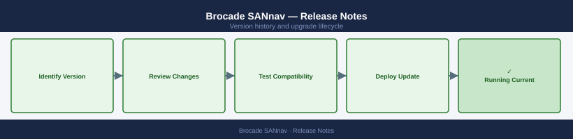

---
tags:
  - san
description: "Version history and release notes for Brocade SANnav."
---
# Brocade SANnav — Release Notes

*Applies to: Brocade FOS 9.x*

Version history and release notes for Brocade SANnav.

## Version History

!!! warning "Unverified version history"
    This table has not yet been checked against the vendor's official release
    notes. Treat the versions, dates and summaries below as unconfirmed until
    they are verified.

| Version | Released | Summary | Notes |
|---------|----------|---------|-------|
| 2.3.1 | 2024-Q3 | SANnav 2.3.1 — FOS 9.2.2 discovery support | Not yet verified |
| 2.3.0 | 2024-Q1 | SANnav 2.3.0 — health dashboard improvements | Not yet verified |
| 2.2.2 | 2023-Q3 | SANnav 2.2.2 — REST API v2 analytics | Not yet verified |
| 2.2.1 | 2023-Q1 | SANnav 2.2.1 — scalability patch release | Not yet verified |
| 2.2.0 | 2022-Q3 | SANnav 2.2.0 — Supportsave automation | Not yet verified |

## Key Terminology

**Major Version**
: A release containing significant new features or architectural changes; may require additional planning and testing.

**Patch Release**
: A targeted fix release that addresses bugs or security issues within a major/minor version.

**EOL (End of Life)**
: Date after which the vendor no longer provides updates, security patches, or technical support.

**Upgrade Path**
: The supported sequence of versions a system must traverse to reach a target version (some versions cannot be skipped).

## Upgrade Path

Review the vendor's official upgrade documentation and compatibility matrix before beginning any version change. Validate that all dependent components (OS, drivers, integration plugins) support the target version. Perform upgrades in a staged approach: dev/test environment first, then production. Capture a snapshot or backup immediately prior to the upgrade window. After the upgrade, run post-validation health checks and confirm all services are operating normally.
