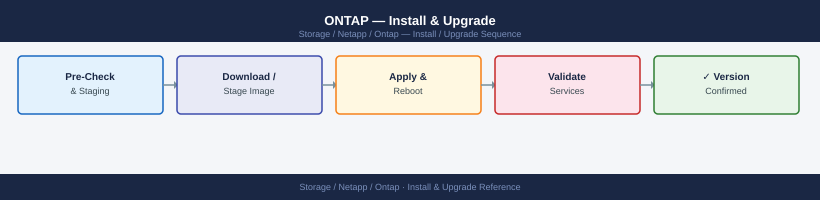

---
tags:
  - netapp
  - operations
description: "Install & Upgrade reference covering ONTAP Version Matrix, Upgrade Paths, EOL Tracking, Refresh Planning."
---
# ONTAP — Install & Upgrade

<div class="kb-summary">
Install & Upgrade reference covering ONTAP Version Matrix, Upgrade Paths, EOL Tracking, Refresh Planning.

*Applies to: ONTAP 9.18.1–9.20.1*
</div>


## Before you begin

- **Access:** Storage admin credentials (cluster admin or equivalent)
- **Timing:** safe to run during business hours unless a step is marked ⚠ (causes interruption)
- **Dependencies:** no active upgrades or migrations on the same infrastructure
- **Logging:** capture command output — paste into the change record on completion

---

## ONTAP Version Matrix

| Release | Released | Notes |
|---|---|---|
| ONTAP 9.20.1 | November 2026 | Current release |
| ONTAP 9.19.1 | July 2026 | Latest ONTAP CLI reference release |
| ONTAP 9.18.1 | November 2025 | |
| ONTAP 9.17.1 | September 2025 | |
| ONTAP 9.16.1 | January 2025 | |
| ONTAP 9.15.1 | July 2024 | |
| ONTAP 9.14.1 | January 2024 | |

Release dates are from NetApp's [ONTAP 9 release support](https://docs.netapp.com/us-en/ontap/release-notes/release-support-reference.html) page. Support for each release moves from Full support to Limited support and then Self-service support: per that page, P-releases and vulnerability alerts are provided in years 1–3, technical support and software downloads in years 1–5, and online documentation in years 1–8. Releases before 9.10.1 are likely on Limited or Self-Service support. Verify the support level for your release on the [NetApp Support Site](https://mysupport.netapp.com/).

## Upgrade Paths

Per NetApp's [supported ONTAP upgrade paths](https://docs.netapp.com/us-en/ontap/upgrade/concept_upgrade_paths.html) page:

- **Direct**: you can always upgrade directly to the next adjacent release family; for many releases a single image can also go up to four releases later (e.g., 9.17.1 → 9.18.1, or 9.15.1 → 9.19.1)
- **Direct multi-hop**: for some ANDU upgrades to non-adjacent releases you install the intermediate and the target image; ONTAP upgrades through the intermediate release automatically
- **Multi-stage**: when no direct path exists, upgrade to a supported intermediate release first (e.g., 9.14.1 → 9.18.1, then 9.18.1 → 9.19.1)
- **Automated Non-Disruptive Upgrade (ANDU)**: recommended whenever possible; upgrades one node at a time via takeover/giveback
- Best practice: upgrade to the latest patch release of the running version before a major upgrade
- Check hardware support in the NetApp Hardware Universe and the exact path on the [upgrade paths page](https://docs.netapp.com/us-en/ontap/upgrade/concept_upgrade_paths.html) before beginning

```text
Examples from the vendor page:
9.17.1 → 9.18.1                   (direct, adjacent)
9.15.1 → 9.19.1                   (direct, up to four releases later)
9.14.1 → 9.18.1 → 9.19.1          (multi-stage)
```

**Pre-upgrade checks:**
1. All SnapMirror relationships healthy; lag within RPO
2. No aggregates above 90% capacity
3. No failed or degraded RAID groups
4. AutoSupport delivering successfully
5. HA storage failover enabled on all pairs (`storage failover show`)

## EOL Tracking

- Monitor the NetApp Support lifecycle calendar quarterly
- Plan upgrades before limited support end dates — limited support means no new bug fixes, only existing fixes available
- Align ONTAP upgrades with SnapCenter compatibility — SnapCenter has its own supported ONTAP version matrix (see SnapCenter lifecycle)
- Track end-of-availability (EOA) for hardware platforms; an EOA platform still runs ONTAP but cannot be added to the fleet

## Refresh Planning

| Trigger | Action |
|---|---|
| ONTAP reaching limited support | Plan upgrade to current GA release within 6 months |
| Hardware EOA announced | Plan platform replacement within 18–24 months |
| Performance headroom <20% | Evaluate node addition or platform refresh |
| Aggregate disk count at shelf max | Add shelf or plan migration to larger-capacity drives |
| SnapMirror destination ONTAP < source | Upgrade destination first before upgrading source |

Refresh projects should be tracked in a capacity and lifecycle register updated quarterly. Use the Active IQ / BlueXP risk advisor to surface hardware and firmware advisories that can trigger unplanned refresh requirements.

---

## Verify

- Confirm the operation completed without errors in the log or management UI
- Verify the expected state change is visible (service running, object created, config applied)
- Document the outcome in the change record

---

## See also

- [Ontap — Procedures](../procedures/)
- [Ontap — Health Checks](../health-checks/)
