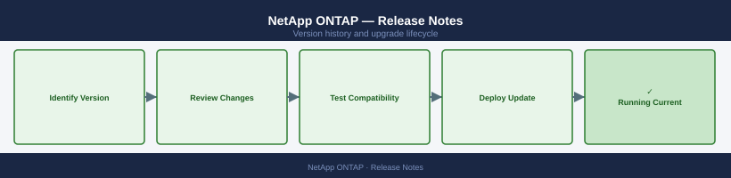

---
tags:
  - netapp
description: "Version history and release notes for NetApp ONTAP."
---
# NetApp ONTAP — Release Notes

*Applies to: NetApp ONTAP 9.11.1–9.20.1*

Version history and release notes for NetApp ONTAP.

## Version History

Release dates are from NetApp's [ONTAP 9 release support](https://docs.netapp.com/us-en/ontap/release-notes/release-support-reference.html) page; summaries are items from each release's *What's new* page.

| Version | Released | Summary | Notes |
|---------|----------|---------|-------|
| 9.20.1 | November 2026 | SnapMirror over FC (backend), FC-SP-3 FC encryption on Broadcom secure HBAs, FPolicy for NFS 4.2 and S3, SNMPv3 SHA-512 authentication | [What's new in 9.20.1](https://docs.netapp.com/us-en/ontap/release-notes/index.html) |
| 9.19.1 | July 2026 | SnapMirror active sync support for NAS, NFS over TLS, TLS offload configuration, foreign LUN import over iSCSI | [What's new in 9.19.1](https://docs.netapp.com/us-en/ontap/release-notes/whats-new-9191.html) |
| 9.18.1 | November 2025 | ONTAP backend cluster network and HA traffic encryption, IPsec hardware offload IPv6, NVMe copy offload, ARP/AI on by default for new volumes | [What's new in 9.18.1](https://docs.netapp.com/us-en/ontap/release-notes/whats-new-9181.html) |
| 9.17.1 | September 2025 | SnapMirror active sync host access over NVMe, ONTAP Cloud Mediator, Just-in-time privilege elevation, SAN support for Autonomous Ransomware Protection | [What's new in 9.17.1](https://docs.netapp.com/us-en/ontap/release-notes/whats-new-9171.html) |
| 9.16.1 | January 2025 | Multinode SnapMirror active sync, ARP with AI (ARP/AI), NVMe/TCP over TLS 1.3, OAuth 2.0 for Microsoft Entra ID | [What's new in 9.16.1](https://docs.netapp.com/us-en/ontap/release-notes/whats-new-9161.html) |
| 9.15.1 | July 2024 | Symmetric active/active SnapMirror active sync, NFSv3 over RDMA, FlexCache write-back | [What's new in 9.15.1](https://docs.netapp.com/us-en/ontap/release-notes/whats-new-9151.html) |
| 9.14.1 | January 2024 | NFSv4.1 session trunking, SnapMirror asynchronous 20 fan-out targets, Cisco Duo MFA for SSH | [What's new in 9.14.1](https://docs.netapp.com/us-en/ontap/release-notes/whats-new-9141.html) |
| 9.13.1 | June 2023 | Autonomous Ransomware Protection enhancements, TOTP multifactor authentication, S3 bucket lifecycle management | [What's new in 9.13.1](https://docs.netapp.com/us-en/ontap/release-notes/whats-new-9131.html) |
| 9.12.1 | February 2023 | Tamperproof snapshots, S3 client access to NAS data, MFA for SSH with FIDO2/PIV | [What's new in 9.12.1](https://docs.netapp.com/us-en/ontap/release-notes/whats-new-9121.html) |
| 9.11.1 | July 2022 | Cluster external key servers, LDAP fast bind, iSCSI LIF failover | [What's new in 9.11.1](https://docs.netapp.com/us-en/ontap/release-notes/whats-new-9111.html) |

## Key Terminology

**Release Train**
: NetApp's versioning scheme: major.minor.patch (e.g. 9.20.1). Since ONTAP 9.8 NetApp intends to ship two releases per calendar year (second and fourth quarter), per the [ONTAP 9 release support](https://docs.netapp.com/us-en/ontap/release-notes/release-support-reference.html) page.

**Support levels**
: Each release moves from Full support to Limited support and then Self-service support over its lifetime; releases before 9.10.1 are likely on Limited or Self-Service support ([ONTAP 9 release support](https://docs.netapp.com/us-en/ontap/release-notes/release-support-reference.html)).

**ANDU (Automated Non-Disruptive Upgrade)**
: Built-in ONTAP upgrade orchestration that performs rolling node-by-node updates without I/O interruption.

**EOS (End of Support)**
: Date after which NetApp no longer issues patches or provides support for a given ONTAP release.

## Upgrade Path

Plan the path from the current running version with NetApp's [ONTAP upgrade documentation](https://docs.netapp.com/us-en/ontap/upgrade/index.html). Apply the upgrade as an automated non-disruptive upgrade using System Manager or the CLI (`cluster image package get`, then `cluster image update`).
