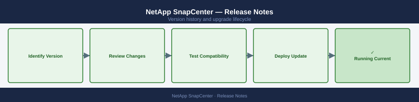

---
tags:
  - netapp
description: "Version history and release notes for NetApp SnapCenter."
---
# NetApp SnapCenter — Release Notes

*Applies to: NetApp ONTAP 9.x*

Version history and release notes for NetApp SnapCenter.

## Version History

!!! warning "Unverified version history"
    This table has not yet been checked against the vendor's official release
    notes. Treat the versions, dates and summaries below as unconfirmed until
    they are verified.

| Version | Released | Summary | Notes |
|---------|----------|---------|-------|
| 6.0 | 2024-Q3 | SnapCenter 6.0 — ONTAP 9.15 compatibility | Not yet verified |
| 5.0 | 2023-Q4 | SnapCenter 5.0 — REST API v3, PostgreSQL plugin | Not yet verified |
| 4.9 | 2023-Q2 | SnapCenter 4.9 — Oracle RAC improvements | Not yet verified |
| 4.8 | 2022-Q4 | SnapCenter 4.8 — SAP HANA System Replication support | Not yet verified |
| 4.7 | 2022-Q2 | SnapCenter 4.7 — Kubernetes CSI plugin GA | Not yet verified |

## Key Terminology

**Major Version**
: A release containing significant new features or architectural changes; may require additional planning and testing.

**Patch Release**
: A targeted fix release that addresses bugs or security issues within a major/minor version.

**EOL (End of Life)**
: Date after which the vendor no longer provides updates, security patches, or technical support.

**Upgrade Path**
: The supported sequence of versions a system must traverse to reach a target version (some versions cannot be skipped).

## Upgrade Path

Review the vendor's official upgrade documentation and compatibility matrix before beginning any version change. Validate that all dependent components (OS, drivers, integration plugins) support the target version. Perform upgrades in a staged approach: dev/test environment first, then production. Capture a snapshot or backup immediately prior to the upgrade window. After the upgrade, run post-validation health checks and confirm all services are operating normally.
