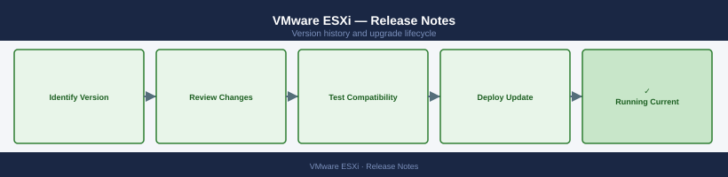

---
tags:
  - esxi
  - vmware
  - vsphere-8
description: "Version history and release notes for VMware ESX 9.x and ESXi 8.x."
---
# VMware ESXi — Release Notes

*Applies to: ESX 9.x (VCF 9) · ESXi 8.0 U3 (vSphere 8, EoGS 2027-10-11)*

Version history and release notes for VMware ESXi.

## Version History

Versions, builds and dates below were checked on 2026-11-25 against the Broadcom
ESX release notes and [Broadcom KB 314608](https://knowledge.broadcom.com/external/article/314608) (VCF-to-component version mapping).
For ESXi 8.x the date is the VCF 5.x release that shipped that build (per KB 314608),
not necessarily the standalone ESXi GA date. vSphere 8.0 (GA 11 Oct 2022) reaches End of
General Support on 11 Oct 2027 ([KB 459135](https://knowledge.broadcom.com/external/article/459135)).

| Version | Build | Released | Source |
|---------|-------|----------|--------|
| ESX 9.1.2.0 | 25946735 | 24 Nov 2026 (VCF 9.1.2.0) | [ESX 9.1.2.0 release notes](https://techdocs.broadcom.com/us/en/vmware-cis/vcf/vcf-9-0-and-later/9-1/release-notes/vmware-cloud-foundation-9-1-2-0-release-notes/esx-9-1-2-0-release-notes.html) |
| ESX 9.1.1.0 | 25714478 | 03 Sep 2026 (VCF 9.1.1) | [ESX 9.1.1.0 release notes](https://techdocs.broadcom.com/us/en/vmware-cis/vcf/vcf-9-0-and-later/9-1/release-notes/vmware-cloud-foundation-9-1-1-0-release-notes/esx-9-1-1-0-release-notes.html) |
| ESX 9.1.0.0100 | 25433460 | 05 Jun 2026 (patch) | [ESX 9.1.0.0100 release notes](https://techdocs.broadcom.com/us/en/vmware-cis/vcf/vcf-9-0-and-later/9-1/release-notes/patch-releases-9-1-0-x/vsphere/esx/esx-9-1-0-0100-release-notes.html) |
| ESX 9.1.0.0 | 25370933 | 12 May 2026 (VCF 9.1.0) | [VCF 9.1.0 bill of materials](https://techdocs.broadcom.com/us/en/vmware-cis/vcf/vcf-9-0-and-later/9-1/release-notes/vmware-cloud-foundation-9-1-0-0-release-notes/vmware-cloud-foundation-bill-of-materials.html) |
| ESX 9.0.2.0 | 25148076 | 20 Jan 2026 (VCF 9.0.2.0) | [ESX 9.0.2.0 release notes](https://techdocs.broadcom.com/us/en/vmware-cis/vcf/vcf-9-0-and-later/9-0/release-notes/vmware-cloud-foundation-9-0-2-release-notes/esx-9-0-2-0000.html) |
| ESX 9.0.1.0 | 24957456 | 29 Sep 2025 (VCF 9.0.1.0) | [ESX 9.0.1.0 release notes](https://techdocs.broadcom.com/us/en/vmware-cis/vcf/vcf-9-0-and-later/9-0/release-notes/vmware-cloud-foundation-9-0-1-0-release-notes/esx-9-0-1-0000.html) |
| ESX 9.0.0.0 | 24755229 | 17 Jun 2025 (VCF 9.0) | [VCF 9.0 bill of materials](https://techdocs.broadcom.com/us/en/vmware-cis/vcf/vcf-9-0-and-later/9-0/release-notes/vmware-cloud-foundation-90-release-notes/vmware-cloud-foundation-bill-of-materials.html) |
| ESXi 8.0 U3m | 25926933 | 19 Nov 2026 (VCF 5.2.5) | [KB 314608](https://knowledge.broadcom.com/external/article/314608) |
| ESXi 8.0 U3j | 25429389 | 27 May 2026 (VCF 5.2.4) | [KB 314608](https://knowledge.broadcom.com/external/article/314608) |
| ESXi 8.0 U3i | 25205845 | 24 Feb 2026 (VCF 5.2.3) | [KB 314608](https://knowledge.broadcom.com/external/article/314608) |
| ESXi 8.0 U3g | 24859861 | 05 Sep 2025 (VCF 5.2.2) | [KB 314608](https://knowledge.broadcom.com/external/article/314608) |
| ESXi 8.0 U3 | 24022510 | 23 Jul 2024 (VCF 5.2) | [KB 314608](https://knowledge.broadcom.com/external/article/314608) |
| ESXi 8.0 U2 | 22380479 | 07 Nov 2023 (VCF 5.1) | [KB 314608](https://knowledge.broadcom.com/external/article/314608) |
| ESXi 8.0 U1a | 21813344 | 01 Jun 2023 (VCF 5.0) | [KB 314608](https://knowledge.broadcom.com/external/article/314608) |
| ESXi 8.0 GA | — | 11 Oct 2022 | [KB 459135](https://knowledge.broadcom.com/external/article/459135) |

Naming: from 9.0 Broadcom calls the hypervisor "ESX" (VMware vSphere Hypervisor (ESX)); 8.x and
earlier are "ESXi". From vSphere 9.0, ESX 9.x hosts must be lifecycle-managed with vLCM images —
baselines (VUM) cannot patch 9.x hosts ([KB 379388](https://knowledge.broadcom.com/external/article/379388)).

## Key Terminology

**Major Version**
: A release containing significant new features or architectural changes; may require additional planning and testing.

**Patch Release**
: A targeted fix release that addresses bugs or security issues within a major/minor version.

**EOL (End of Life)**
: Date after which the vendor no longer provides updates, security patches, or technical support.

**Upgrade Path**
: The supported sequence of versions a system must traverse to reach a target version (some versions cannot be skipped).

## Upgrade Path

Review the vendor's official upgrade documentation and compatibility matrix before beginning any version change. Validate that all dependent components (OS, drivers, integration plugins) support the target version. Perform upgrades in a staged approach: dev/test environment first, then production. Capture a snapshot or backup immediately prior to the upgrade window. After the upgrade, run post-validation health checks and confirm all services are operating normally.
