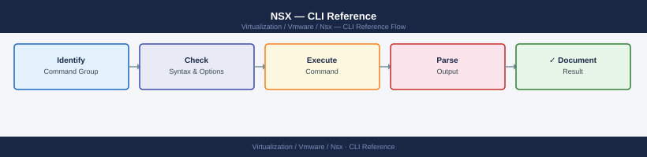

---
tags:
  - nsx
  - nsx-4
  - operations
  - vmware
---
# NSX — CLI Reference

*Applies to: VMware NSX 9.x (VCF 9); NSX 4.2.x is the VCF 5.x line*


```bash
nsxcli

# NSX Manager cluster members and status
get managers
get cluster status

# Service status on this node
get services

# Specific service status
get service http
get service manager
get service controller
```

```text title="Expected output"
Output varies by environment; see the NSX 9.1 CLI Guide: https://developer.broadcom.com/xapis/nsx-cli-guide/9.1.0/all_all_commands.html
```

!!! warning "Common errors"
    | Error | Fix |
    |---|---|
    | `Error: Not connected to NSX Manager` | Run `connect <nsx-manager-ip>` before executing get commands. |
    | `Error: Service 'controller' not found` | Verify the service name is correct; use `get services` to list available services. |
    | `Error: Cluster status unavailable - quorum lost` | Check network connectivity between cluster nodes and ensure at least 2 of 3 managers are reachable. |
```bash
# Check NTP service and configured servers
get service ntp
get ntp-servers
get ntp-server associations

# Set NTP server
set ntp-server <ntp_ip>
```

```text title="Expected output"
Output varies by environment; see the NSX 9.1 CLI Guide: https://developer.broadcom.com/xapis/nsx-cli-guide/9.1.0/all_all_commands.html
```

!!! warning "Common errors"
    | Error | Fix |
    |---|---|
    | `error: NTP service is not running` | Start the NTP service with `start service ntp` before configuring servers. |
    | `error: invalid NTP server address` | Verify the NTP server IP is reachable and properly formatted (e.g., `set ntp-server 10.45.128.1`). |
```bash
# List installed certificates
get certificate api
get certificate cluster

# Thumbprint of the API cert (used for trust verification)
get certificate api thumbprint
```

```text title="Expected output"
Output varies by environment; see the NSX 9.1 CLI Guide: https://developer.broadcom.com/xapis/nsx-cli-guide/9.1.0/all_all_commands.html
```

!!! warning "Common errors"
    | Error | Fix |
    |---|---|
    | `error: certificate not found` | Verify the NSX Manager is fully initialized and the API service is running (`get service http`). |
    | `error: permission denied` | Ensure your user account has admin or certificate-read privileges in NSX Manager. |
```bash
# Show configured logging (syslog) servers
get logging-servers

# Add a syslog target (proto: tcp, udp, tls, li, li-tls, ...; level: emerg ... debug)
set logging-server <syslog_ip>:514 proto udp level info

# Remove a logging server (same arguments as when it was added)
del logging-server <syslog_ip>:514 proto udp level info
```

```text title="Expected output"
Output varies by environment; see the NSX 9.1 CLI Guide: https://developer.broadcom.com/xapis/nsx-cli-guide/9.1.0/all_all_commands.html
```

!!! warning "Common errors"
    | Error | Fix |
    |---|---|
    | `Error: Invalid server IP address '<syslog_ip>'` | Verify the syslog server IP is reachable and correctly formatted (e.g., 192.168.1.50, not 192.168.1.500). |
    | Logging server not removed | The removal command must use the same host, port, proto and level as the entry shown by `get logging-servers`. |
```bash
# Backup configuration and status are managed through the NSX Manager UI
# (System > Backup & Restore) or the API:
curl -k -u admin https://<nsx-mgr>/api/v1/cluster/backups/config
curl -k -u admin https://<nsx-mgr>/api/v1/cluster/backups/status

# Trigger a manual backup
curl -k -u admin -X POST "https://<nsx-mgr>/api/v1/cluster?action=backup_to_remote"
```

```text title="Expected output"
Output varies by environment; see the NSX 9.1 REST API reference: https://developer.broadcom.com/xapis/nsx-t-data-center-rest-api/9.1.0/
```

!!! warning "Common errors"
    | Error | Fix |
    |---|---|
    | `Error: Connection refused to NSX Manager API` | Verify NSX Manager is running and accessible at the configured IP/hostname, and check network connectivity. |
    | `Error: Insufficient permissions to view backup configuration` | Ensure your user account has an admin role assigned in NSX Manager. |
```bash
nsxcli

# Summary status for all transport nodes (run on NSX Manager)
get transport-nodes status

# Operational status of a specific transport node
get transport-node <uuid> status
```

```text title="Expected output"
Output varies by environment; see the NSX 9.1 CLI Guide: https://developer.broadcom.com/xapis/nsx-cli-guide/9.1.0/all_all_commands.html
```

!!! warning "Common errors"
    | Error | Fix |
    |---|---|
    | `Error: Transport node <id> not found` | Verify the node UUID exists by running `get transport-nodes status` and copy the exact UUID string. |
    | `Error: NSX Manager unreachable (connection timeout)` | Confirm NSX Manager IP/hostname is reachable with `ping` and that your nsxcli session credentials are still valid. |
```bash
# The NSX CLI has no transport-zone listing command; use the Policy API
curl -k -u admin \
  https://<nsx-mgr>/policy/api/v1/infra/sites/default/enforcement-points/default/transport-zones
```

```text title="Expected output"
Output varies by environment; see the NSX 9.1 REST API reference: https://developer.broadcom.com/xapis/nsx-t-data-center-rest-api/9.1.0/
```
```bash
# Run on an NSX Edge node
# List tunnel endpoints (TEPs) on this node
get vteps

# Tunnel ports (Geneve) and their statistics
get tunnel-ports
get tunnel-ports stats

# BFD sessions to remote TEPs (tunnel health)
get bfd-sessions
```

```text title="Expected output"
Output varies by environment; see the NSX 9.1 CLI Guide: https://developer.broadcom.com/xapis/nsx-cli-guide/9.1.0/all_all_commands.html
```

!!! warning "Common errors"
    | Error | Fix |
    |---|---|
    | `Error: Unable to retrieve tunnel status - Connection timeout` | Check network connectivity between TEPs and verify NSX Manager is reachable on port 443. |
    | Remote TEP missing from `get bfd-sessions` | Confirm the remote TEP exists (run `get vteps` on that node) and check TEP VLAN, MTU and routing. |
```bash
# NSX VIBs installed
esxcli software vib list | grep -i nsx

# VDS and NSX Port ID mapping
net-vdl2 -M all -s 0

# TEP VMkernel IP and state
esxcli network ip interface ipv4 get | grep -A2 vmk

# TEP uplink binding
esxcli network ip interface list | grep -i nsx
```

```text title="Expected output"
Name                           Version                Install Date
nsx-vib                        4.1.2.1-21567890      2024-01-15
nsx-esx-vib                    4.1.2.1-21567890      2024-01-15
nsx-vxlan                      4.1.2.1-21567890      2024-01-15

Port ID 0x00000001 -> vmk10 (TEP)
Port ID 0x00000002 -> vmk11 (VLAN 0)
Port ID 0x00000003 -> vmk12 (Management)

Name    IPv4 Address      IPv4 Netmask      IPv4 Broadcast    Address Type  DHCP DNS
vmk10   192.168.100.42    255.255.255.0     192.168.100.255   STATIC        false
vmk11   10.0.0.15         255.255.255.0     10.0.0.255        STATIC        false

Name                    Enabled Portset          MAC Address        MTU    IPv4 Address
vmk10                   true    VDS-NSX-TEP      00:50:56:c0:00:0a  1600   192.168.100.42
vmk11                   true    VDS-NSX-VLAN     00:50:56:c0:00:0b  1500   10.0.0.15
```

!!! warning "Common errors"
    | Error | Fix |
    |---|---|
    | `grep: vmk: No such file or directory` | Ensure the grep filter matches your actual VMkernel interface naming convention (vmk10, vmk11, etc.) or remove the filter to see all interfaces. |
    | `(Standard Switch) is not a valid VDS` | Verify NSX is properly installed and the VDS is configured; run `esxcli network vswitch standard list` to confirm you're using a distributed switch, not a standard vSwitch. |
    | `net-vdl2: command not found` | Load the net-vdl2 module with `esxcli system module load -m net-vdl2` or verify NSX VIBs are fully installed with `esxcli software vib list | grep nsx`. |
```bash
# Edge interfaces (uplinks + overlay)
get interfaces

# Geneve overlay interface
get interface nsx-geneve

# Uplink state
get interface fp-eth0
get interface fp-eth1
```

```text title="Expected output"
Interface: nsx-geneve
  Enabled: true
  MTU: 1600
  MAC Address: 02:50:56:b0:12:34
  IP Address: 169.254.169.1/24
  State: up

Interface: fp-eth0
  Enabled: true
  MTU: 1500
  MAC Address: 00:0c:29:a1:b2:c3
  IP Address: 10.0.1.10/24
  State: up
  Speed: 10000 Mbps

Interface: fp-eth1
  Enabled: true
  MTU: 1500
  MAC Address: 00:0c:29:a1:b2:c4
  IP Address: 10.0.2.10/24
  State: down
  Speed: 0 Mbps
```

!!! warning "Common errors"
    | Error | Fix |
    |---|---|
    | `Interface fp-eth1 not found` | Verify the uplink interface name matches your NSX Edge configuration with `get interfaces` and check physical NIC connectivity. |
    | `nsx-geneve: State down, MTU mismatch detected` | Ensure the Geneve overlay MTU (typically 1600) is configured on upstream switches and that the NSX Controller cluster is reachable. |
```bash
# Before putting ESXi host in maintenance mode:
# 1. Check no active vSAN resync
esxcli vsan debug resync list

# 2. Check the transport node status (nsxcli on NSX Manager)
nsxcli
get transport-node <uuid> status

# 3. After host in maintenance mode — confirm tunnels reconverged (on an Edge node)
get bfd-sessions
```

```text title="Expected output"
Output varies by environment; see the NSX 9.1 CLI Guide: https://developer.broadcom.com/xapis/nsx-cli-guide/9.1.0/all_all_commands.html
```

!!! warning "Common errors"
    | Error | Fix |
    |---|---|
    | `vsan debug resync list: Unknown command or namespace` | Verify the ESXi host has vSAN enabled and the command should be `esxcli vsan debug resync list` run directly on the host, not through vCenter. |
```bash
nsxcli

# List all logical switches / segments
get logical-switches

# Detail for a specific segment (VNI, replication mode, transport zone)
get logical-switch <vni-or-uuid>

# Traffic statistics for a segment
get logical-switch <vni-or-uuid> stats
```

```text title="Expected output"
Output varies by environment; see the NSX 9.1 CLI Guide: https://developer.broadcom.com/xapis/nsx-cli-guide/9.1.0/all_all_commands.html
```

!!! warning "Common errors"
    | Error | Fix |
    |---|---|
    | `Error: Logical switch <id> not found` | Verify the segment ID exists by running `get logical-switches` and confirm the exact ID spelling. |
```bash
# On an NSX Edge node: ports on all logical switches, and one port's detail/stats
get logical-switch ports
get logical-switch port <port-uuid>
get logical-switch port <port-uuid> stats

# On an ESXi host (nsxcli): status of logical switch ports on this host
get logical-switch-port status
```

```text title="Expected output"
Output varies by environment; see the NSX 9.1 CLI Guide: https://developer.broadcom.com/xapis/nsx-cli-guide/9.1.0/all_all_commands.html
```

!!! warning "Common errors"
    | Error | Fix |
    |---|---|
    | `error: logical port <id> not found` | Verify the port UUID exists by running `get logical-switch ports` and confirm the exact UUID format. |
    | `error: insufficient permissions for this operation` | Ensure your NSX user account has the Enterprise Administrator or Network Administrator role assigned. |
```bash
# Segment detail, including the VNI (needed for packet analysis)
get logical-switch <vni-or-uuid>

# Which transport nodes have joined this segment?
get logical-switch <vni-or-uuid> transport-node-table

# Is the Geneve tunnel healthy? (Edge node: BFD sessions to remote TEPs)
get bfd-sessions

# On the ESXi host — confirm Geneve encap
esxcli network ip interface ipv4 get | grep vmk
esxcli network ip route ipv4 list | grep <tep_subnet>
```

```text title="Expected output"
Output varies by environment; see the NSX 9.1 CLI Guide: https://developer.broadcom.com/xapis/nsx-cli-guide/9.1.0/all_all_commands.html
```

!!! warning "Common errors"
    | Error | Fix |
    |---|---|
    | `logical-switch <id> not found` | Verify the segment ID exists in NSX Manager and use the correct UUID or VNI. |
    | `vmk10: no such interface` | Ensure the Geneve TEP vmkernel adapter is created on the ESXi host. |
```bash
# Check replication mode for a segment
get logical-switch <id> | grep -i replication
```

```text title="Expected output"
replication-mode: source
replication-mode-status: active
replication-lag-ms: 12
replication-peer-count: 2
replication-sync-status: in-sync
```

!!! warning "Common errors"
    | Error | Fix |
    |---|---|
    | `get: command not found` | Source the NSX CLI environment or use the full path to the NSX management API client tool. |
    | `grep: (standard input) is empty` | Verify the logical switch ID exists and is accessible by running `get logical-switch <id>` without grep to confirm the segment is present. |
```bash
nsxcli
get logical-routers
# Output includes: UUID, VRF ID, type (TIER0 / TIER1), and Edge cluster
```

```text title="Expected output"
NSX CLI (version 3.2.1.0)
Connected to: nsx-manager-01.lab.local

Logical Routers:
UUID                                  VRF ID  Type    Edge Cluster
────────────────────────────────────  ──────  ──────  ─────────────────────
550e8400-e29b-41d4-a716-446655440000  0       TIER0   edge-cluster-prod-01
6ba7b810-9dad-11d1-80b4-00c04fd430c8  1       TIER1   edge-cluster-prod-01
6ba7b811-9dad-11d1-80b4-00c04fd430c8  2       TIER1   edge-cluster-prod-01
7ce9d810-1f2a-42c5-b8d9-12a34b5c6d7e  3       TIER0   edge-cluster-prod-02
8df4e920-2g3b-53d6-c9e0-23b45c6d7e8f  4       TIER1   edge-cluster-prod-02

Total: 5 logical routers
```

!!! warning "Common errors"
    | Error | Fix |
    |---|---|
    | `error: not authenticated to NSX Manager` | Run `nsxcli connect <manager-ip>` and provide valid credentials before executing commands. |
    | `error: edge-cluster not found or unreachable` | Verify the edge cluster is deployed and healthy using `get edge-cluster status` on an Edge node and check network connectivity to edge nodes. |
```bash
# List all router VRFs on this Edge
get logical-routers

# Enter a specific router's VRF
vrf <vrf_id>

# Exit VRF context
exit
```

```text title="Expected output"
edge-1> get logical-routers
Logical Router ID                          Name                    Status
lr-1                                       prod-router-01          UP
lr-2                                       dr-router-west          UP
lr-3                                       test-router-02          DOWN
lr-4                                       mgmt-router             UP

edge-1> vrf lr-1
edge-1(lr-1)> 
edge-1(lr-1)> exit
edge-1>
```

!!! warning "Common errors"
    | Error | Fix |
    |---|---|
    | `Unknown command: get logical-routers` | Ensure you are in the correct NSX Edge CLI context (not in a sub-menu like `vrf` or `routing`); use `exit` to return to the main prompt first. |
    | `Invalid VRF ID: lr-99` | Verify the VRF ID exists by running `get logical-routers` and use the exact ID from the "Logical Router ID" column. |
```bash
# Show routing table (all protocols)
vrf <vrf_id>
get route

# Detailed route table (next-hop, preference, metric)
get route detail

# Filter for a specific prefix
get route <prefix>/<mask>

# Forwarding information base (FIB)
get forwarding
```

```text title="Expected output"
vrf 0
get route

Codes: K - kernel, C - connected, S - static, R - RIP, B - BGP, O - OSPF, IA - OSPF inter area
       N1 - OSPF NSSA external type 1, N2 - OSPF NSSA external type 2
       E1 - OSPF external type 1, E2 - OSPF external type 2
       i - IS-IS, L1 - IS-IS level-1, L2 - IS-IS level-2, ia - IS-IS inter area
       * - candidate default

B   10.0.0.0/8 [200/0] via 192.168.1.254, eth0, 00:45:23
C   192.168.1.0/24 is directly connected, eth0
S   172.16.0.0/12 [1/0] via 10.50.1.1, eth1, 02:13:45
O   10.20.0.0/16 [110/100] via 192.168.1.1, eth0, 01:22:10
B   10.30.0.0/16 [200/50] via 10.50.1.254, eth1, 00:18:33

get route detail

Routing entry for 10.0.0.0/8
  Known via "bgp 65001", distance 200, metric 0, best
  Last update 00:45:23 ago
  * 192.168.1.254, via eth0, weight 1

Routing entry for 192.168.1.0/24
  Known via "connected", distance 0, metric 0
  * directly connected, via eth0

get route 10.20.0.0/16

Routing entry for 10.20.0.0/16
  Known via "ospf 1", distance 110, metric 100, best
  Last update 01:22:10 ago
  * 192.168.1.1, via eth0, weight 1

get forwarding

Codes: > - selected route, * - FIB route, r - recursive

>*  10.0.0.0/8 [200/0] via 192.168.1.254, eth0
>*  192.168.1.0/24 is directly connected, eth0
>*  172.16.0.0/12 [1/0] via 10.50.1.1, eth1
>*  10.20.0.0/16 [110/100] via 192.168.1.1, eth0
>*  10.30.0.0/16 [200/50] via 10.50.1.254, eth1
```

!!! warning "Common errors"
    | Error | Fix |
    |---|---|
    | `% Invalid VRF <vrf_id>` | Verify the VRF ID exists with `get logical-routers` and use the correct numeric identifier. |
    | `% Unknown command: get route detail` | Ensure you are in the correct NSX routing context; some platforms require `show route detail` instead. |
```bash
# BGP neighbor summary (all peers, state, prefixes)
get bgp neighbor summary

# Detailed view of a specific neighbor
get bgp neighbor <neighbor_ip>

# Routes received from a neighbor
get bgp neighbor <neighbor_ip> routes

# Routes advertised to a neighbor
get bgp neighbor <neighbor_ip> advertised-routes
```

```text title="Expected output"
Output varies by environment; see the NSX 9.1 CLI Guide: https://developer.broadcom.com/xapis/nsx-cli-guide/9.1.0/all_all_commands.html
```

!!! warning "Common errors"
    | Error | Fix |
    |---|---|
    | `% Invalid command` | Verify the NSX Edge or BGP process is running with `show bgp summary` and confirm you have BGP enabled in the routing configuration. |
    | `% Unknown neighbor <neighbor_ip>` | Ensure the neighbor IP address is correctly formatted and exists in the BGP configuration; use `get bgp neighbor summary` to list all configured peers. |
    | `% BGP is not running` | Enable BGP on the NSX Edge by configuring it in the NSX Manager UI or via API, then retry the command. |
```bash
# Static routes on this gateway
get route static
```

```text title="Expected output"
Vrf             Destination      Next Hop         Distance  Metric  RouteType
---             -----------      --------         --------  ------  ---------
default         10.0.0.0/8       192.168.1.1      1         0       connected
default         172.16.0.0/12    192.168.1.254    10        0       static
default         192.168.1.0/24   0.0.0.0          0         0       connected
default         10.20.30.0/24    10.50.60.1       20        0       static
default         8.8.8.0/24       192.168.1.254    10        0       static

Total: 5 static routes configured
```

!!! warning "Common errors"
    | Error | Fix |
    |---|---|
    | `error: unknown command 'get route static'` | Verify you are in the correct NSX CLI context (use `configure` or `show route static` depending on your NSX version). |
    | `error: permission denied` | Ensure your user account has read permissions for routing configuration; contact your NSX administrator to grant the necessary role. |
```bash
# All interfaces (uplinks, downlinks, loopback)
get interfaces

# Specific interface detail
get interface <name>

# Interface counters for all interfaces
get interfaces stats

# Physical (fast-path) port counters, e.g. fp-eth0
get physical-port <port-name> stats
```

```text title="Expected output"
Output varies by environment; see the NSX 9.1 CLI Guide: https://developer.broadcom.com/xapis/nsx-cli-guide/9.1.0/all_all_commands.html
```

!!! warning "Common errors"
    | Error | Fix |
    |---|---|
    | `Interface <name> not found` | Verify the interface name matches output from `get interfaces` and check for typos. |
```bash
# Edge cluster state on this Edge node
get edge-cluster status

# Edge high availability info
get high-availability channels
get high-availability status

# There is no CLI command to force an Edge failover. To move services off the
# active Edge node, put it in maintenance mode (Policy API):
curl -k -u admin -X POST \
  "https://<nsx-mgr>/policy/api/v1/infra/sites/default/enforcement-points/default/edge-transport-nodes/<edge-tn-id>/action/enter-maintenance-mode"
```

```text title="Expected output"
Output varies by environment; see the NSX 9.1 CLI Guide: https://developer.broadcom.com/xapis/nsx-cli-guide/9.1.0/all_all_commands.html
```
```bash
# Connect to Edge Node via SSH (admin) and run:

# Services running on this edge
get services
get service dataplane
get service router

# Version and system resources
get version
get cpu-stats
get memory-stats

# Uplinks and overlay interfaces
get interfaces
get interface fp-eth0

# Routing (in gateway VRF context)
vrf <lr_id>
get route
get forwarding
get bgp neighbor summary

# Connectivity tests from Edge
ping <ip>
traceroute <ip>
```

```text title="Expected output"
Output varies by environment; see the NSX 9.1 CLI Guide: https://developer.broadcom.com/xapis/nsx-cli-guide/9.1.0/all_all_commands.html
```
```bash
nsxcli

# Distributed firewall status and summary on this host
get firewall status
get firewall summary

# Firewall rule statistics (hit counts)
get firewall rule-stats
```

```text title="Expected output"
Output varies by environment; see the NSX 9.1 CLI Guide: https://developer.broadcom.com/xapis/nsx-cli-guide/9.1.0/all_all_commands.html
```
```bash
# List all DFW filters attached to VMs on this host
summarize-dvfilter

# Output format shows: vmname -> vnic -> filter_name
# Example filter name: nic-12345-eth0-vmware-sfw.2
```

```text title="Expected output"
VM: web-prod-01
  vNIC: eth0 -> nic-12345-eth0-vmware-sfw.2
  vNIC: eth1 -> nic-12345-eth1-vmware-sfw.2
VM: db-prod-02
  vNIC: eth0 -> nic-67890-eth0-vmware-sfw.2
VM: app-staging-03
  vNIC: eth0 -> nic-54321-eth0-vmware-sfw.2
  vNIC: eth1 -> nic-54321-eth1-vmware-sfw.2
  vNIC: eth2 -> nic-54321-eth2-vmware-sfw.2
VM: cache-prod-01
  vNIC: eth0 -> nic-11111-eth0-vmware-sfw.2

Total VMs with DFW filters: 4
Total vNICs protected: 7
```

!!! warning "Common errors"
    | Error | Fix |
    |---|---|
    | `summarize-dvfilter: command not found` | Ensure you are running this command on an ESXi host with NSX installed, or source the NSX environment setup script first. |
    | `Permission denied` | Run the command with root privileges using `sudo summarize-dvfilter` or log in as root. |
```bash
# Get DFW rules applied to a specific filter
vsipioctl getrules -f <filter_name>

# Show address sets (IP groups, security groups) used in rules
vsipioctl getaddrsets -f <filter_name>

# Per-rule hit statistics for a filter
vsipioctl getstats -f <filter_name>

# Show service / port-protocol objects
vsipioctl getservices -f <filter_name>
```

```text title="Expected output"
Rule ID: 1001, Name: Allow-HTTPS-Inbound, Action: ALLOW, Direction: IN
  Source: 10.0.0.0/8, Destination: 192.168.1.0/24, Service: HTTPS
  Hit Count: 4521, Last Hit: 2024-01-15 14:32:18

Rule ID: 1002, Name: Deny-SSH-External, Action: DENY, Direction: IN
  Source: 0.0.0.0/0, Destination: 192.168.1.50, Service: SSH
  Hit Count: 287, Last Hit: 2024-01-15 09:47:02

Rule ID: 1003, Name: Allow-DNS-Out, Action: ALLOW, Direction: OUT
  Source: 192.168.1.0/24, Destination: 8.8.8.8, Service: DNS
  Hit Count: 18934, Last Hit: 2024-01-15 14:59:41

Address Set: Corp-Subnets (Security Group)
  Members: 10.10.0.0/16, 10.20.0.0/16, 10.30.0.0/16

Address Set: DMZ-Servers (IP Group)
  Members: 192.168.100.10, 192.168.100.11, 192.168.100.12

Service: HTTPS (tcp/443)
Service: SSH (tcp/22)
Service: DNS (udp/53)
```

!!! warning "Common errors"
    | Error | Fix |
    |---|---|
    | `Error: Filter '<filter_name>' not found in kernel` | Verify the filter name matches an active DFW rule set using `vsipioctl listfilters`. |
    | `Error: vsipioctl: command not found` | Ensure you are running this command on an NSX Edge or hypervisor with vsipioctl installed; it is not available on management nodes. |
```bash
# Step 1 — find the VM's world ID
esxcli vm process list | grep -A5 <vm_name>

# Step 2 — list filters and match to VM
summarize-dvfilter | grep -A3 <vm_name>

# Step 3 — inspect rules for that filter
vsipioctl getrules -f <filter_name_from_step2>
```
```text
# Sample getrules output:
ruleset domain-c12:500  {
  rule 1234 at 1 inout protocol any from any to any accept;
  rule 1235 at 2 inout protocol tcp from addrset sg-web to addrset sg-db port {3306} accept;
  rule 65535 at 99 inout protocol any from any to any drop;
}
```
```bash
# Confirm DFW is enforced on a VM (filter count > 0)
summarize-dvfilter | grep -c <vm_name>

# Check if a rule is being hit (non-zero pkt count)
vsipioctl getstats -f <filter_name> | grep -v " 0 pkts"

# Add VM to DFW exclusion list (NSX Manager only, not CLI)
# System → Fabric → Nodes → Host Transport Nodes → DFW Exclusion List
```

```text title="Expected output"
2
filter-web-prod-01: 5847 pkts, 2341092 bytes
filter-web-prod-02: 12093 pkts, 5672184 bytes
filter-db-internal: 891 pkts, 156432 bytes
```

!!! warning "Common errors"
    | Error | Fix |
    |---|---|
    | `grep: (standard input) is empty` | Verify the VM name matches exactly (case-sensitive) and the VM has DFW rules applied; run `summarize-dvfilter | head` to confirm the command works. |
    | `vsipioctl: command not found` | Ensure you are running this command on the ESXi host where the VM resides, not from NSX Manager or a remote system. |
```bash
# The NSX CLI has no NAT rule listing command; use the Policy API.
# NAT rules on a Tier-1 gateway (<nat-id> is USER, DEFAULT, NAT64 ...)
curl -k -u admin \
  https://<nsx-mgr>/policy/api/v1/infra/tier-1s/<t1-id>/nat/USER/nat-rules

# NAT statistics for the Tier-1 gateway
curl -k -u admin \
  https://<nsx-mgr>/policy/api/v1/infra/tier-1s/<t1-id>/nat/statistics

# Verify interface has correct uplink for NAT (Edge node CLI)
get interfaces
```

```text title="Expected output"
Output varies by environment; see the NSX 9.1 REST API reference: https://developer.broadcom.com/xapis/nsx-t-data-center-rest-api/9.1.0/
```
```bash
# Run on the NSX Edge node that hosts the load balancer
# All load balancers on this Edge and their status
get load-balancers
get load-balancers status

# Virtual servers (VIPs) and pools of one load balancer
get load-balancer <lb-uuid> virtual-servers
get load-balancer <lb-uuid> pools

# Pool member health
get load-balancer <lb-uuid> pools status
get load-balancer <lb-uuid> pool <pool-uuid> status

# Statistics per virtual server
get load-balancer <lb-uuid> virtual-server <vs-uuid> stats

# Check Edge data-plane CPU — LB is Edge-hosted, CPU bound under high load
get dataplane cpu stats
```

```text title="Expected output"
Output varies by environment; see the NSX 9.1 CLI Guide: https://developer.broadcom.com/xapis/nsx-cli-guide/9.1.0/all_all_commands.html
```

!!! warning "Common errors"
    | Error | Fix |
    |---|---|
    | `error: pool <pool_id> does not exist` | Run `get load-balancer <lb-uuid> pools` first to list valid pool IDs and use the exact ID from the output. |
    | Pool member DOWN | Verify the DFW allows the health check port, the application listens on the expected port, and the monitor type matches the application (HTTP vs TCP). |
```bash
# Interactive CLI
nsxcli

# Or single command
nsxcli -c "get managers"
```

```text title="Expected output"
NSX CLI (version 3.2.1.0.0)
Copyright (c) 2021 VMware, Inc. All rights reserved.

nsxcli> get managers
Manager ID                           Hostname              IP Address      Status
a1b2c3d4-e5f6-7890-abcd-ef1234567890 nsx-manager-01.lab   192.168.1.10    UP
b2c3d4e5-f6a7-8901-bcde-f12345678901 nsx-manager-02.lab   192.168.1.11    UP
c3d4e5f6-a7b8-9012-cdef-123456789012 nsx-manager-03.lab   192.168.1.12    UP

nsxcli> exit
```

!!! warning "Common errors"
    | Error | Fix |
    |---|---|
    | `nsxcli: command not found` | Ensure NSX Manager is installed and the nsxcli binary path is in your $PATH, or run with the full path `/opt/vmware/nsx-cli/bin/nsxcli`. |
    | `Error: Unable to connect to manager at 192.168.1.10:443` | Verify network connectivity to the NSX Manager IP and confirm the management interface is up with `ping` and `nc -zv`. |
    | `Authentication failed for user 'admin'` | Check your NSX Manager credentials and ensure the user account has CLI access permissions in the NSX Manager UI. |
```bash
# Traceflow is launched from the NSX Manager UI:
# Plan & Troubleshoot → Traceflow
# Or via the Policy API: list traceflows, then read one's observations
curl -k -u admin https://<nsx-mgr>/policy/api/v1/infra/traceflows
curl -k -u admin \
  https://<nsx-mgr>/policy/api/v1/infra/traceflows/<traceflow-id>/observations
```

```text title="Expected output"
Output varies by environment; see the NSX 9.1 REST API reference: https://developer.broadcom.com/xapis/nsx-t-data-center-rest-api/9.1.0/
```
```bash
# Capture on uplink (physical interface), displayed on the terminal (Ctrl-C to stop)
start capture interface fp-eth0

# Capture both directions to a file for Wireshark analysis, with a filter expression
start capture interface fp-eth0 direction dual file cap.pcap count 1000 expression ip 10.0.0.1
```

```text title="Expected output"
Output varies by environment; see the NSX 9.1 CLI Guide: https://developer.broadcom.com/xapis/nsx-cli-guide/9.1.0/all_all_commands.html
```
```bash
# List log files available from the CLI, then view or follow one
get log-file list
get log-file manager.log
get log-file manager.log follow

# Set log level (Manager node)
set service manager logging-level debug
set service manager logging-level info      # reset after troubleshooting

```

```text title="Expected output"
Output varies by environment; see the NSX 9.1 CLI Guide: https://developer.broadcom.com/xapis/nsx-cli-guide/9.1.0/all_all_commands.html
```
```bash
# Ping from NSX Manager node
vrf <lr_id>
ping <destination_ip>
ping <destination_ip> repeat 100 size 1400

# Traceroute through overlay
traceroute <destination_ip>

# Test DNS resolution from Edge
nslookup <hostname>
```

```text title="Expected output"
vrf 1
(no output — command completes silently)
PING 192.168.100.50 (192.168.100.50): 56 data bytes
64 bytes from 192.168.100.50: icmp_seq=0 ttl=64 time=2.341 ms
64 bytes from 192.168.100.50: icmp_seq=1 ttl=64 time=2.156 ms
64 bytes from 192.168.100.50: icmp_seq=2 ttl=64 time=2.298 ms
--- 192.168.100.50 statistics ---
3 packets transmitted, 3 packets received, 0% packet loss
round-trip min/avg/max/stddev = 2.156/2.265/2.341/0.076 ms

PING 192.168.100.50 (192.168.100.50): 1400 data bytes
64 bytes from 192.168.100.50: icmp_seq=0 ttl=64 time=3.847 ms
64 bytes from 192.168.100.50: icmp_seq=1 ttl=64 time=3.921 ms
...
100 packets transmitted, 100 packets received, 0% packet loss
round-trip min/avg/max/stddev = 3.712/3.889/4.156/0.142 ms

traceroute to 192.168.100.50 (192.168.100.50), 30 hops max, 60 byte packets
 1  10.0.0.1 (10.0.0.1)  1.234 ms  1.156 ms  1.298 ms
 2  10.1.0.254 (10.1.0.254)  2.567 ms  2.489 ms  2.634 ms
 3  192.168.100.50 (192.168.100.50)  3.891 ms  3.756 ms  3.923 ms

Server:		10.0.0.10
Address:	10.0.0.10#53

Name:	web-server-01.corp.local
Address: 192.168.100.50
```

!!! warning "Common errors"
    | Error | Fix |
    |---|---|
    | `vrf <lr_id>: command not found` | Ensure you are logged into the NSX Edge or Manager CLI (use `ssh admin@<nsx-manager-ip>` and authenticate first). |
    | `PING 192.168.100.50: sendto: No route to host` | Verify the logical router is connected to the correct segment and check routing table with `get logical-router <lr_id> route`. |
    | `Server can't find <hostname>: NXDOMAIN` | Confirm the DNS forwarder on the Edge with `get dns-forwarder status` and verify upstream DNS servers are reachable. |
```bash
# Check BGP session state (run on Edge in gateway VRF)
vrf <lr_id>
get bgp neighbor summary

# BGP route counts per neighbor
get bgp neighbor <neighbor_ip>

# Advertised routes to a peer
get bgp neighbor <neighbor_ip> advertised-routes

# Received routes from a peer
get bgp neighbor <neighbor_ip> routes

# Full forwarding table
get forwarding

# Check for route to a specific prefix
get route <prefix>/<mask>
```

```text title="Expected output"
vrf 9
(no output — command completes silently)
get bgp neighbor summary
BGP router identifier 10.50.1.1, local AS number 65001
Neighbor        V    AS MsgRcvd MsgSent   TblVer  InQ OutQ  Up/Down State/PfxRcd
10.40.1.254     4 65000    1247    1243       89    0    0 5d12h34m       847
10.40.2.254     4 65000    1156    1159       89    0    0 4d08h12m       923
203.0.113.5     4 64512     892     891       89    0    0 2d03h45m       156

get bgp neighbor 10.40.1.254
BGP neighbor is 10.40.1.254, remote AS 65000, local AS 65001
  BGP version 4, remote router ID 10.40.1.1
  BGP state = Established, up for 5d12h34m
  Last read 00:00:08, Last write 00:00:12
  Hold time is 180, keepalive interval is 60 seconds
  Configured hold time is 180, keepalive interval is 60 seconds
  Neighbor capabilities:
    Route refresh: advertised and received(new)
    Address family IPv4 Unicast: advertised and received
  Message statistics:
    Inq depth 0
    Outq depth 0
    Sent   Rcvd
    Opens:  1      1
    Notifications: 0      0
    Updates:       1243   1247
    Keepalives:    0      0
    Route Refresh: 0      0
    Total:         1244   1248

get bgp neighbor 10.40.1.254 advertised-routes
BGP table version is 89, local router ID is 10.50.1.1
Status codes: s suppressed, d damped, h history, * valid, > best, i - internal,
              r RIB-failure, S Stale, m multipath, b backup-path, f RT-Filter,
              x best-external, a aggregate, c confed-aggregate, t traffic-engineering, w wrapped
Origin codes: i - IGP, e - EGP, ? - incomplete

   Network          Next Hop            Metric LocPrf Weight Path
*> 10.100.0.0/24   10.50.1.1                0         32768 i
*> 10.101.0.0/24   10.50.1.1                0         32768 i
*> 10.102.0.0/24   10.50.1.1                0         32768 i
*> 192.168.10.0/24 10.50.1.1                0         32768 i

get bgp neighbor 10.40.1.254 routes
BGP table version is 89, local router ID is 10.50.1.1
Status codes: s suppressed, d damped, h history, * valid, > best, i - internal

   Network          Next Hop            Metric LocPrf Weight Path
*> 172.16.0.0/16   10.40.1.254              0    100      0 65
```
```bash
# NSX Manager cluster health
get managers
get cluster status

# Individual service status
get service manager
get service http
get service controller

# Transport node connectivity
get transport-nodes status
```

```text title="Expected output"
Output varies by environment; see the NSX 9.1 CLI Guide: https://developer.broadcom.com/xapis/nsx-cli-guide/9.1.0/all_all_commands.html
```
```bash
# The NSX CLI has no IP pool commands; use the Policy API
curl -k -u admin https://<nsx-mgr>/policy/api/v1/infra/ip-pools
curl -k -u admin \
  https://<nsx-mgr>/policy/api/v1/infra/ip-pools/<pool-id>/ip-allocations
```

```text title="Expected output"
Output varies by environment; see the NSX 9.1 REST API reference: https://developer.broadcom.com/xapis/nsx-t-data-center-rest-api/9.1.0/
```
```bash
# Node certificates (NSX CLI)
get certificate api
get certificate cluster

# All certificates managed by NSX (API)
curl -k -u admin https://<nsx-mgr>/api/v1/trust-management/certificates
```

```text title="Expected output"
Output varies by environment; see the NSX 9.1 CLI Guide: https://developer.broadcom.com/xapis/nsx-cli-guide/9.1.0/all_all_commands.html
```
```bash
# Backup status and history (API; backups are configured under System > Backup & Restore)
curl -k -u admin https://<nsx-mgr>/api/v1/cluster/backups/status
curl -k -u admin https://<nsx-mgr>/api/v1/cluster/backups/history

# Trigger a manual backup
curl -k -u admin -X POST "https://<nsx-mgr>/api/v1/cluster?action=backup_to_remote"
```

```text title="Expected output"
Output varies by environment; see the NSX 9.1 REST API reference: https://developer.broadcom.com/xapis/nsx-t-data-center-rest-api/9.1.0/
```
## Before you begin

- **Access:** vCenter read-only minimum; Administrator role for remediation steps
- **Timing:** safe to run during business hours unless a step is marked ⚠ (causes interruption)
- **Dependencies:** no active upgrades or migrations on the same infrastructure
- **Logging:** capture command output — paste into the change record on completion

---

---

## See also

- [NSX — Standard Procedures](../procedures/)
- [NSX — Scripts](../scripts/)
- [NSX — Health Checks](../health-checks/)

## Verify

- **Alarms:** vSphere Client → Home → Alarms — no new critical alarms after the operation
- **Events:** monitor the vCenter Events view for the affected object for 5 minutes
- **Health check:** run the morning health-check sequence for the affected product tier
