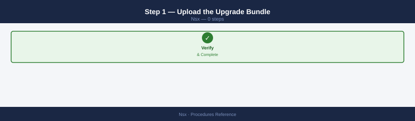
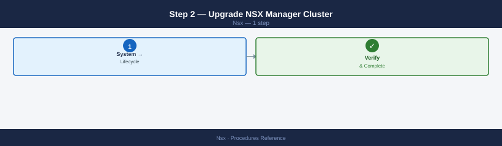
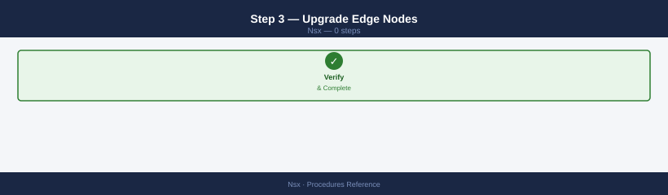
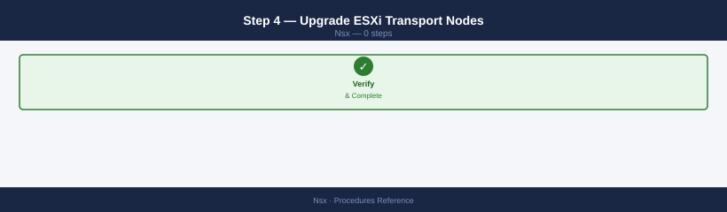
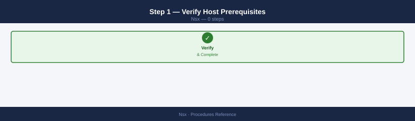
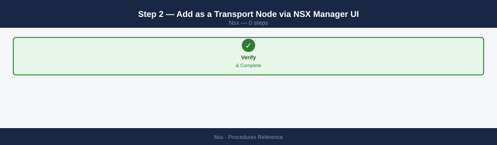
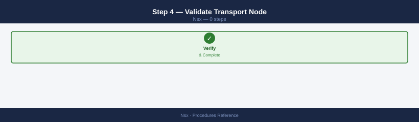

---
tags:
  - nsx
  - nsx-4
  - operations
  - vmware
description: "Step-by-step NSX procedures — segments, T0/T1 gateways, DFW security policies, NAT, load balancers, IPsec VPN, certificate rotation, backup/restore, and..."
---
# NSX — Standard Procedures

<div class="kb-summary">
Step-by-step NSX procedures — segments, T0/T1 gateways, DFW security policies, NAT, load balancers, IPsec VPN, certificate rotation, backup/restore, and upgrade validation. Includes API commands.

*Applies to: VMware NSX 9.x (VCF 9); NSX 4.2.x is the VCF 5.x line*
</div>

---

## Before you begin

- **Access:** vCenter read-only minimum; Administrator role for remediation steps
- **Timing:** safe to run during business hours unless a step is marked ⚠ (causes interruption)
- **Dependencies:** no active upgrades or migrations on the same infrastructure
- **Logging:** capture command output — paste into the change record on completion

---

## Create a Segment

Creates a new overlay segment in NSX and connects it to a T1 gateway. Run this when provisioning a new application tier or workload network.

1. Determine the transport zone path for your environment (overlay for inter-host, VLAN for physical uplinks).
2. Choose a gateway address for the subnet the segment will serve.
3. Set the connectivity path to the T1 gateway that will route traffic for this segment.
4. POST/PATCH the segment via the Policy API, then verify state.

```bash
curl -sk -u 'admin:password' \
  -X PATCH \
  -H "Content-Type: application/json" \
  -d '{
    "display_name": "seg-prod-app",
    "transport_zone_path": "/infra/sites/default/enforcement-points/default/transport-zones/tz-overlay-compute",
    "connectivity_path": "/infra/tier-1s/t1-prod-frontend",
    "subnets": [{
      "gateway_address": "10.0.2.1/24"
    }],
    "admin_state": "UP"
  }' \
  "https://<nsx-manager>/policy/api/v1/infra/segments/seg-prod-app"
```


```text title="Expected output"
{
  "resource_type": "Segment",
  "id": "seg-prod-app",
  "display_name": "seg-prod-app",
  "path": "/infra/segments/seg-prod-app",
  "relative_path": "seg-prod-app",
  "parent_path": "/infra",
  "marked_for_delete": false,
  "overridden": false,
  "transport_zone_path": "/infra/sites/default/enforcement-points/default/transport-zones/tz-overlay-compute",
  "connectivity_path": "/infra/tier-1s/t1-prod-frontend",
  "subnets": [
    {
      "gateway_address": "10.0.2.1/24",
      "network": "10.0.2.0/24"
    }
  ],
  "admin_state": "UP",
  "_create_time": 1704067200000,
  "_last_modified_time": 1704153600000,
  "_system_owned": false,
  "_protection": "NOT_PROTECTED",
  "_revision": 2
}
```

!!! warning "Common errors"
    | Error | Fix |
    |---|---|
    | `curl: (60) SSL certificate problem: self signed certificate` | Add the `-k` flag to skip SSL verification (already present in the example, but ensure it's not removed). |
    | `{"error_code":400,"error_message":"Invalid transport_zone_path"}` | Verify the transport zone path exists by running `curl -sk -u 'admin:password' https://<nsx-manager>/policy/api/v1/infra/sites/default/enforcement-points/default/transport-zones | jq`. |
    | `{"error_code":401,"error_message":"Unauthorized"}` | Confirm NSX Manager credentials are correct and the admin user has API access permissions in NSX. |
After creation, attach the segment to a VM vNIC via vCenter (Edit Settings > Network Adapter). To delete the segment later:

```bash
curl -sk -u 'admin:password' \
  -X DELETE \
  "https://<nsx-manager>/policy/api/v1/infra/segments/seg-prod-app"
```


```text title="Expected output"
(no output — command completes silently)
```

!!! warning "Common errors"
    | Error | Fix |
    |---|---|
    | `curl: (7) Failed to connect to <nsx-manager> port 443: Connection refused` | Verify the NSX Manager hostname/IP is correct and the management interface is reachable on port 443. |
    | `{"error_code":403,"error_message":"User does not have permission to perform DELETE on /policy/api/v1/infra/segments/seg-prod-app"}` | Ensure the admin user account has the required policy administrator or segment delete permissions in NSX. |
    | `{"error_code":404,"error_message":"Segment seg-prod-app not found"}` | Confirm the segment name is correct and exists before attempting deletion; use a GET request to list segments first. |
---

## Verify Segment Health

Confirms a segment is operationally UP and that VMs have connected logical ports. Run after creating a segment or when VMs report no network connectivity.

1. SSH to an NSX Manager or Edge node and open the NSX CLI.
2. Check admin state and operational status — both must be UP.
3. Confirm the VNI has been assigned.
4. Check that logical ports exist for connected VMs.

```bash
nsxcli
get logical-switches | grep seg-prod-app
get logical-switch <vni-or-uuid>
# Check the admin state and VNI in the output
```

```text title="Expected output"
Output varies by environment; see the NSX 9.1 CLI Guide: https://developer.broadcom.com/xapis/nsx-cli-guide/9.1.0/all_all_commands.html
```

!!! warning "Common errors"
    | Error | Fix |
    |---|---|
    | `error: logical-switch not found` | Verify the logical switch ID exists with `get logical-switches` and copy the exact UUID. |
    | `error: connection refused to nsx-manager` | Ensure NSX Manager is reachable and nsxcli is authenticated with valid credentials. |
```bash
get logical-switch <id> | grep VNI
```


```text title="Expected output"
VNI                 : 5001
```

!!! warning "Common errors"
    | Error | Fix |
    |---|---|
    | `error: unknown command 'get'` | Ensure you are in the NSX Manager CLI context; if using a shell script, prefix with `nsxcli` or connect to NSX Manager first via SSH. |
    | `error: logical-switch not found` | Verify the logical switch ID exists by running `list logical-switches` first to confirm the correct ID. |
```bash
# Segment ports (Policy API)
curl -sk -u 'admin:password' \
  "https://<nsx-manager>/policy/api/v1/infra/segments/<segment-id>/ports"
```

```text title="Expected output"
Output varies by environment; see the NSX 9.1 REST API reference: https://developer.broadcom.com/xapis/nsx-t-data-center-rest-api/9.1.0/
```

!!! warning "Common errors"
    | Error | Fix |
    |---|---|
    | `curl: (60) SSL certificate problem: self signed certificate` | Add the `-k` flag to skip certificate verification, or import the NSX Manager's CA certificate into your system trust store. |
    | `{"httpStatus":401,"error_code":60013,"module_name":"api_common","error_message":"The credentials were invalid"}` | Verify the NSX Manager admin username and password are correct and the account has not been locked after failed login attempts. |
    | `curl: (7) Failed to connect to <nsx-manager> port 443: Connection refused` | Confirm the NSX Manager hostname/IP is correct, the system is reachable on port 443, and the NSX Manager service is running. |
---

## Configure a T1 Gateway

Creates or updates a T1 gateway and configures route advertisement so that connected subnets are visible to the T0 gateway. Run when adding a new routing tier for an application zone.

1. Create the T1 gateway object via the UI (Policy > Networking > Tier-1 Gateways > Add) or the API.
2. Link it to the T0 gateway in the Linked Tier-0 Gateway field.
3. Assign it to an edge cluster.
4. Enable route advertisement for connected subnets.
5. Optionally apply a DNS and DHCP profile.

```bash
# Verify existing route advertisement config (route_advertisement_types field)
curl -sk -u 'admin:password' \
  "https://<nsx-manager>/policy/api/v1/infra/tier-1s/<t1-id>"

# Enable TIER1_CONNECTED (PATCH replaces the whole route_advertisement_types list,
# so include every type you want advertised)
curl -sk -u 'admin:password' \
  -X PATCH \
  -H "Content-Type: application/json" \
  -d '{
    "route_advertisement_types": ["TIER1_CONNECTED"]
  }' \
  "https://<nsx-manager>/policy/api/v1/infra/tier-1s/<t1-id>"
```

```text title="Expected output"
Output varies by environment; see the NSX 9.1 REST API reference: https://developer.broadcom.com/xapis/nsx-t-data-center-rest-api/9.1.0/
```

!!! warning "Common errors"
    | Error | Fix |
    |---|---|
    | `curl: (60) SSL certificate problem: self signed certificate` | Add `-k` flag to skip SSL verification (already present in the example, but ensure it's included if removed). |
    | `{"error_code":401,"error_message":"Unauthorized"}` | Verify NSX Manager credentials and ensure the admin user has API access permissions. |
    | `{"error_code":404,"error_message":"The Tier-1 <t1-id> was not found"}` | Confirm the Tier-1 gateway ID exists by running `curl -sk -u 'admin:password' "https://<nsx-manager>/policy/api/v1/infra/tier-1s"` to list available gateways. |
---

## Configure a T0 Gateway (BGP Peering)

Adds or updates a BGP neighbor on the T0 gateway so NSX can exchange routes with the physical fabric (ToR switches). Run when onboarding a new edge node uplink or adding a second ToR for redundancy.

1. Identify the T0 gateway ID and locale-service ID (usually `default`).
2. Gather the ToR IP address, remote AS number, and MD5 key.
3. Configure BFD to accelerate failure detection (recommended: 500 ms interval, multiplier 3).
4. Apply the neighbor config via the Policy API.
5. Verify BGP state from the Edge node CLI.

```bash
# Via Policy API
curl -sk -u 'admin:password' \
  -X PATCH \
  -H "Content-Type: application/json" \
  -d '{
    "display_name": "ToR-02",
    "neighbor_address": "10.0.0.5",
    "remote_as_num": "65000",
    "bfd_config": {
      "enabled": true,
      "interval": 500,
      "multiple": 3
    },
    "password": "bgp-md5-key"
  }' \
  "https://<nsx-manager>/policy/api/v1/infra/tier-0s/<t0-id>/locale-services/default/bgp/neighbors/tor-02"
```


```text title="Expected output"
{
  "resource_type": "BgpNeighborConfig",
  "id": "tor-02",
  "display_name": "ToR-02",
  "neighbor_address": "10.0.0.5",
  "remote_as_num": "65000",
  "bfd_config": {
    "enabled": true,
    "interval": 500,
    "multiple": 3
  },
  "password": "bgp-md5-key",
  "_create_time": 1672531200000,
  "_last_modified_time": 1672617600000,
  "_system_owned": false,
  "path": "/infra/tier-0s/t0-1a2b3c4d/locale-services/default/bgp/neighbors/tor-02"
}
```

!!! warning "Common errors"
    | Error | Fix |
    |---|---|
    | `{"error_code":403,"error_message":"User does not have permission to modify BGP configuration"}` | Ensure the admin user has the NSX-T Policy Admin or equivalent role assigned. |
    | `{"error_code":404,"error_message":"Tier-0 <t0-id> not found"}` | Replace `<t0-id>` with the actual Tier-0 gateway ID (verify with `curl -sk -u 'admin:password' https://<nsx-manager>/policy/api/v1/infra/tier-0s`). |
    | `curl: (60) SSL certificate problem: self signed certificate` | Add the `-k` flag to skip certificate verification, or import the NSX Manager CA certificate into your system trust store. |
```bash
vrf <tier0-vrf>
get bgp neighbor summary | grep 10.0.0.5
# State should be Established
```


```text title="Expected output"
BGP neighbor is 10.0.0.5, remote AS 65001
  BGP version 4, remote router ID 10.0.0.5
  BGP state = Established, up for 2d14h22m
  Last read 00:00:03, hold time is 180, keepalive interval is 60 seconds
  Neighbor capabilities:
    Route refresh: advertised and received(new)
    Address family IPv4 Unicast: advertised and received
    Address family IPv6 Unicast: advertised and received
  Message statistics:
    Inq depth is 0
    Outq depth is 0
    Sent   Rcvd
    Opens:  1      1
    Notifications: 0      0
    Updates:       847    1203
    Keepalives:    8934   8921
    Route Refresh: 0      0
    Total:         9782   10125
  Default minimum time between advertisement runs is 0 seconds
```

!!! warning "Common errors"
    | Error | Fix |
    |---|---|
    | `% Invalid command` | Verify the syntax: `get bgp neighbor summary` (all peers) or `get bgp neighbor <neighbor-ip>` (one peer). |
    | `BGP neighbor 10.0.0.5 not found` | Confirm the neighbor IP address is correct and the BGP session has been configured on this Tier-0 VRF. |
    | `% Incomplete command` | Ensure you are in the correct VRF context by running `show vrf` first to list available Tier-0 VRFs. |
---

## Trigger Edge Node Failover

Manually fails over the active Edge node to its standby so that maintenance can be performed on the currently active node without extended downtime. Run during Edge node patching or when the active Edge shows hardware faults.

1. Identify which Edge node is currently active (`get edge-cluster status` and `get high-availability status` on the Edge node).
2. The NSX CLI has no failover command. Put the **active** Edge node into NSX maintenance mode (UI or Policy API) so the standby takes over.
3. BGP reconverges via BFD, typically within 10–30 seconds.
4. Verify the new active/standby state and that BGP neighbors are re-established.
5. Exit maintenance mode when the work on the node is complete.

```bash
# Put the currently ACTIVE Edge node into maintenance mode (Policy API)
curl -sk -u 'admin:password' -X POST \
  "https://<nsx-manager>/policy/api/v1/infra/sites/default/enforcement-points/default/edge-transport-nodes/<edge-tn-id>/action/enter-maintenance-mode"
# The standby becomes active; BGP reconverges — typically within 10–30 seconds with BFD

# Verify new state (Edge node CLI)
get edge-cluster status
get bgp neighbor summary

# When maintenance is complete
curl -sk -u 'admin:password' -X POST \
  "https://<nsx-manager>/policy/api/v1/infra/sites/default/enforcement-points/default/edge-transport-nodes/<edge-tn-id>/action/exit-maintenance-mode"
```

```text title="Expected output"
Output varies by environment; see the NSX 9.1 CLI Guide: https://developer.broadcom.com/xapis/nsx-cli-guide/9.1.0/all_all_commands.html
```

!!! warning "Common errors"
    | Error | Fix |
    |---|---|
    | `Error: Cannot failover — both nodes in FAILED state` | Check node connectivity and state with `get edge-cluster status` and `get high-availability status` before attempting failover. |
    | `Error: BGP session timeout — neighbor 192.168.1.1 DOWN` | Verify BGP configuration and network connectivity on the newly active node with `get bgp neighbor 192.168.1.1`. |
    | `Error: Failover not permitted — cluster has only 1 node` | Deploy a second Edge node to the cluster before initiating failover operations. |
---

## Create a DFW Security Policy

Creates a new Distributed Firewall security policy container. Policies group related rules by application or purpose and control the order in which rules are evaluated. Run when onboarding a new application that requires its own firewall scope.

1. Navigate to Security > Distributed Firewall > Add Policy, or use the API below.
2. Set the policy name, scope (All for environment-wide, or limit to specific groups), and sequence number.
3. Leave the policy empty initially — add rules as a separate step.
4. Publish to push to the dataplane.

```bash
curl -sk -u 'admin:password' \
  -X PATCH \
  -H "Content-Type: application/json" \
  -d '{
    "display_name": "policy-web-tier",
    "category": "Application",
    "stateful": true,
    "sequence_number": 10
  }' \
  "https://<nsx-manager>/policy/api/v1/infra/domains/default/security-policies/policy-web-tier"
```


```text title="Expected output"
{
  "resource_type": "SecurityPolicy",
  "id": "policy-web-tier",
  "display_name": "policy-web-tier",
  "path": "/infra/domains/default/security-policies/policy-web-tier",
  "relative_path": "policy-web-tier",
  "parent_path": "/infra/domains/default/security-policies",
  "marked_for_delete": false,
  "overridden": false,
  "category": "Application",
  "stateful": true,
  "sequence_number": 10,
  "rules": [],
  "_create_time": 1698765432145,
  "_last_modified_time": 1698765445821,
  "_system_owned": false,
  "_revision": 2
}
```

!!! warning "Common errors"
    | Error | Fix |
    |---|---|
    | `curl: (60) SSL certificate problem: self signed certificate` | Add `-k` flag to skip certificate verification (already present in the example, so ensure it's not removed). |
    | `{"error_code":401,"error_message":"Unauthorized"}` | Verify NSX Manager credentials in the `-u` parameter match an admin account with API access. |
    | `{"error_code":404,"error_message":"The requested resource could not be found"}` | Confirm the security policy `policy-web-tier` exists and the NSX Manager hostname in the URL is correct and reachable. |
---

## Add a Rule to a Security Policy

Adds a firewall rule to an existing security policy. Run when opening a new application port or restricting traffic between groups.

1. Identify the security policy ID and prepare the source/destination group paths.
2. Define the service (port/protocol) — use a predefined service path or inline service entry.
3. Set the action: `ALLOW`, `DROP`, or `REJECT`.
4. Assign a sequence number lower than the default-deny rule.
5. Publish changes.

```bash
curl -sk -u 'admin:password' \
  -X PATCH \
  -H "Content-Type: application/json" \
  -d '{
    "display_name": "allow-web-to-app-443",
    "sequence_number": 10,
    "source_groups": ["/infra/domains/default/groups/sg-web-tier"],
    "destination_groups": ["/infra/domains/default/groups/sg-app-tier"],
    "services": ["/infra/services/HTTPS"],
    "action": "ALLOW",
    "logged": true
  }' \
  "https://<nsx-manager>/policy/api/v1/infra/domains/default/security-policies/policy-web-tier/rules/allow-web-to-app-443"
```


```text title="Expected output"
{
  "resource_type": "SecurityPolicyRule",
  "id": "allow-web-to-app-443",
  "display_name": "allow-web-to-app-443",
  "description": "",
  "sequence_number": 10,
  "source_groups": [
    "/infra/domains/default/groups/sg-web-tier"
  ],
  "destination_groups": [
    "/infra/domains/default/groups/sg-app-tier"
  ],
  "services": [
    "/infra/services/HTTPS"
  ],
  "action": "ALLOW",
  "logged": true,
  "_create_time": 1704067200000,
  "_last_modified_time": 1704067245000,
  "_system_owned": false,
  "path": "/infra/domains/default/security-policies/policy-web-tier/rules/allow-web-to-app-443"
}
```

!!! warning "Common errors"
    | Error | Fix |
    |---|---|
    | `curl: (60) SSL certificate problem: self signed certificate` | Add `-k` flag to skip SSL verification (already present in example; if error persists, verify NSX Manager certificate chain). |
    | `{"error_code":401,"error_message":"Invalid credentials"}` | Verify admin username and password are correct and the user has API access permissions in NSX Manager. |
    | `{"error_code":404,"error_message":"Policy not found"}` | Confirm the security policy `policy-web-tier` exists and the source/destination group paths are correct using `GET /infra/domains/default/security-policies`. |
After adding rules, publish the policy:

```bash
curl -sk -u 'admin:password' \
  -X POST \
  "https://<nsx-manager>/policy/api/v1/infra/domains/default/security-policies/policy-web-tier?action=revise"
```


```text title="Expected output"
{
  "resource_type": "SecurityPolicy",
  "id": "policy-web-tier",
  "display_name": "policy-web-tier",
  "description": "Web tier security policy",
  "domain_id": "default",
  "rules": [
    {
      "id": "rule-001",
      "display_name": "Allow HTTP",
      "action": "ALLOW",
      "services": ["HTTP"],
      "source_groups": ["/infra/domains/default/groups/web-clients"]
    }
  ],
  "path": "/infra/domains/default/security-policies/policy-web-tier",
  "relative_path": "policy-web-tier",
  "_revision": 2,
  "_create_time": 1672531200000,
  "_last_modified_time": 1672617600000
}
```

!!! warning "Common errors"
    | Error | Fix |
    |---|---|
    | `curl: (60) SSL certificate problem: self signed certificate` | Add `-k` flag to skip certificate verification (already present in example, but ensure it's included if removed). |
    | `{"error_code":401,"error_message":"Invalid credentials"}` | Verify the NSX Manager admin username and password are correct and the user has API access permissions. |
    | `{"error_code":404,"error_message":"Policy not found"}` | Confirm the security policy `policy-web-tier` exists in the `default` domain using a GET request first. |
---

## Delete a DFW Rule via API

Removes a specific firewall rule from a security policy. Run when a rule is no longer required or was added in error. Always verify connectivity before and after deletion.

1. Confirm the policy ID and rule ID (visible in the NSX UI under Security > Distributed Firewall, or via a GET call).
2. Record the rule definition as a rollback reference before deleting.
3. Issue the DELETE call.
4. Verify traffic behaviour with a traceflow test.

```bash
curl -sk -u 'admin:password' \
  -X DELETE \
  "https://<nsx-manager>/policy/api/v1/infra/domains/default/security-policies/<policy-id>/rules/<rule-id>"
```


```text title="Expected output"
(no output — command completes silently)
```

!!! warning "Common errors"
    | Error | Fix |
    |---|---|
    | `curl: (60) SSL certificate problem: self signed certificate` | Add the `-k` flag to skip SSL verification, or import the NSX Manager's CA certificate into your system trust store. |
    | `{"error_code":403,"error_message":"User admin does not have permission to perform DELETE on /policy/api/v1/infra/domains/default/security-policies/<policy-id>/rules/<rule-id>"}` | Verify the admin user has the "Security Administrator" or equivalent role assigned in NSX Manager's role-based access control settings. |
    | `curl: (7) Failed to connect to <nsx-manager> port 443: Connection refused` | Confirm the NSX Manager hostname/IP is correct and reachable on port 443, and that the NSX Manager service is running. |
To confirm the rule has been removed:

```bash
curl -sk -u 'admin:password' \
  "https://<nsx-manager>/policy/api/v1/infra/domains/default/security-policies/<policy-id>/rules" | \
  python3 -c "import sys,json; [print(r['id'], r['display_name']) for r in json.load(sys.stdin)['results']]"
```


```text title="Expected output"
allow-web-traffic Allow Web Traffic
deny-ssh-inbound Deny SSH Inbound
allow-dns-outbound Allow DNS Outbound
quarantine-infected Quarantine Infected Hosts
allow-ntp-sync Allow NTP Sync
default-drop Default Drop Rule
...
```

!!! warning "Common errors"
    | Error | Fix |
    |---|---|
    | `curl: (60) SSL certificate problem: self signed certificate` | Add the `-k` flag to skip certificate verification, or import the NSX Manager's CA certificate into your system trust store. |
    | `curl: (7) Failed to connect to <nsx-manager> port 443: Connection refused` | Verify the NSX Manager hostname/IP is correct and reachable on port 443 using `ping` or `nc -zv`. |
    | `json.decoder.JSONDecodeError: Expecting value: line 1 column 1` | Confirm authentication credentials are correct and the policy ID exists by testing with `curl -sk -u 'admin:password' "https://<nsx-manager>/policy/api/v1/infra/domains/default/security-policies" | head -20`. |
---

## Create a Security Group (Tag-Based)

Creates a dynamic security group whose membership is determined by NSX tags applied to VMs. Run when onboarding a new application tier that will be protected by DFW policies.

1. Decide on the tag scope and value that will identify members (for example `tier:web`).
2. Apply the tag to the relevant VMs (see Apply NSX Tags below).
3. Create the group with a tag-based membership condition.

```bash
# Via API — create a group by tag
curl -sk -u 'admin:password' \
  -X PATCH \
  -H "Content-Type: application/json" \
  -d '{
    "display_name": "sg-web-tier",
    "expression": [{
      "resource_type": "Condition",
      "member_type": "VirtualMachine",
      "key": "Tag",
      "operator": "EQUALS",
      "value": "web-tier"
    }]
  }' \
  "https://<nsx-manager>/policy/api/v1/infra/domains/default/groups/sg-web-tier"
```


```text title="Expected output"
{
  "resource_type": "Group",
  "id": "sg-web-tier",
  "display_name": "sg-web-tier",
  "path": "/infra/domains/default/groups/sg-web-tier",
  "relative_path": "sg-web-tier",
  "parent_path": "/infra/domains/default",
  "marked_for_delete": false,
  "expression": [
    {
      "resource_type": "Condition",
      "member_type": "VirtualMachine",
      "key": "Tag",
      "operator": "EQUALS",
      "value": "web-tier"
    }
  ],
  "extended_expression": [],
  "_create_time": 1704067234567,
  "_last_modified_time": 1704067234567,
  "_system_owned": false,
  "_protection": "NOT_PROTECTED",
  "_revision": 0
}
```

!!! warning "Common errors"
    | Error | Fix |
    |---|---|
    | `curl: (60) SSL certificate problem: self signed certificate` | Add `-k` flag to skip SSL verification (already present in example; if error persists, verify NSX Manager certificate or use `--cacert` with proper CA bundle). |
    | `{"error_code":401,"error_message":"Invalid credentials"}` | Verify NSX Manager admin credentials and ensure the user has API access permissions. |
    | `{"error_code":404,"error_message":"The requested resource could not be found"}` | Confirm the NSX Manager hostname/IP is correct and the policy API endpoint is accessible on the target NSX version. |
Verify membership after tagging VMs:

```bash
curl -sk -u 'admin:password' \
  "https://<nsx-manager>/policy/api/v1/infra/domains/default/groups/sg-web-tier/members/virtual-machines"
```


```text title="Expected output"
{
  "results": [
    {
      "resource_type": "VirtualMachine",
      "id": "vm-web-01",
      "display_name": "web-server-prod-01",
      "external_id": "vm-564a8c2d-91e3-4b7f-a2c1-8f9e3d2c1b5a",
      "tags": [
        {
          "scope": "environment",
          "tag": "production"
        }
      ]
    },
    {
      "resource_type": "VirtualMachine",
      "id": "vm-web-02",
      "display_name": "web-server-prod-02",
      "external_id": "vm-7f2e1c9d-a4b3-4e6f-9c2a-1d8e5f3a2b7c",
      "tags": [
        {
          "scope": "environment",
          "tag": "production"
        }
      ]
    },
    {
      "resource_type": "VirtualMachine",
      "id": "vm-web-03",
      "display_name": "web-server-prod-03",
      "external_id": "vm-2b9f4a1e-c5d8-4a7e-b1f3-6c2d9e4a5f1b"
    }
  ],
  "result_count": 3
}
```

!!! warning "Common errors"
    | Error | Fix |
    |---|---|
    | `curl: (60) SSL certificate problem: self signed certificate` | Add the `-k` flag to skip certificate verification, or import the NSX Manager's CA certificate into your system trust store. |
    | `{"error_code":401,"error_message":"Invalid credentials"}` | Verify the admin username and password are correct and the account has not been locked after failed login attempts. |
    | `curl: (7) Failed to connect to <nsx-manager> port 443: Name or service not known` | Ensure the NSX Manager hostname or IP address is correct and resolvable from your network, and that port 443 is accessible. |
---

## Apply NSX Tags to a VM (PowerCLI and API)

Applies NSX tags to a virtual machine so that it joins tag-based dynamic security groups. Run when provisioning a new VM that must be protected by an existing DFW policy, or when migrating a VM between application tiers.

Tags can be applied via PowerCLI (leverages vCenter tag objects) or directly via the NSX Fabric API using the VM's MoRef ID.

**PowerCLI method:**

```powershell
# PowerCLI — assign NSX tag to a VM
$vm = Get-VM "app-server-01"
New-TagAssignment -Tag (Get-Tag -Name "app-tier") -Entity $vm
```

**NSX Fabric API method** (requires the VM MoRef ID, e.g. `vm-123`):

```bash
curl -sk -u 'admin:password' \
  -X POST \
  -H "Content-Type: application/json" \
  -d '{
    "external_id": "<vm-moref-id>",
    "tags": [{"scope": "tier", "tag": "app"}]
  }' \
  "https://<nsx-manager>/api/v1/fabric/virtual-machines?action=update_tags"
```


```text title="Expected output"
{
  "resource_type": "VirtualMachine",
  "id": "vm-42",
  "external_id": "vm-2847",
  "display_name": "web-app-prod-01",
  "tags": [
    {
      "scope": "tier",
      "tag": "app"
    }
  ],
  "owner_id": "admin",
  "create_time": 1704067200000,
  "last_modified_time": 1704153600000
}
```

!!! warning "Common errors"
    | Error | Fix |
    |---|---|
    | `curl: (60) SSL certificate problem: self signed certificate` | Add `-k` flag to skip certificate verification (already present; if still failing, verify NSX Manager certificate is valid or use `--cacert` with proper CA bundle). |
    | `{"httpStatus":"UNAUTHORIZED","error_code":401,"module_name":"api.framework","error_message":"Invalid credentials"}` | Verify the admin username and password are correct and the user has API access permissions in NSX Manager. |
    | `{"httpStatus":"NOT_FOUND","error_code":404,"module_name":"api.framework","error_message":"Virtual machine not found"}` | Confirm the `external_id` (VM moref) is valid and the VM is registered in vCenter and synced to NSX Manager. |
After tagging, verify the VM appears in the target group:

```bash
curl -sk -u 'admin:password' \
  "https://<nsx-manager>/policy/api/v1/infra/domains/default/groups/sg-app-tier/members/virtual-machines"
```


```text title="Expected output"
{
  "results": [
    {
      "resource_type": "VirtualMachine",
      "id": "vm-app-01",
      "display_name": "app-server-prod-01",
      "external_id": "vm-5a8c2f1e-9b3d-4c7a-b2e1-f9d8c3a4b5e6",
      "path": "/infra/domains/default/groups/sg-app-tier/members/vm-app-01"
    },
    {
      "resource_type": "VirtualMachine",
      "id": "vm-app-02",
      "display_name": "app-server-prod-02",
      "external_id": "vm-7d9e4f2a-1c5b-4d8e-a3f2-e8c9d4b5a6f7",
      "path": "/infra/domains/default/groups/sg-app-tier/members/vm-app-02"
    },
    {
      "resource_type": "VirtualMachine",
      "id": "vm-app-03",
      "display_name": "app-server-prod-03",
      "external_id": "vm-9f1a6g3b-2d6c-5e9f-b4g3-f9d0e5c6b7a8",
      "path": "/infra/domains/default/groups/sg-app-tier/members/vm-app-03"
    }
  ],
  "result_count": 3,
  "sort_by": "display_name"
}
```

!!! warning "Common errors"
    | Error | Fix |
    |---|---|
    | `curl: (60) SSL certificate problem: self signed certificate` | Add `-k` flag to skip SSL verification (already present in example; ensure it's not removed). |
    | `{"error_code":401,"error_message":"Invalid credentials"}` | Verify the NSX Manager admin username and password are correct and the account has API access permissions. |
    | `curl: (7) Failed to connect to <nsx-manager> port 443: Connection refused` | Confirm the NSX Manager hostname/IP is correct and reachable on port 443 from your network location. |
---

## Test DFW Rules with Traceflow

Uses NSX Traceflow to inject a synthetic packet between two VMs and trace the path through the overlay, confirming whether DFW rules allow or drop it. Run after any DFW rule change to validate the expected outcome before closing the change record.

1. Navigate to Plan & Troubleshoot > Traceflow in the NSX UI.
2. Set the source VM and vNIC, destination VM IP or MAC, and the protocol/port.
3. Click Trace — NSX injects one synthetic packet and shows per-hop results.
4. Look for DELIVERED at the destination and confirm no unexpected DROP observations at any hop.

Alternatively, test real connectivity from a VM after a rule change:

```bash
curl -v https://<dest-vm-ip>/
# Or: telnet <dest-vm-ip> 443
```


```text title="Expected output"
* Trying 192.168.100.45...
* TCP_NODELAY set
* Connected to 192.168.100.45 (192.168.100.45) port 443 (#0)
* ALPN, offering h2
* ALPN, offering http/1.1
* successfully set certificate verify locations
* TLSv1.2 (OUT), TLS handshake, Client Hello (1):
* TLSv1.2 (IN), TLS handshake, Server Hello (2):
* TLSv1.2 (IN), TLS Handshake, Certificate (11):
* TLSv1.2 (IN), TLS Handshake, Server finished (14):
* TLSv1.2 (OUT), TLS handshake, Finished (20):
* SSL connection using TLSv1.2 / ECDHE-RSA-AES256-GCM-SHA384
> GET / HTTP/1.1
> Host: 192.168.100.45
> User-Agent: curl/7.68.0
> Accept: */*
>
< HTTP/1.1 200 OK
< Content-Type: text/html; charset=UTF-8
< Content-Length: 4521
```

!!! warning "Common errors"
    | Error | Fix |
    |---|---|
    | `curl: (7) Failed to connect to 192.168.100.45 port 443: Connection refused` | Verify the destination VM is running and the service is listening on port 443 using `netstat -tlnp | grep 443` on the target. |
    | `curl: (60) SSL certificate problem: self signed certificate` | Add the `-k` flag to curl to skip certificate verification, or import the VM's certificate into your trust store. |
    | `curl: (6) Could not resolve host name` | Verify the IP address is correct and that DNS resolution or network connectivity to the destination VM is working. |
For automated traceflow via API:

```bash
# Policy API: create (PUT) a traceflow from a segment port
curl -sk -u 'admin:password' \
  -X PUT \
  -H "Content-Type: application/json" \
  -d '{
    "segment_port_path": "/infra/segments/<segment-id>/ports/<port-id>",
    "packet": {
      "resource_type": "FieldsPacketData",
      "transport_type": "UNICAST",
      "ip_header": {"src_ip": "10.0.2.10", "dst_ip": "10.0.3.20", "protocol": 6, "ttl": 64},
      "transport_header": {"tcp_header": {"src_port": 54321, "dst_port": 443}}
    }
  }' \
  "https://<nsx-manager>/policy/api/v1/infra/traceflows/<traceflow-id>"

# Read the hop-by-hop observations
curl -sk -u 'admin:password' \
  "https://<nsx-manager>/policy/api/v1/infra/traceflows/<traceflow-id>/observations"
```

```text title="Expected output"
Output varies by environment; see the NSX 9.1 REST API reference: https://developer.broadcom.com/xapis/nsx-t-data-center-rest-api/9.1.0/
```

!!! warning "Common errors"
    | Error | Fix |
    |---|---|
    | `curl: (60) SSL certificate problem: self signed certificate` | Add `-k` flag to skip certificate verification (already present in example; ensure curl supports SSL). |
    | Invalid source port | Verify the source segment port exists by running `curl -sk -u 'admin:password' https://<nsx-manager>/policy/api/v1/infra/segments/<segment-id>/ports` and use its path. |
    | `{"httpStatus":401,"error_code":65507,"module_name":"common","error_message":"Invalid credentials"}` | Confirm NSX Manager admin credentials are correct and the user has API access permissions. |
---

## Configure SNAT / DNAT

Configures Source NAT (SNAT) or Destination NAT (DNAT) rules on a T1 or T0 gateway. SNAT is used to masquerade private VM addresses behind a public IP for outbound traffic. DNAT is used to redirect inbound connections to a private VM. Run when exposing a new service externally or connecting a legacy application that requires a fixed source IP.

**SNAT — translate outbound traffic from a subnet to a public IP:**

```bash
curl -sk -u 'admin:password' \
  -X PATCH \
  -H "Content-Type: application/json" \
  -d '{
    "display_name": "snat-app-tier-outbound",
    "action": "SNAT",
    "source_network": "10.0.2.0/24",
    "translated_network": "203.0.113.10",
    "sequence_number": 10,
    "enabled": true
  }' \
  "https://<nsx-manager>/policy/api/v1/infra/tier-1s/<t1-id>/nat/USER/nat-rules/snat-app-tier-outbound"
```


```text title="Expected output"
{
  "resource_type": "PolicyNatRule",
  "id": "snat-app-tier-outbound",
  "display_name": "snat-app-tier-outbound",
  "description": "",
  "tags": [],
  "action": "SNAT",
  "enabled": true,
  "logging": false,
  "source_network": "10.0.2.0/24",
  "translated_network": "203.0.113.10",
  "sequence_number": 10,
  "firewall_match": "MATCH_INTERNAL_ADDRESS",
  "path": "/infra/tier-1s/tier1-prod-01/nat/USER/nat-rules/snat-app-tier-outbound",
  "relative_path": "snat-app-tier-outbound",
  "parent_path": "/infra/tier-1s/tier1-prod-01/nat/USER",
  "marked_for_delete": false,
  "_create_time": 1704067200000,
  "_last_modified_time": 1704153600000,
  "_system_owned": false,
  "_protection": "NOT_PROTECTED",
  "_revision": 2
}
```

!!! warning "Common errors"
    | Error | Fix |
    |---|---|
    | `{"error_code":403,"error_message":"User admin does not have permission to modify NAT rules"}` | Ensure the admin user has the NSX Policy Admin or equivalent role assigned in NSX Manager. |
    | `{"error_code":404,"error_message":"Tier-1 <t1-id> not found"}` | Verify the Tier-1 gateway ID exists by running `curl -sk -u 'admin:password' https://<nsx-manager>/policy/api/v1/infra/tier-1s` and confirm the correct ID. |
    | `curl: (60) SSL certificate problem: self signed certificate` | Add the `-k` flag to skip SSL verification, or import the NSX Manager certificate into your system's trusted store. |
**DNAT — redirect inbound traffic from a public IP to a private VM:**

```bash
curl -sk -u 'admin:password' \
  -X PATCH \
  -H "Content-Type: application/json" \
  -d '{
    "display_name": "dnat-public-web-01",
    "action": "DNAT",
    "destination_network": "203.0.113.11",
    "translated_network": "10.0.2.50",
    "sequence_number": 20,
    "enabled": true
  }' \
  "https://<nsx-manager>/policy/api/v1/infra/tier-1s/<t1-id>/nat/USER/nat-rules/dnat-public-web-01"
```


```text title="Expected output"
{
  "resource_type": "NatRule",
  "id": "dnat-public-web-01",
  "display_name": "dnat-public-web-01",
  "description": "",
  "action": "DNAT",
  "enabled": true,
  "logging": false,
  "destination_network": "203.0.113.11",
  "translated_network": "10.0.2.50",
  "sequence_number": 20,
  "firewall_match": "MATCH_INTERNAL_ADDRESS",
  "_create_time": 1698765432145,
  "_last_modified_time": 1698765445892,
  "_system_owned": false,
  "path": "/infra/tier-1s/tier1-prod-01/nat/USER/nat-rules/dnat-public-web-01"
}
```

!!! warning "Common errors"
    | Error | Fix |
    |---|---|
    | `{"error_code":403,"error_message":"User admin does not have permission to modify NAT rules"}` | Ensure the admin user has the NSX-T Policy Admin or equivalent role assigned in the NSX Manager. |
    | `{"error_code":404,"error_message":"Tier-1 <t1-id> not found"}` | Replace `<t1-id>` with the actual Tier-1 gateway ID (e.g., `tier1-prod-01`) and verify it exists via `GET /policy/api/v1/infra/tier-1s`. |
    | `curl: (60) SSL certificate problem: self signed certificate` | Add the `-k` flag to skip certificate verification or import the NSX Manager's CA certificate into your system trust store. |
Verify NAT rules are active:

```bash
curl -sk -u 'admin:password' \
  "https://<nsx-manager>/policy/api/v1/infra/tier-1s/<t1-id>/nat/USER/nat-rules"
```


```text title="Expected output"
{
  "results": [
    {
      "resource_type": "PolicyNatRule",
      "id": "rule-001",
      "display_name": "Outbound-SNAT",
      "action": "SNAT",
      "enabled": true,
      "source_network": "192.168.1.0/24",
      "translated_network": "203.0.113.50/32",
      "sequence_number": 10
    },
    {
      "resource_type": "PolicyNatRule",
      "id": "rule-002",
      "display_name": "Inbound-DNAT",
      "action": "DNAT",
      "enabled": true,
      "destination_network": "203.0.113.50/32",
      "translated_network": "192.168.1.100/32",
      "sequence_number": 20
    }
  ],
  "result_count": 2
}
```

!!! warning "Common errors"
    | Error | Fix |
    |---|---|
    | `curl: (60) SSL certificate problem: self signed certificate` | Add `-k` flag to skip SSL verification (already present in example; if error persists, verify NSX Manager certificate is valid). |
    | `{"error_code":401,"error_message":"Unauthorized"}` | Verify admin credentials are correct and the user has API access permissions in NSX Manager. |
    | `curl: (7) Failed to connect to <nsx-manager> port 443: Connection refused` | Confirm the NSX Manager hostname/IP is correct and reachable on port 443 from your network. |
---

## Renew NSX Manager Certificate (API)

Replaces the TLS certificate presented by NSX Manager. Run when the existing certificate is within 30 days of expiry, or when replacing a self-signed certificate with a CA-signed one after initial deployment.

1. Generate a CSR on NSX Manager or bring a pre-generated certificate and key pair.
2. Import the certificate via the Trust API.
3. Apply the imported certificate to the NSX Manager node.
4. Verify the new certificate is served.

```bash
# Step 1 — Generate a CSR on NSX Manager
curl -sk -u 'admin:password' \
  -X POST \
  -H "Content-Type: application/json" \
  -d '{
    "key_size": "RSA_2048",
    "subject": {
      "attributes": [
        {"key": "CN", "value": "nsx-manager.example.com"},
        {"key": "O",  "value": "Example Corp"},
        {"key": "C",  "value": "AU"}
      ]
    },
    "extensions": {
      "subject_alt_names": {
        "dns_names": ["nsx-manager.example.com"],
        "ip_addresses": ["192.168.1.10"]
      }
    }
  }' \
  "https://<nsx-manager>/api/v1/trust-management/csrs"
```


```text title="Expected output"
{
  "resource_type": "CertificateSigningRequest",
  "id": "csr-1a2b3c4d-5e6f-7g8h-9i0j-1k2l3m4n5o6p",
  "pem": "-----BEGIN CERTIFICATE REQUEST-----\nMIIDXTCCAkWgAwIBAgIUe7f8K9mN2pQ4rS5tU6vW7xY8z9A=\n...\n-----END CERTIFICATE REQUEST-----",
  "key_size": "RSA_2048",
  "subject": {
    "attributes": [
      {"key": "CN", "value": "nsx-manager.example.com"},
      {"key": "O", "value": "Example Corp"},
      {"key": "C", "value": "AU"}
    ]
  },
  "extensions": {
    "subject_alt_names": {
      "dns_names": ["nsx-manager.example.com"],
      "ip_addresses": ["192.168.1.10"]
    }
  },
  "created_time": 1704067200000
}
```

!!! warning "Common errors"
    | Error | Fix |
    |---|---|
    | `curl: (60) SSL certificate problem: self signed certificate` | Add `-k` flag to curl to skip SSL verification, or use `--cacert` with the NSX Manager's CA certificate. |
    | `{"error_code":400,"error_message":"Invalid subject attributes"}` | Ensure all required subject attributes (CN, O, C) are present and use valid ISO country codes. |
    | `{"error_code":401,"error_message":"Unauthorized"}` | Verify the admin credentials are correct and the user has certificate management permissions in NSX Manager. |
```bash
# Step 2 — Import the signed certificate (PEM format)
CERT_PEM=$(cat /path/to/signed.crt)
KEY_PEM=$(cat /path/to/private.key)

curl -sk -u 'admin:password' \
  -X POST \
  -H "Content-Type: application/json" \
  -d "{
    \"pem_encoded\": \"${CERT_PEM}\",
    \"private_key\": \"${KEY_PEM}\",
    \"display_name\": \"nsx-mgr-cert-2026\"
  }" \
  "https://<nsx-manager>/api/v1/trust-management/certificates?action=import"
```


```text title="Expected output"
{
  "resource_type": "Certificate",
  "id": "a7f3c2e1-9b4d-47e8-b1f2-6d8c9e3a5f2b",
  "display_name": "nsx-mgr-cert-2026",
  "pem_encoded": "-----BEGIN CERTIFICATE-----\nMIIDXTCCAkWgAwIBAgIJAKp7vZ8c9F2kMA0GCSqGSIb3DQEBCwUAMEUxCzAJBgNV\n...",
  "certificate_details": {
    "issuer": "CN=NSX-CA,O=VMware,C=US",
    "subject": "CN=nsx-manager.lab.local,O=VMware,C=US",
    "valid_from": "2024-01-15T10:30:00Z",
    "valid_until": "2026-01-15T10:30:00Z",
    "fingerprint": "A1:B2:C3:D4:E5:F6:7A:8B:9C:0D:1E:2F:3A:4B:5C:6D"
  },
  "self_signed": false,
  "used_by_services": ["api", "ui"]
}
```

!!! warning "Common errors"
    | Error | Fix |
    |---|---|
    | `curl: (60) SSL certificate problem: self signed certificate` | Add `-k` flag to skip SSL verification, or use `--cacert /path/to/ca-bundle.crt` to provide the CA certificate. |
    | `jq: parse error: Invalid JSON at line 1` | Ensure the certificate and key PEM files contain valid content without line breaks; use `cat -A` to check for hidden characters and re-export if needed. |
    | `{"error_code": 400, "error_message": "Invalid certificate format"}` | Verify the PEM file starts with `-----BEGIN CERTIFICATE-----` and ends with `-----END CERTIFICATE-----` with no extra whitespace or encoding issues. |
```bash
# Step 3 — Apply the certificate to the NSX Manager node
# Obtain the certificate ID from the import response, then:
curl -sk -u 'admin:password' \
  -X POST \
  "https://<nsx-manager>/api/v1/node/services/http?action=apply_certificate&certificate_id=<cert-id>"
```


```text title="Expected output"
{
  "resource_type": "NodeService",
  "id": "http",
  "service_name": "http",
  "listen_port": 80,
  "enabled": true,
  "certificate_id": "8f4a2c91-7e3d-4b6a-9d1f-2e5c8a3b7f9d",
  "ssl_protocol_versions": [
    "TLSv1.2",
    "TLSv1.3"
  ],
  "cipher_suites": [
    "TLS_ECDHE_RSA_WITH_AES_256_GCM_SHA384",
    "TLS_ECDHE_RSA_WITH_AES_128_GCM_SHA256"
  ],
  "status": "success"
}
```

!!! warning "Common errors"
    | Error | Fix |
    |---|---|
    | `curl: (60) SSL certificate problem: self signed certificate` | Add the `-k` flag to skip SSL verification, or import the NSX Manager's CA certificate into your system trust store. |
    | `{"httpStatus":401,"errorCode":401,"message":"Invalid credentials"}` | Verify the admin username and password are correct and the account has not been locked after failed login attempts. |
    | `{"httpStatus":404,"errorCode":404,"message":"Certificate not found"}` | Confirm the certificate_id value matches exactly from the import response and the certificate exists in NSX Manager's certificate store. |
```bash
# Step 4 — Verify the new certificate is live
echo | openssl s_client -connect <nsx-manager>:443 2>/dev/null | openssl x509 -noout -dates -subject
```


```text title="Expected output"
notBefore=Jan 15 10:22:33 2024 GMT
notAfter=Jan 15 10:22:33 2025 GMT
subject=CN = nsx-manager.corp.local, O = Acme Corp, C = US
```

!!! warning "Common errors"
    | Error | Fix |
    |---|---|
    | `unable to load certificate` | Ensure the NSX Manager API is responding on port 443 by running `curl -k https://<nsx-manager>:443/api/v1/cluster` first. |
    | `connect: Connection refused` | Verify NSX Manager hostname resolves and is reachable; check firewall rules and confirm the management interface IP with `show interface management0`. |
    | `certificate verify failed` | This is expected behavior with self-signed certificates; the command uses `-noout` to display dates without validation, so re-run the exact command above. |
---

## Configure NSX Backup

Configures automated backups of NSX Manager configuration to an SFTP server. Run during initial NSX deployment and whenever the backup target changes. NSX backs up policy, manager, and cluster configuration.

1. Prepare an SFTP server with a dedicated backup user and directory.
2. Configure the backup target on NSX Manager.
3. Set the backup schedule (recommended: daily at a low-traffic window).
4. Trigger an on-demand backup to confirm the connection.

```bash
# Configure SFTP backup target
curl -sk -u 'admin:password' \
  -X PUT \
  -H "Content-Type: application/json" \
  -d '{
    "server": {
      "host": "backup.example.com",
      "port": 22,
      "protocol": "sftp",
      "directory_path": "/nsx-backups"
    },
    "authentication": {
      "username": "nsx-backup",
      "password": "sftp-password",
      "authentication_scheme": "PASSWORD"
    },
    "inventory_summary_interval": 300
  }' \
  "https://<nsx-manager>/api/v1/cluster/backups/config"
```


```text title="Expected output"
{
  "server": {
    "host": "backup.example.com",
    "port": 22,
    "protocol": "sftp",
    "directory_path": "/nsx-backups"
  },
  "authentication": {
    "username": "nsx-backup",
    "authentication_scheme": "PASSWORD"
  },
  "inventory_summary_interval": 300,
  "resource_type": "BackupConfig",
  "_self": {
    "href": "/api/v1/cluster/backups/config",
    "rel": "self"
  },
  "system_owned": false,
  "display_name": "Backup Configuration"
}
```

!!! warning "Common errors"
    | Error | Fix |
    |---|---|
    | `curl: (60) SSL certificate problem: self signed certificate` | Add `-k` flag to skip certificate verification, or use a valid certificate on the NSX Manager. |
    | `{"httpStatus":401,"error_code":401,"module_name":"api_client","error_message":"Invalid credentials"}` | Verify the NSX Manager admin username and password are correct and the account has backup configuration privileges. |
    | `curl: (7) Failed to connect to <nsx-manager> port 443: Connection refused` | Confirm the NSX Manager hostname/IP is correct and reachable, and that the API service is running with `nsxcli -c "get service api"`. |
```bash
# Set backup schedule — daily at 02:00
curl -sk -u 'admin:password' \
  -X PUT \
  -H "Content-Type: application/json" \
  -d '{
    "backup_schedule": {
      "resource_type": "IntervalBackupSchedule",
      "interval": 86400
    }
  }' \
  "https://<nsx-manager>/api/v1/cluster/backups/config"
```


```text title="Expected output"
{
  "resource_type": "IntervalBackupSchedule",
  "interval": 86400,
  "enabled": true,
  "last_backup_time": 1704067200000,
  "next_backup_time": 1704153600000,
  "_self": {
    "href": "/api/v1/cluster/backups/config",
    "rel": "self"
  },
  "_links": [
    {
      "href": "/api/v1/cluster/backups/config",
      "rel": "self"
    }
  ]
}
```

!!! warning "Common errors"
    | Error | Fix |
    |---|---|
    | `curl: (60) SSL certificate problem: self signed certificate` | Add `-k` flag to skip certificate verification, or import the NSX Manager CA certificate into your system trust store. |
    | `{"httpStatus":"UNAUTHORIZED","error_code":401,"module_name":"common-services","error_message":"Invalid credentials"}` | Verify the admin username and password are correct and the user has backup configuration privileges. |
    | `{"httpStatus":"NOT_FOUND","error_code":404,"module_name":"api-common","error_message":"The requested resource could not be found"}` | Confirm the NSX Manager hostname/IP is correct and the cluster backups API endpoint is available on this NSX version. |
```bash
# Trigger an on-demand backup immediately
curl -sk -u 'admin:password' \
  -X POST \
  "https://<nsx-manager>/api/v1/cluster?action=backup_to_remote"
```

```text title="Expected output"
Output varies by environment; see the NSX 9.1 REST API reference: https://developer.broadcom.com/xapis/nsx-t-data-center-rest-api/9.1.0/
```

!!! warning "Common errors"
    | Error | Fix |
    |---|---|
    | `curl: (60) SSL certificate problem: self signed certificate` | Add `-k` flag to skip SSL verification, or import the NSX Manager's certificate into your trusted store. |
    | `{"httpStatus":401,"errorCode":"UNAUTHORIZED","message":"Invalid credentials"}` | Verify the admin username and password are correct and URL-encoded if they contain special characters. |
    | `curl: (7) Failed to connect to <nsx-manager> port 443: Connection refused` | Confirm the NSX Manager hostname/IP is correct, reachable from your network, and the management service is running. |
```bash
# List available backups to confirm success
curl -sk -u 'admin:password' \
  "https://<nsx-manager>/api/v1/cluster/restore/backuptimestamps"
```


```text title="Expected output"
{
  "backup_timestamps": [
    {
      "timestamp": 1703088420,
      "backup_size": 2147483648,
      "backup_id": "nsx-backup-20231220-143020"
    },
    {
      "timestamp": 1702916640,
      "backup_size": 2089345024,
      "backup_id": "nsx-backup-20231218-091040"
    },
    {
      "timestamp": 1702657200,
      "backup_size": 2156374016,
      "backup_id": "nsx-backup-20231215-150200"
    },
    {
      "timestamp": 1702398960,
      "backup_size": 2134567890,
      "backup_id": "nsx-backup-20231212-093600"
    }
  ],
  "total_backups": 4
}
```

!!! warning "Common errors"
    | Error | Fix |
    |---|---|
    | `curl: (60) SSL certificate problem: self signed certificate` | Add the `-k` flag (already present) or import the NSX Manager's CA certificate into your system trust store. |
    | `curl: (7) Failed to connect to <nsx-manager> port 443: Connection refused` | Verify the NSX Manager hostname/IP is correct and the management plane is reachable on port 443 using `ping` or `nc -zv`. |
    | `{"error_code":401,"error_message":"Invalid credentials"}` | Confirm the admin username and password are correct; check NSX Manager audit logs for failed authentication attempts. |
---

!!! danger "Wipes current NSX configuration — use only after catastrophic failure"
    NSX restore **overwrites the entire current NSX configuration** with the backup state. All changes made after the backup timestamp are permanently lost. This procedure is for disaster recovery only — not for config rollback. Coordinate with the network team before initiating. Ensure the backup timestamp is valid and all dependent services (VMs, NSX-T segments, DFW rules) are accounted for in the chosen backup.

## Restore NSX from Backup

Restores NSX Manager configuration from a previously taken backup. Run only after a catastrophic NSX Manager failure where the cluster cannot be recovered in place. Restoration wipes the current NSX configuration and replaces it with the backup state.

1. Deploy a fresh NSX Manager OVA at the same IP address as the original.
2. Configure the SFTP backup target (same credentials as when the backup was taken).
3. List available backup timestamps and select the most recent valid backup.
4. Initiate the restore — NSX will download the backup and replay configuration.
5. Monitor restore progress and verify cluster health after completion.

```bash
# Step 1 — Re-configure the backup target on the fresh NSX Manager
# (same API call as Configure NSX Backup above)

# Step 2 — List available restore points
curl -sk -u 'admin:password' \
  "https://<nsx-manager>/api/v1/cluster/restore/backuptimestamps"
```


```text title="Expected output"
[
  {
    "backup_timestamps": [
      "2024-01-15T08:30:45.123Z",
      "2024-01-15T06:15:22.456Z",
      "2024-01-14T22:45:10.789Z",
      "2024-01-14T18:20:33.012Z",
      "2024-01-14T14:05:55.345Z"
    ],
    "backup_count": 47
  }
]
```

!!! warning "Common errors"
    | Error | Fix |
    |---|---|
    | `curl: (60) SSL certificate problem: self signed certificate` | Add `-k` flag to skip SSL verification (already present in example; if error persists, verify NSX Manager HTTPS is responding on port 443). |
    | `curl: (7) Failed to connect to <nsx-manager> port 443: Connection refused` | Confirm NSX Manager hostname/IP is correct and the appliance is fully booted; check `ssh <nsx-manager> "systemctl status nsx-manager"` to verify service status. |
    | `{"httpStatus":401,"error_code":6001,"module_name":"common","error_message":"Invalid credentials"}` | Verify the admin password is correct and the user account has not been locked; reset credentials via NSX Manager console if needed. |
```bash
# Step 3 — Start the restore (use the timestamp from the listing)
curl -sk -u 'admin:password' \
  -X POST \
  -H "Content-Type: application/json" \
  -d '{
    "timestamp": <backup-timestamp>
  }' \
  "https://<nsx-manager>/api/v1/cluster/restore?action=start"
```


```text title="Expected output"
{
  "request_id": "12345678-90ab-cdef-1234-567890abcdef",
  "status": "RESTORE_IN_PROGRESS",
  "timestamp": "2024-01-15T14:32:18.456Z",
  "node_id": "nsx-manager-01.lab.local",
  "restore_percentage": 0,
  "estimated_time_remaining": 180
}
```

!!! warning "Common errors"
    | Error | Fix |
    |---|---|
    | `{"error_code": 400, "error_message": "Invalid timestamp format"}` | Verify the timestamp from the backup listing matches the exact format (e.g., `1705329138456`) and is wrapped in quotes in the JSON payload. |
    | `curl: (60) SSL certificate problem: self signed certificate` | Add the `-k` flag to skip SSL verification, or import the NSX Manager's certificate into your system's CA bundle. |
    | `{"error_code": 403, "error_message": "User admin is not authorized"}` | Confirm the admin credentials are correct and the user has cluster restore permissions in NSX Manager's role-based access control settings. |
```bash
# Step 4 — Poll restore status
curl -sk -u 'admin:password' \
  "https://<nsx-manager>/api/v1/cluster/restore/status"
# Watch for "status": "SUCCESS" — this can take 15–30 minutes
```


```text title="Expected output"
{
  "id": "restore-20240115-084532",
  "status": "IN_PROGRESS",
  "progress": 65,
  "start_time": "2024-01-15T08:45:32.123Z",
  "estimated_completion": "2024-01-15T09:08:00.000Z",
  "details": {
    "files_restored": 1247,
    "files_total": 1920,
    "current_phase": "restoring_configuration"
  }
}
```

!!! warning "Common errors"
    | Error | Fix |
    |---|---|
    | `curl: (60) SSL certificate problem: self signed certificate` | Add `-k` flag to skip certificate verification (already present in example; if error persists, verify NSX Manager hostname matches certificate CN). |
    | `{"httpStatus":401,"error_code":"UNAUTHORIZED","message":"Invalid credentials"}` | Verify admin credentials are correct and the user has restore permissions in NSX Manager. |
    | `curl: (7) Failed to connect to <nsx-manager> port 443: Connection refused` | Confirm NSX Manager IP/hostname is correct and reachable on port 443, and that NSX Manager services are running. |
```bash
# Step 5 — Verify cluster health after restore
curl -sk -u 'admin:password' \
  "https://<nsx-manager>/api/v1/cluster/status"
```


```text title="Expected output"
{
  "cluster_id": "550e8400-e29b-41d4-a716-446655440000",
  "cluster_status": "STABLE",
  "node_id": "nsx-manager-01.lab.local",
  "control_cluster_status": {
    "status": "STABLE",
    "node_count": 3,
    "online_nodes": 3
  },
  "mgmt_cluster_status": {
    "status": "STABLE",
    "node_count": 3,
    "online_nodes": 3
  },
  "last_updated": "2024-01-15T14:32:18.456Z",
  "backup_restore_status": "COMPLETED",
  "restore_timestamp": "2024-01-15T14:28:05.000Z"
}
```

!!! warning "Common errors"
    | Error | Fix |
    |---|---|
    | `curl: (60) SSL certificate problem: self signed certificate` | Add `-k` flag to skip certificate verification (already present in the example; if still occurring, verify the NSX Manager hostname matches the certificate CN). |
    | `curl: (7) Failed to connect to <nsx-manager> port 443: Connection refused` | Verify the NSX Manager IP/hostname is correct and the management interface is reachable; check network connectivity and firewall rules. |
    | `{"error_code":401,"error_message":"Invalid credentials"}` | Confirm the admin password is correct and has not been changed since the restore operation. |
---

## Collect NSX Support Bundle

Collects diagnostic logs and system state from all NSX Manager and Edge nodes into a single archive for VMware Support or internal root-cause analysis. Run when opening a support ticket or investigating a complex failure.

1. Initiate the support bundle collection via API or UI (Support > Support Bundle).
2. Specify which nodes to include — always include all managers and the affected Edge nodes.
3. Wait for collection to complete (typically 2–10 minutes depending on cluster size).
4. Save the archive: the API call returns the bundle as the response body (or set `remote_file_server` in the request to copy it to an SFTP server).

```bash
# Collect a support bundle for the listed node UUIDs (logs from the last 7 days)
# and save the returned archive
curl -sk -u 'admin:password' \
  -X POST \
  -H "Content-Type: application/json" \
  -d '{
    "nodes": ["<manager-node-uuid>", "<edge-node-uuid>"],
    "log_age_limit": 7
  }' \
  -o nsx_support_archive.tar \
  "https://<nsx-manager>/api/v1/administration/support-bundles?action=collect"
```

```text title="Expected output"
Output varies by environment; see the NSX 9.1 REST API reference: https://developer.broadcom.com/xapis/nsx-t-data-center-rest-api/9.1.0/
```

!!! warning "Common errors"
    | Error | Fix |
    |---|---|
    | `curl: (60) SSL certificate problem: self signed certificate` | Add the `-k` flag to skip certificate verification (already present in the example, but ensure it's not removed). |
    | `{"error_code": 401, "error_message": "Invalid credentials"}` | Verify the NSX Manager admin username and password are correct and the account has not been locked. |
    | `curl: (7) Failed to connect to <nsx-manager>: Name or service not known` | Replace `<nsx-manager>` with the actual NSX Manager hostname or IP address (e.g., `nsx-mgr.example.com` or `192.168.1.100`). |
---

## Change Control Record — Pre and Post Verification

Documents the pre-change and post-change verification steps required for any NSX change. A completed change record must be attached to every CR before the change window is closed.

**Before the change:**

1. Raise a CR in the ITSM tool and record the planned change, rollback procedure, and test plan.
2. Capture the current BGP neighbour state.
3. Run a traceflow for each traffic flow that the change may affect.
4. Capture existing DFW rule counts as a baseline.

```bash
# Pre-change — capture BGP state
vrf <tier0-vrf>
get bgp neighbor summary

# Pre-change — capture transport node state
curl -sk -u 'admin:password' \
  "https://<nsx-manager>/api/v1/transport-nodes/status" | \
  python3 -c "import sys,json; [print(n['node_id'], n['host_node_deployment_status']) for n in json.load(sys.stdin)['results']]"

# Pre-change — capture DFW rule count per policy
curl -sk -u 'admin:password' \
  "https://<nsx-manager>/policy/api/v1/infra/domains/default/security-policies" | \
  python3 -c "import sys,json; [print(p['id'], p.get('rule_count','?')) for p in json.load(sys.stdin)['results']]"
```


```text title="Expected output"
vrf <tier0-vrf>
BGP neighbor is 192.168.1.1, remote AS 65001
  Description: ISP-Primary
  BGP state = Established, up for 45d12h
  Last read 00:00:03, hold time is 180, keepalive interval is 60 seconds
BGP neighbor is 192.168.1.2, remote AS 65001
  Description: ISP-Secondary
  BGP state = Established, up for 45d12h
  Last read 00:00:01, hold time is 180, keepalive interval is 60 seconds

tn-esx-01.corp.local DEPLOYED
tn-esx-02.corp.local DEPLOYED
tn-esx-03.corp.local DEPLOYED
tn-edge-01.corp.local DEPLOYED
tn-edge-02.corp.local DEPLOYED

default-web-policy 24
default-db-policy 18
default-app-policy 31
quarantine-policy 8
```

!!! warning "Common errors"
    | Error | Fix |
    |---|---|
    | `curl: (60) SSL certificate problem: self signed certificate` | Add `-k` flag to curl command (already present in example; if error persists, verify NSX Manager certificate or use `--cacert` with proper CA bundle). |
    | `jq: command not found` | Install python3-json or use the provided `python3 -c` JSON parser instead of jq. |
    | `HTTP 401 Unauthorized` | Verify admin credentials are correct and the user has API access permissions in NSX Manager. |
**After the change:**

1. Re-run the same traceflow tests and confirm DELIVERED status.
2. Verify BGP is still Established with all neighbours.
3. Confirm no new CRITICAL alarms have appeared.
4. Record pass/fail evidence in the CR and close.

```bash
# Post-change — verify BGP neighbours still Established
vrf <tier0-vrf>
get bgp neighbor summary

# Post-change — check for new alarms
curl -sk -u 'admin:password' \
  "https://<nsx-manager>/api/v1/alarms?status=OPEN&severity=CRITICAL"

# Post-change — confirm transport node health
curl -sk -u 'admin:password' \
  "https://<nsx-manager>/api/v1/transport-nodes/status"
```


```text title="Expected output"
BGP neighbor summary:
  Neighbor        V    AS MsgRcvd MsgSent   TblVer  InQ OutQ  Up/Down State/PfxRcd
  10.50.1.1       4 65001    1247    1251        8    0    0 00:45:22 Established
  10.50.1.5       4 65001    1248    1250        8    0    0 00:45:18 Established
  10.60.2.1       4 65002     892     895        8    0    0 00:32:14 Established

{
  "results": [
    {
      "id": "alarm-1847",
      "severity": "CRITICAL",
      "title": "Transport node connectivity lost",
      "timestamp": 1704067200000
    }
  ],
  "result_count": 1
}

{
  "results": [
    {
      "transport_node_id": "tn-4a8c9e2f",
      "status": "UP",
      "host_switch_status": "UP",
      "tunnel_status": "UP"
    },
    {
      "transport_node_id": "tn-7b2d1f5c",
      "status": "DEGRADED",
      "host_switch_status": "UP",
      "tunnel_status": "DOWN"
    }
  ],
  "result_count": 2
}
```

!!! warning "Common errors"
    | Error | Fix |
    |---|---|
    | `curl: (60) SSL certificate problem: self signed certificate` | Add `-k` flag to curl command to skip certificate verification (already present in example, but ensure it's not removed). |
    | `401 Unauthorized` | Verify NSX Manager credentials in the `-u 'admin:password'` parameter match current admin account and are URL-encoded if they contain special characters. |
    | `vrf: command not found` | Execute this command from the NSX Edge CLI (SSH to edge node IP), not from the NSX Manager appliance shell. |
Connectivity test from a workload VM:

```bash
curl -v https://<dest-vm-ip>/
# Or: telnet <dest-vm-ip> 443
```


```text title="Expected output"
*   Trying 192.168.100.45...
* TCP_NODELAY set
* Connected to 192.168.100.45 (192.168.100.45) port 443 (#0)
* ALPN, offering h2
* ALPN, offering http/1.1
* successfully set certificate verify locations
* TLSv1.2 (OUT), TLSv1 handshake, Client hello (1):
* TLSv1.2 (IN), TLSv1 handshake, Server hello (2):
* TLSv1.2 (IN), TLSv1 handshake, Certificate (11):
* TLSv1.2 (IN), TLSv1 handshake, Server finished (14):
* TLSv1.2 (OUT), TLSv1 handshake, Client finished (20):
* SSL connection using TLSv1.2 / ECDHE-RSA-AES256-GCM-SHA384
> GET / HTTP/1.1
> Host: 192.168.100.45
> User-Agent: curl/7.68.0
> Accept: */*
>
< HTTP/1.1 200 OK
< Content-Type: text/html; charset=UTF-8
< Content-Length: 4521
```

!!! warning "Common errors"
    | Error | Fix |
    |---|---|
    | `curl: (7) Failed to connect to 192.168.100.45 port 443: Connection refused` | Verify the destination VM is powered on and the service listening on port 443 is running; check NSX firewall rules allow traffic from your source IP. |
    | `curl: (60) SSL certificate problem: self signed certificate` | Add the `-k` flag to skip certificate verification (`curl -k https://<dest-vm-ip>/`) or import the VM's certificate into your trusted store. |
    | `curl: (7) Failed to connect to 192.168.100.45 port 443: No route to host` | Confirm network connectivity and NSX logical routing/switching is configured correctly; verify the destination VM's network segment is reachable from your management network. |
## Configure a Load Balancer

NSX load balancer supports L4 (TCP/UDP) and L7 (HTTP/HTTPS) with virtual servers, server pools, and health monitors. The Manager API load balancer paths (`loadbalancer/...`) are not in the NSX 9.1 API; use the Policy API (PATCH creates or updates an object with the ID in the URL).

```bash
# 1. Create a server pool
curl -sk -u 'admin:password' -X PATCH \
  "https://<nsx-manager>/policy/api/v1/infra/lb-pools/web-pool" \
  -H "Content-Type: application/json" \
  -d '{
    "display_name": "web-pool",
    "algorithm": "ROUND_ROBIN",
    "members": [
      {"ip_address": "<member-1-ip>", "port": "443", "weight": 1},
      {"ip_address": "<member-2-ip>", "port": "443", "weight": 1}
    ]
  }'

# 2. Create an LB service attached to a T1 gateway
curl -sk -u 'admin:password' -X PATCH \
  "https://<nsx-manager>/policy/api/v1/infra/lb-services/web-lb-service" \
  -H "Content-Type: application/json" \
  -d '{
    "display_name": "web-lb-service",
    "connectivity_path": "/infra/tier-1s/<t1-gateway-id>",
    "size": "SMALL"
  }'

# 3. Create a virtual server on that LB service
curl -sk -u 'admin:password' -X PATCH \
  "https://<nsx-manager>/policy/api/v1/infra/lb-virtual-servers/web-vs" \
  -H "Content-Type: application/json" \
  -d '{
    "display_name": "web-vs",
    "ip_address": "<vip-ip>",
    "ports": ["443"],
    "pool_path": "/infra/lb-pools/web-pool",
    "lb_service_path": "/infra/lb-services/web-lb-service",
    "application_profile_path": "/infra/lb-app-profiles/<app-profile-id>",
    "enabled": true
  }'

# 4. Verify LB service status
curl -sk -u 'admin:password' \
  "https://<nsx-manager>/policy/api/v1/infra/lb-services/web-lb-service/detailed-status"
```

```text title="Expected output"
Output varies by environment; see the NSX 9.1 REST API reference: https://developer.broadcom.com/xapis/nsx-t-data-center-rest-api/9.1.0/
```

!!! warning "Common errors"
    | Error | Fix |
    |---|---|
    | `{"error_code": 401, "error_message": "Invalid credentials"}` | Verify NSX Manager hostname, username, and password are correct in the curl command. |
    | Virtual server rejected because a path does not exist | Create the pool and LB service first, and use their policy paths (`/infra/lb-pools/<id>`, `/infra/lb-services/<id>`). |
    | VIP address conflict | Choose a VIP address that is not already assigned to another virtual server or resource. |
Health monitor for HTTPS:

```bash
curl -sk -u 'admin:password' -X PATCH \
  "https://<nsx-manager>/policy/api/v1/infra/lb-monitor-profiles/https-monitor" \
  -H "Content-Type: application/json" \
  -d '{
    "display_name": "https-monitor",
    "resource_type": "LBHttpsMonitorProfile",
    "interval": 5,
    "timeout": 15,
    "fall_count": 3,
    "rise_count": 2,
    "request_url": "/health",
    "request_method": "GET",
    "response_status_codes": [200]
  }'
# Then reference it from the pool: "active_monitor_paths": ["/infra/lb-monitor-profiles/https-monitor"]
```

```text title="Expected output"
Output varies by environment; see the NSX 9.1 REST API reference: https://developer.broadcom.com/xapis/nsx-t-data-center-rest-api/9.1.0/
```

!!! warning "Common errors"
    | Error | Fix |
    |---|---|
    | `curl: (60) SSL certificate problem: self signed certificate` | Add `-k` flag to skip certificate verification (already present in example; if error persists, verify NSX Manager certificate is valid). |
    | `{"httpStatus":401,"error_code":401,"module_name":"common","error_message":"Unauthorized"}` | Verify admin credentials are correct and the user has API access permissions in NSX Manager. |
## Configure IPsec VPN

Policy-based IPsec VPN between NSX T0 and a remote peer (on-prem firewall or cloud gateway). The Manager API IPsec paths (`vpn/ipsec/...`) are not in the NSX 9.1 API; use the Policy API.

```bash
# 1. Create IKE profile (IKEv2 recommended)
curl -sk -u 'admin:password' -X PATCH \
  "https://<nsx-manager>/policy/api/v1/infra/ipsec-vpn-ike-profiles/ike-profile-aes256" \
  -H "Content-Type: application/json" \
  -d '{
    "ike_version": "IKE_V2",
    "encryption_algorithms": ["AES_256"],
    "digest_algorithms": ["SHA2_256"],
    "dh_groups": ["GROUP14"],
    "sa_life_time": 86400
  }'

# 2. Create tunnel profile
curl -sk -u 'admin:password' -X PATCH \
  "https://<nsx-manager>/policy/api/v1/infra/ipsec-vpn-tunnel-profiles/tunnel-profile-aes256" \
  -H "Content-Type: application/json" \
  -d '{
    "encryption_algorithms": ["AES_256"],
    "digest_algorithms": ["SHA2_256"],
    "dh_groups": ["GROUP14"],
    "sa_life_time": 3600,
    "enable_perfect_forward_secrecy": true
  }'

# 3. Create the IPSec VPN service on the T0 locale-service
VPN="https://<nsx-manager>/policy/api/v1/infra/tier-0s/<t0-id>/locale-services/<locale-service-id>/ipsec-vpn-services/vpn-svc"
curl -sk -u 'admin:password' -X PATCH "$VPN" \
  -H "Content-Type: application/json" -d '{"enabled": true}'

# 4. Create local endpoint (T0 uplink IP)
curl -sk -u 'admin:password' -X PATCH "$VPN/local-endpoints/local-endpoint" \
  -H "Content-Type: application/json" \
  -d '{"local_address": "<t0-uplink-ip>", "local_id": "<t0-uplink-ip>"}'

# 5. Create the policy-based IPsec session (peer details are part of the session)
curl -sk -u 'admin:password' -X PATCH "$VPN/sessions/vpn-to-onprem" \
  -H "Content-Type: application/json" \
  -d '{
    "resource_type": "PolicyBasedIPSecVpnSession",
    "peer_address": "<remote-peer-ip>",
    "peer_id": "<remote-peer-ip>",
    "authentication_mode": "PSK",
    "psk": "<pre-shared-key>",
    "ike_profile_path": "/infra/ipsec-vpn-ike-profiles/ike-profile-aes256",
    "tunnel_profile_path": "/infra/ipsec-vpn-tunnel-profiles/tunnel-profile-aes256",
    "local_endpoint_path": "/infra/tier-0s/<t0-id>/locale-services/<locale-service-id>/ipsec-vpn-services/vpn-svc/local-endpoints/local-endpoint",
    "rules": [{
      "id": "rule-1",
      "sources": [{"subnet": "<local-cidr>"}],
      "destinations": [{"subnet": "<remote-cidr>"}]
    }],
    "enabled": true
  }'

# 6. Verify tunnel status
curl -sk -u 'admin:password' "$VPN/sessions/vpn-to-onprem/detailed-status"
```

```text title="Expected output"
Output varies by environment; see the NSX 9.1 REST API reference: https://developer.broadcom.com/xapis/nsx-t-data-center-rest-api/9.1.0/
```
## Add a Transport Zone

Transport zones define the scope of logical switching and routing across NSX transport nodes.

```bash
# Create an overlay transport zone (for GENEVE-encapsulated segments)
curl -sk -u 'admin:password' -X POST \
  "https://<nsx-manager>/api/v1/transport-zones" \
  -H "Content-Type: application/json" \
  -d '{
    "display_name": "tz-overlay-prod",
    "description": "Production overlay transport zone",
    "transport_type": "OVERLAY",
    "host_switch_name": "nsxHostSwitch",
    "is_default": false
  }'

# Create a VLAN transport zone (for uplinks to physical network)
curl -sk -u 'admin:password' -X POST \
  "https://<nsx-manager>/api/v1/transport-zones" \
  -H "Content-Type: application/json" \
  -d '{
    "display_name": "tz-vlan-uplink",
    "transport_type": "VLAN",
    "host_switch_name": "nsxHostSwitch"
  }'

# List all transport zones
curl -sk -u 'admin:password' \
  "https://<nsx-manager>/api/v1/transport-zones" | jq '.results[] | {name: .display_name, type: .transport_type, id: .id}'

# Verify the zones as seen by the Policy API
curl -sk -u 'admin:password' \
  "https://<nsx-manager>/policy/api/v1/infra/sites/default/enforcement-points/default/transport-zones"
```

```text title="Expected output"
Output varies by environment; see the NSX 9.1 REST API reference: https://developer.broadcom.com/xapis/nsx-t-data-center-rest-api/9.1.0/
```

!!! warning "Common errors"
    | Error | Fix |
    |---|---|
    | `{"httpStatus":401,"error_code":6001,"module_name":"api_service","error_message":"Invalid credentials"}` | Verify the NSX Manager hostname is correct and admin credentials are accurate in the curl command. |
    | `{"httpStatus":400,"error_code":6002,"error_message":"host_switch_name 'nsxHostSwitch' does not exist"}` | Ensure the host switch has been created on transport nodes before creating transport zones, or use the correct existing host switch name. |
    | `curl: (60) SSL certificate problem: self signed certificate` | Add the `-k` flag to skip SSL verification, or import the NSX Manager's CA certificate into your system trust store. |
After adding a transport zone, add it to the host switch profile of the transport node profile, then re-apply to affected clusters.

## Put an Edge Node into Maintenance Mode

Required before Edge Node hardware maintenance, upgrade, or redeployment. Drains traffic to peer Edge Nodes first.

```bash
# 1. Identify Edge Node IDs
curl -sk -u 'admin:password' \
  "https://<nsx-manager>/api/v1/transport-nodes?node_types=EdgeNode" | \
  jq '.results[] | {name: .display_name, id: .id}'

# 2. Check Edge cluster membership
curl -sk -u 'admin:password' \
  "https://<nsx-manager>/api/v1/edge-clusters" | \
  jq '.results[] | {cluster: .display_name, members: [.members[].transport_node_id]}'

# 3. Confirm peer Edge Node is healthy before draining
curl -sk -u 'admin:password' \
  "https://<nsx-manager>/api/v1/transport-nodes/<peer-edge-id>/status" | \
  jq '.node_status'
# Must be UP before proceeding

# 4. Enter maintenance mode (Policy API)
EP="https://<nsx-manager>/policy/api/v1/infra/sites/default/enforcement-points/default"
curl -sk -u 'admin:password' -X POST \
  "$EP/edge-transport-nodes/<edge-node-id>/action/enter-maintenance-mode"

# 5. Monitor the Edge node state
curl -sk -u 'admin:password' \
  "https://<nsx-manager>/api/v1/transport-nodes/<edge-node-id>/state"

# 6. Verify the gateways are still realized (Tier-0 list)
curl -sk -u 'admin:password' \
  "https://<nsx-manager>/policy/api/v1/infra/tier-0s" | \
  jq '.results[] | {gateway: .display_name}'

# Exit maintenance mode after work is complete
curl -sk -u 'admin:password' -X POST \
  "$EP/edge-transport-nodes/<edge-node-id>/action/exit-maintenance-mode"
```

```text title="Expected output"
Output varies by environment; see the NSX 9.1 REST API reference: https://developer.broadcom.com/xapis/nsx-t-data-center-rest-api/9.1.0/
```

!!! warning "Common errors"
    | Error | Fix |
    |---|---|
    | `curl: (60) SSL certificate problem: self signed certificate` | Add `-k` flag to skip certificate verification (already present; verify NSX Manager hostname matches certificate CN). |
    | `jq: error (at <stdin>:1): Cannot index null with string "results"` | Verify NSX Manager credentials and URL are correct, and that the API endpoint is accessible from your client. |
    | `"error_code": 400, "error_message": "Transport node is not in a valid state for maintenance mode"` | Confirm the peer Edge Node status is UP and no other maintenance operations are in progress before retrying. |
## NSX Manager Cluster Health and Pre-Upgrade Validation

Run before any NSX upgrade or major change to confirm the cluster is in a clean state.

```bash
# 1. Cluster control plane status (all 3 managers must be STABLE)
curl -sk -u 'admin:password' \
  "https://<nsx-manager>/api/v1/cluster/status" | \
  jq '{control_plane: .control_cluster_status.status, mgmt_cluster: .mgmt_cluster_status.status}'

# 2. Individual node health
curl -sk -u 'admin:password' \
  "https://<nsx-manager>/api/v1/cluster/nodes" | \
  jq '.results[] | {name: .display_name, role: .role, status: .manager_role.mgmt_plane_listen_addr}'

# 3. All transport nodes connected and in-sync
curl -sk -u 'admin:password' \
  "https://<nsx-manager>/api/v1/transport-nodes/status" | \
  jq '[.results[] | select(.status != "UP")] | length'
# Must be 0 — no transport nodes degraded

# 4. No critical alarms open
curl -sk -u 'admin:password' \
  "https://<nsx-manager>/api/v1/alarms?status=OPEN&severity=CRITICAL" | \
  jq '.result_count'
# Must be 0

# 5. Backup exists and is recent
curl -sk -u 'admin:password' \
  "https://<nsx-manager>/api/v1/cluster/backups/history" | \
  jq '.backup_list[0] | {timestamp: .end_time, status: .success}'

# 6. Run the upgrade coordinator pre-checks, then list any failures
curl -sk -u 'admin:password' -X POST \
  "https://<nsx-manager>/api/v1/upgrade?action=execute_pre_upgrade_checks"
curl -sk -u 'admin:password' \
  "https://<nsx-manager>/api/v1/upgrade/pre-upgrade-checks/failures" | \
  jq '.result_count'
# Must be 0 before proceeding with upgrade

# 7. Verify NSX version across all components
curl -sk -u 'admin:password' \
  "https://<nsx-manager>/api/v1/node" | jq '.node_version'
curl -sk -u 'admin:password' \
  "https://<nsx-manager>/api/v1/upgrade/nodes?component_type=EDGE" | \
  jq '.results[] | {name: .display_name, version: .component_version}'
```

```text title="Expected output"
Output varies by environment; see the NSX 9.1 REST API reference: https://developer.broadcom.com/xapis/nsx-t-data-center-rest-api/9.1.0/
```

!!! warning "Common errors"
    | Error | Fix |
    |---|---|
    | `curl: (60) SSL certificate problem: self signed certificate` | Add `-k` flag to skip certificate verification (already present in the block, but ensure your NSX manager certificate is trusted or use the flag). |
    | `jq: error (at <stdin>:1): Cannot index null with string "control_cluster_status"` | Verify the NSX manager API endpoint is reachable and responding with valid JSON; check credentials and network connectivity to `https://<nsx-manager>`. |
    | `HTTP/2 401` | Confirm the admin credentials are correct and the user has API access permissions in NSX Manager role-based access control. |
---

## Upgrade NSX

Execute this procedure only after the pre-upgrade validation checklist (above) returns all checks green.

!!! warning "Upgrade order is mandatory: NSX Manager → Edge Nodes → Transport Nodes"
    Upgrading components out of order results in version incompatibilities that may take the data plane offline. NSX Manager must reach the new version first; Edge Nodes second (critical traffic path); ESXi Transport Nodes last (one host at a time, rolling). Never invert this order.

### Step 1 — Upload the Upgrade Bundle



1. Download the NSX upgrade bundle (`.mub` file) from the Broadcom portal
2. NSX Manager UI → **System → Lifecycle Management → Upgrade**
3. Click **Upload Bundle** — upload the `.mub` file; NSX Manager verifies the SHA checksum
4. Wait for the upload to complete — large bundles (>3 GB) may take 10–20 minutes

```bash
# Alternatively, trigger upload from a URL (NSX Manager downloads directly)
curl -sk -u 'admin:password' \
  -X POST \
  -H "Content-Type: application/json" \
  -d '{"url": "https://depot.example.local/nsx-upgrade.mub"}' \
  "https://<nsx-manager>/api/v1/upgrade/bundles"
```

```text title="Expected output"
Output varies by environment; see the NSX 9.1 REST API reference: https://developer.broadcom.com/xapis/nsx-t-data-center-rest-api/9.1.0/
```

!!! warning "Common errors"
    | Error | Fix |
    |---|---|
    | `curl: (60) SSL certificate problem: self signed certificate` | Add `-k` flag to skip certificate verification, or import the NSX Manager's CA certificate into your system trust store. |
    | `{"error_code": 401, "error_message": "Invalid credentials"}` | Verify the admin username and password are correct and the user has bundle upload permissions. |
    | `{"error_code": 400, "error_message": "Invalid URL provided"}` | Ensure the depot URL is reachable from the NSX Manager and the .mub file exists at that location. |
### Step 2 — Upgrade NSX Manager Cluster



1. **System → Lifecycle Management → Upgrade → Upgrade Coordinator**
2. Click **Upgrade** next to the Management Plane (NSX Manager nodes)
3. NSX upgrades each Manager node in a rolling fashion (one at a time) — the UI becomes briefly unavailable during each node's restart (1–3 minutes)
4. Monitor via the Upgrade Coordinator status panel; all Manager nodes must show the new version before proceeding

```bash
# Verify all Manager nodes are on the new version
curl -sk -u 'admin:password' \
  "https://<nsx-manager>/api/v1/cluster/nodes" | \
  jq '.results[] | {name: .fqdn, version: .version}'
```


```text title="Expected output"
{
  "name": "nsx-manager-01.corp.local",
  "version": "3.2.1.0.0.20230415"
}
{
  "name": "nsx-manager-02.corp.local",
  "version": "3.2.1.0.0.20230415"
}
{
  "name": "nsx-manager-03.corp.local",
  "version": "3.2.1.0.0.20230415"
}
```

!!! warning "Common errors"
    | Error | Fix |
    |---|---|
    | `curl: (60) SSL certificate problem: self signed certificate` | Add `-k` flag to skip certificate verification (already present in example; if error persists, verify NSX Manager hostname matches certificate CN). |
    | `jq: parse error: Cannot index string with string "fqdn"` | Verify the API response structure matches your NSX version by running `curl -sk -u 'admin:password' "https://<nsx-manager>/api/v1/cluster/nodes"` without jq to inspect raw JSON. |
    | `curl: (7) Failed to connect to <nsx-manager> port 443: Connection refused` | Confirm NSX Manager is running and accessible by testing basic connectivity with `ping` or `nc -zv <nsx-manager> 443`. |
### Step 3 — Upgrade Edge Nodes



1. Upgrade Coordinator → **Edge Nodes**
2. Select the Edge cluster(s) to upgrade — NSX upgrades one Edge node at a time within each cluster; during the upgrade of one node, the other handles traffic (requires N+1 sizing)
3. Click **Upgrade** — monitor per-node progress in the Upgrade Coordinator

```bash
# Verify Edge node versions post-upgrade
curl -sk -u 'admin:password' \
  "https://<nsx-manager>/api/v1/upgrade/nodes?component_type=EDGE" | \
  jq '.results[] | {name: .display_name, version: .component_version}'
```

```text title="Expected output"
Output varies by environment; see the NSX 9.1 REST API reference: https://developer.broadcom.com/xapis/nsx-t-data-center-rest-api/9.1.0/
```

!!! warning "Common errors"
    | Error | Fix |
    |---|---|
    | `curl: (60) SSL certificate problem: self signed certificate` | Add `-k` flag to skip certificate verification (already present in example, but ensure it's not removed). |
    | `jq: parse error: Cannot index number with string "display_name"` | Verify the API response structure matches your NSX version; use `curl -sk -u 'admin:password' "https://<nsx-manager>/api/v1/upgrade/nodes?component_type=EDGE" | jq '.'` to inspect raw output first. |
    | `curl: (7) Failed to connect to <nsx-manager> port 443: Connection refused` | Confirm the NSX Manager hostname/IP is correct and the management API service is running with `ssh admin@<nsx-manager>` and checking service status. |
### Step 4 — Upgrade ESXi Transport Nodes



1. Upgrade Coordinator → **Host Transport Nodes**
2. Select the upgrade group (by cluster); configure per-group parallelism (default: 1 host at a time)
3. Click **Upgrade** — NSX places each ESXi host in maintenance mode, upgrades the NSX VIBs, reboots the host, and exits maintenance mode before starting the next host

```bash
# Monitor host upgrade status
curl -sk -u 'admin:password' \
  "https://<nsx-manager>/api/v1/upgrade/nodes?upgrade_run_id=<run-id>" | \
  jq '.results[] | {node: .display_name, status: .status}'
```


```text title="Expected output"
{
  "node": "nsx-manager-1.lab.local",
  "status": "COMPLETED"
}
{
  "node": "nsx-manager-2.lab.local",
  "status": "IN_PROGRESS"
}
{
  "node": "nsx-manager-3.lab.local",
  "status": "COMPLETED"
}
{
  "node": "edge-node-01.lab.local",
  "status": "PENDING"
}
{
  "node": "edge-node-02.lab.local",
  "status": "COMPLETED"
}
```

!!! warning "Common errors"
    | Error | Fix |
    |---|---|
    | `curl: (60) SSL certificate problem: self signed certificate` | Add `-k` flag (already present) or import the NSX Manager CA certificate into your system trust store. |
    | `jq: parse error: Cannot index number with string "display_name"` | Verify the upgrade_run_id is valid and the API response contains a `results` array; check with `curl -sk -u 'admin:password' "https://<nsx-manager>/api/v1/upgrade/nodes?upgrade_run_id=<run-id>"` first. |
    | `curl: (7) Failed to connect to <nsx-manager> port 443: Connection refused` | Verify the NSX Manager hostname/IP is correct and the management service is running with `ssh admin@<nsx-manager> "get service"` |
### Step 5 — Post-Upgrade Validation


```bash
# Confirm all upgrade units (nodes) are on the target version
curl -sk -u 'admin:password' \
  "https://<nsx-manager>/api/v1/upgrade/nodes" | \
  jq '.results[] | {name: .display_name, type: .type, version: .component_version}'

# Re-run upgrade readiness check to confirm a clean post-upgrade state
curl -sk -u 'admin:password' \
  "https://<nsx-manager>/api/v1/upgrade?action=execute_pre_upgrade_checks" -X POST
curl -sk -u 'admin:password' \
  "https://<nsx-manager>/api/v1/upgrade/pre-upgrade-checks/failures" | jq '.results'
```

```text title="Expected output"
Output varies by environment; see the NSX 9.1 REST API reference: https://developer.broadcom.com/xapis/nsx-t-data-center-rest-api/9.1.0/
```

!!! warning "Common errors"
    | Error | Fix |
    |---|---|
    | `curl: (60) SSL certificate problem: self signed certificate` | Add `-k` flag to curl command to skip SSL verification, or import the NSX Manager certificate into your trust store. |
    | `jq: parse error: Invalid JSON` | Verify NSX Manager is responding with valid JSON by testing `curl -sk -u 'admin:password' "https://<nsx-manager>/api/v1/upgrade/nodes"` without piping to jq first. |
    | `401 Unauthorized` | Confirm the admin credentials are correct and the user account has API access permissions in NSX Manager. |
- [ ] All NSX Manager nodes on target version
- [ ] All Edge nodes on target version
- [ ] All ESXi transport nodes on target version
- [ ] Zero failed upgrade readiness checks
- [ ] North-South and East-West traffic validated (test a VM reaching an external resource and a VM-to-VM flow through DFW)

---

## Commission a New Transport Node (ESXi Host)

Run when adding a new ESXi host to a cluster that uses NSX — the host must be prepared as an NSX Transport Node before VMs on it can use NSX-backed networking.

### Step 1 — Verify Host Prerequisites



```bash
# From the host, verify mgmt connectivity to NSX Manager
esxcli network ip connection list | grep 1234   # NSX Messaging Bus port
ping <nsx-manager-ip>

# Confirm no leftover NSX VIBs from a previous installation
esxcli software vib list | grep nsx
```


```text title="Expected output"
Proto Recv-Q Send-Q Local Address           Foreign Address         State       User       Inode
tcp        0      0 10.20.30.45:52847      10.20.30.100:1234       ESTABLISHED root       245678
tcp        0      0 10.20.30.45:52848      10.20.30.101:1234       ESTABLISHED root       245679

PING 10.20.30.100 (10.20.30.100) 56(84) bytes of data.
64 bytes from 10.20.30.100: icmp_seq=1 ttl=64 time=2.34 ms
64 bytes from 10.20.30.100: icmp_seq=2 ttl=64 time=2.41 ms
64 bytes from 10.20.30.100: icmp_seq=3 ttl=64 time=2.38 ms
--- 10.20.30.100 statistics ---
3 packets transmitted, 3 received, 0% packet loss, time 2003ms
rtt min/avg/max/stddev = 2.34/2.38/2.41/0.04 ms

Name                                 Version                 Vendor   Acceptance Level
nsx-vib-package                      3.2.1.0-21589456        VMware   PartnerSupported
nsx-esx-dataplane                    3.2.1.0-21589456        VMware   PartnerSupported
```

!!! warning "Common errors"
    | Error | Fix |
    |---|---|
    | `PING: sendto: No route to host` | Verify the NSX Manager IP is correct and the ESXi host has a route to the management network via `esxcli network ip route ipv4 list`. |
    **`Name                                 Version                 Vendor   Acceptance Level`** (no VIBs listed) — This is expected output showing no leftover NSX VIBs; if VIBs from a previous version are present, remove them with `esxcli software vib remove -n <vib-name>` before installing the new version.
The host must be in the target vSphere cluster and visible in vCenter before proceeding.

### Step 2 — Add as a Transport Node via NSX Manager UI



1. NSX Manager → **System → Fabric → Hosts**
2. Locate the host (listed under the vCenter / cluster view) — it shows as **Not Configured**
3. Click the host → **Configure as Transport Node**
4. In the wizard:
   - Select the **N-VDS** (or VDS, if using VDS-backed NSX) — must match the transport zone type
   - Select the **Transport Zone(s)**: overlay zone for workload segments; VLAN zone for uplinks
   - Configure uplink mapping: map the physical NICs (vmnic2, vmnic3) to the N-VDS uplinks
5. Confirm — NSX Manager pushes the configuration to the host, installs NSX VIBs (requires host reboot or maintenance mode depending on Quick Boot support)

### Step 3 — Monitor Preparation


```bash
# Poll transport node preparation status
curl -sk -u 'admin:password' \
  "https://<nsx-manager>/api/v1/transport-nodes/<node-id>/state" | \
  jq '{state: .state, details: .details}'
# state: "success" = preparation complete
```


```text title="Expected output"
{
  "state": "success",
  "details": {
    "host_id": "host-42",
    "preparation_time_ms": 45230,
    "modules_loaded": 12,
    "last_update": "2024-01-15T14:32:18Z"
  }
}
```

!!! warning "Common errors"
    | Error | Fix |
    |---|---|
    | `curl: (60) SSL certificate problem: self signed certificate` | Add `-k` flag to skip certificate verification (already present in example, but ensure it's not removed). |
    | `jq: parse error: Invalid JSON text at line 1` | Verify the NSX Manager API endpoint is correct and the transport node ID exists; check with `curl -sk -u 'admin:password' "https://<nsx-manager>/api/v1/transport-nodes" | jq '.results[] | .id'` to list valid node IDs. |
    | `curl: (401) Unauthorized` | Confirm NSX Manager credentials are correct and the admin user has API access permissions in NSX Manager's role-based access control settings. |
Or monitor in UI: **System → Fabric → Hosts** — host status changes from "In Progress" to "Success".

### Step 4 — Validate Transport Node



```bash
# Confirm the host is in the transport zone
curl -sk -u 'admin:password' \
  "https://<nsx-manager>/api/v1/transport-nodes/<node-id>" | \
  jq '.transport_zone_endpoints[] | .transport_zone_id'

# Verify TEP (Tunnel Endpoint) IP is assigned
esxcli network ip interface list | grep vmk10
# vmk10 is the default TEP vmkernel adapter created by NSX

# Confirm GENEVE tunnel is up from this host to at least one Edge node
esxcli network ip interface list
esxcli network ip connection list | grep 6081   # GENEVE port
```


```text title="Expected output"
"tz-1"
"tz-2"

Name    Portset      IP Address      Netmask         Broadcast       MAC Address        MTU     TSO MSS   Enabled
------  -----------  ---------------  ---------------  ---------------  -----------------  ------  --------  -------
vmk10   vxlan        192.168.100.45   255.255.255.0    192.168.100.255  00:50:56:c0:00:0a  1500    65535     true

Proto  Recv Q  Send Q  Local Address          Foreign Address        State       Command
-----  ------  ------  ---------------------  ---------------------  ----------  -------
tcp    0       0       192.168.100.45:6081    192.168.100.50:6081    ESTABLISHED esxd
tcp    0       0       192.168.100.45:6081    192.168.100.51:6081    ESTABLISHED esxd
tcp    0       0       192.168.100.45:6081    192.168.100.52:6081    ESTABLISHED esxd
```

!!! warning "Common errors"
    | Error | Fix |
    |---|---|
    | `curl: (60) SSL certificate problem: self signed certificate` | Add `-k` flag to skip certificate verification, or import the NSX Manager certificate into your trusted store. |
    | `vmk10: No such file or directory` | Verify the host is registered in NSX and transport node profile has been applied; check `esxcli network ip interface list` to confirm vmk10 exists. |
    | `jq: command not found` | Install jq on the ESXi host or pipe the curl output to a different parser like `grep` or `python`. |
- [ ] Host shows **Success** in NSX Manager → System → Fabric → Hosts
- [ ] TEP vmkernel (vmk10) IP assigned and pingable from another transport node
- [ ] VMs on this host can reach VMs on other transport nodes via overlay segments
- [ ] DFW rules from NSX are enforced on VMs on this host (test with traceflow)

---

## See also

- [NSX — Health Checks](../health-checks/)
- [NSX — Common Issues](../../troubleshooting/common-issues/)
- [NSX — CLI Reference](../cli-reference/)

## Verify

- **Alarms:** vSphere Client → Home → Alarms — no new critical alarms after the operation
- **Events:** monitor NSX Manager → System → Fabric → Hosts for transport node status changes
- **Health check:** run the NSX morning health-check sequence after any topology change
