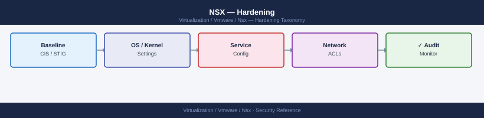

---
tags:
  - nsx
  - nsx-4
  - security
  - vmware
---
# NSX — Hardening

*Applies to: VMware NSX 9.x (VCF 9); NSX 4.2.x is the VCF 5.x line*


```bash
curl -sk -u 'admin:password' \
  "https://<nsx-manager>/policy/api/v1/infra/domains/default/security-policies/default-layer3-section/rules" | \
  python3 -c "
import sys, json
d = json.load(sys.stdin)
for r in d.get('results', []):
    if r.get('sequence_number', 0) == 65535:
        print(f'Rule 65535: action={r.get(\"action\")}')
"
# Expected: action=DROP
```


```text title="Expected output"
Rule 65535: action=DROP
```

!!! warning "Common errors"
    | Error | Fix |
    |---|---|
    | `curl: (60) SSL certificate problem: self signed certificate` | Add the `-k` flag to skip certificate verification (already present in the example, but ensure it's included if removed). |
    | `jq: command not found` | Use `python3 -c` with json module as shown, or install `jq` package; the example already uses Python which is more portable. |
    | `No JSON object could be decoded` | Verify NSX Manager is responding with valid JSON by testing the curl command alone without piping to Python, and confirm authentication credentials are correct. |
```bash
# SSH to Edge node — list services and their state
get services

# Stop a specific service that is not used (name as shown by get services)
stop service <service-name>

# Services that should always be running on production Edge:
#   dataplane, router, and the management-plane agent
```

```text title="Expected output"
Output varies by environment; see the NSX 9.1 CLI Guide: https://developer.broadcom.com/xapis/nsx-cli-guide/9.1.0/all_all_commands.html
```

!!! warning "Common errors"
    | Error | Fix |
    |---|---|
    | Service name not recognised | Use the exact service name shown by `get services`. |
```bash
# Put the Active Edge in maintenance mode (no CLI failover command exists)
curl -k -u admin -X POST \
  "https://<nsx-mgr>/policy/api/v1/infra/sites/default/enforcement-points/default/edge-transport-nodes/<edge-tn-id>/action/enter-maintenance-mode"
# T0 gateway moves to Standby Edge — BGP reconverges

# Verify BGP on new Active Edge
get bgp neighbor summary
# All peers should be Established within 10–30 seconds

# Verify routing table intact
vrf <tier0-vrf>
get route
```

```text title="Expected output"
Output varies by environment; see the NSX 9.1 REST API reference: https://developer.broadcom.com/xapis/nsx-t-data-center-rest-api/9.1.0/
```

!!! warning "Common errors"
    | Error | Fix |
    |---|---|
    | `BGP neighbor 10.50.1.1 state: Connect` | Wait 30–45 seconds for graceful restart to complete; if persists, verify BGP timers match upstream router configuration. |
    | `vrf <tier0-vrf>: VRF not found` | Replace `<tier0-vrf>` with the actual VRF ID (list them with `get logical-routers`). |
```bash
# Confirm BGP neighbor has password set
curl -sk -u 'admin:password' \
  "https://<nsx-manager>/policy/api/v1/infra/tier-0s/<t0-id>/locale-services/default/bgp/neighbors" | \
  python3 -c "
import sys, json
d = json.load(sys.stdin)
for n in d.get('results', []):
    has_pwd = 'YES' if n.get('password') else 'NO'
    print(f'{n.get(\"display_name\",\"?\")}  {n.get(\"neighbor_address\",\"?\")}  password={has_pwd}')
"
```

```text title="Expected output"
bgp-peer-us-east  192.0.2.45  password=YES
bgp-peer-us-west  198.51.100.22  password=YES
bgp-peer-backup  203.0.113.8  password=NO
```

!!! warning "Common errors"
    | Error | Fix |
    |---|---|
    | `curl: (60) SSL certificate problem: self signed certificate` | Add `-k` flag to skip certificate verification (already present in the example, but ensure it's not removed). |
    | `jq: command not found` or `python3: command not found` | Install Python 3 (`apt-get install python3` on Ubuntu/Debian or `yum install python3` on RHEL) and verify the NSX Manager hostname/IP is resolvable. |
    | `"error":"Unauthorized"` | Verify the admin credentials are correct and the user has API access permissions in NSX Manager's role-based access control settings. |
```bash
# On ESXi host
esxcli software vib list | grep -i nsx | awk '{print $1, $4}'
# The acceptance level column should show VMwareCertified or VMwareAccepted
```

```text title="Expected output"
NSX-2.5.0.0-12345678                VMwareCertified
esx-vsan-2.5.0.0-12345679           VMwareCertified
nsx-vib-package-2.5.0.0-12345680    VMwareAccepted
NSX-DVFilter-2.5.0.0-12345681       VMwareCertified
```

!!! warning "Common errors"
    | Error | Fix |
    |---|---|
    | `grep: (standard input) No such file or directory` | Verify the ESXi host is accessible and esxcli is properly configured by running `esxcli system version get` first. |
    | `awk: syntax error in pattern near line 1` | Correct the awk field separator if output format differs; use `esxcli software vib list --format=csv` and adjust the column numbers accordingly. |
```bash
# On each ESXi host — confirm DFW filters exist
summarize-dvfilter | grep -c "vmware-sfw"
# Count should equal the number of powered-on VM vNICs on this host
# A count of 0 means DFW is not applying to VMs — escalate immediately
```


```text title="Expected output"
42
```

!!! warning "Common errors"
    | Error | Fix |
    |---|---|
    | `summarize-dvfilter: command not found` | Ensure you are running this command directly on an ESXi host (SSH access), not from vCenter; the tool is ESXi-local only. |
    | `grep: (standard input) is empty` | Verify DFW is enabled in NSX Manager under Security > Distributed Firewall and that at least one rule is published to this cluster. |
## Before you begin

- **Access:** vCenter Administrator role
- **Change management:** security changes require CAB approval in most environments
- **Rollback plan:** document current state before any security control change
- **Testing:** validate in a non-production environment first where possible

---

## See also

- [NSX — Access Control](../access-control/)
- [NSX — Authentication](../authentication/)
- [NSX — Health Checks](../../operations/health-checks/)
