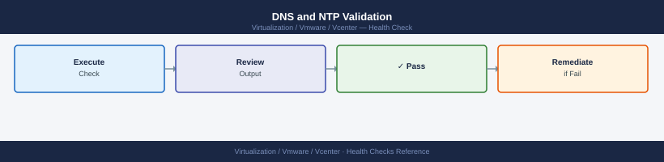

---
tags:
  - operations
  - vcenter
  - vmware
  - vsphere-8
description: "Health Checks reference covering Disk Partition Usage, SSO and Lookup Service Health, DNS and NTP Validation, PowerCLI Health Checks, Daily Checks and 2..."
---
# vCenter — Health Checks

<div class="kb-summary">
Health Checks reference covering Disk Partition Usage, SSO and Lookup Service Health, DNS and NTP Validation, PowerCLI Health Checks, Daily Checks and 2 more sections.

*Applies to: vCenter 9.x (VCF/VVF 9) · vCenter 8.0 U3 (EoGS 2027-10-11)*
</div>

## Before you begin

- **Access:** vCenter read-only minimum; Administrator role for remediation steps
- **Timing:** safe to run during business hours unless a step is marked ⚠ (causes interruption)
- **Dependencies:** no active upgrades or migrations on the same infrastructure
- **Logging:** capture command output — paste into the change record on completion

---

## Run This Routine

Run these commands in sequence for a complete vCenter health snapshot. Each block can be pasted directly into an SSH session on the VCSA appliance shell.

```bash
# 1. VCSA service health — status of all services (KB 344633)
service-control --status --all

# 2. vCenter version and build number
# VAMI https://<vcenter>:5480 → Summary, or GET /api/appliance/system/version

# 3. SSO / Lookup Service health (service names per KB 344633)
service-control --status vmware-stsd
service-control --status lookupsvc

# 4. Certificate store list — inspect VECS stores for expiring certs
/usr/lib/vmware-vmafd/bin/vecs-cli store list

# 5. Disk usage — key VCSA partitions: DB, logs, seat data
df -h /storage/db /storage/log /storage/seat

# 6. vCenter HA state (only if VCHA is deployed)
# vSphere Client → vCenter → Configure → vCenter HA, or POST /api/vcenter/vcha/cluster?action=get

# 7. NTP sync status — confirm clock is synchronised
timedatectl status

# 8. Connected host count via REST API — create a session first (POST /api/session)
# Replace credentials before running
TOKEN=$(curl -sk -u 'administrator@vsphere.local:<password>' \
  -X POST https://localhost/api/session | tr -d '"')
curl -sk -H "vmware-api-session-id: $TOKEN" \
  https://localhost/api/vcenter/host | python3 -m json.tool | grep -c connection_state

# 9. Recent vpxd errors — last 100 lines of the main vCenter log
tail -100 /var/log/vmware/vpxd/vpxd.log | grep -i error

# 10. Backup schedule — file-based backups are scheduled in VAMI (https://<vcenter>:5480 → Backup)
# (KB 318731 recommends VAMI) or with the Appliance Recovery Backup Schedules API
curl -sk -H "vmware-api-session-id: $TOKEN" \
  https://localhost/api/appliance/recovery/backup/schedules
```


```text title="Expected output"
Output varies by environment and build; see https://knowledge.broadcom.com/external/article/344633/stopping-starting-or-restarting-vmware-v.html (service-control) and https://developer.broadcom.com/xapis/vsphere-automation-api/latest/api/appliance/recovery/backup/schedules/get/ (backup schedules API).
```

!!! warning "Common errors"
    | Error | Fix |
    |---|---|
    | `curl: (60) SSL certificate problem: self signed certificate` | Add `-k` flag to skip certificate verification (already present in example; if still failing, verify curl is installed with `which curl`). |
    | `/var/log/vmware/vpxd/vpxd.log: No such file or directory` | Verify vpxd service is running with `service-control --status vmware-vpxd` and check log location with `find /var/log -name vpxd.log`. |
Key partitions to monitor:
- `/storage/log` — fills quickly during issues
- `/storage/db` — vCenter database
- `/storage/core` — core appliance data

## SSO and Lookup Service Health


```bash
service-control --status vmware-stsd
service-control --status lookupsvc
service-control --status vmware-eam
```


```text title="Expected output"
Output varies by environment and build; see https://knowledge.broadcom.com/external/article/344633/stopping-starting-or-restarting-vmware-v.html (service names and service-control usage).
```

!!! warning "Common errors"
    | Error | Fix |
    |---|---|
    | `service-control: command not found` | Ensure you are running this command on the vCenter Server appliance (VCSA) with root privileges, as `service-control` is only available in the vCenter environment. |
    | `vmware-stsd` reported as stopped | Start the Security Token Service with `service-control --start vmware-stsd` (KB 344633). |
## DNS and NTP Validation



```bash
# Check DNS from vCenter appliance shell
nslookup <vcenter-fqdn>
dig <vcenter-fqdn>

# Check NTP status
timedatectl
```


```text title="Expected output"
Server:		10.0.0.1
Address:	10.0.0.1#53

Name:	vcenter.example.com
Address: 192.168.1.50

; <<>> DiG 9.11.4-P8-RedHat-9.11.4-26.P2-el7 <<>> vcenter.example.com
;; global options: +cmd
;; Got answer:
;; ->>HEADER<<- opcode: QUERY, status: NOERROR, id: 54321
;; QUESTION SECTION:
;vcenter.example.com.		IN	A

;; ANSWER SECTION:
vcenter.example.com.	300	IN	A	192.168.1.50

;; Query time: 2 msec
;; SERVER: 10.0.0.1#53(10.0.0.1)

               Local time: Wed 2024-01-10 14:32:45 UTC
           Universal time: Wed 2024-01-10 14:32:45 UTC
                 RTC time: Wed 2024-01-10 14:32:44
                Time zone: UTC (UTC, +0000)
System clock synchronized: yes
              NTP service: active
       RTC in local TZ: no
```

!!! warning "Common errors"
    | Error | Fix |
    |---|---|
    | `nslookup: command not found` | Install bind-utils package with `yum install bind-utils` or use `dig` instead. |
    | `connection timed out; no servers could be reached` | Verify DNS server IP is correct in `/etc/resolv.conf` and network connectivity to the DNS server exists. |
    | `System clock synchronized: no` | Restart the NTP service with `systemctl restart ntp` or `systemctl restart chrony` depending on your time daemon. |
## PowerCLI Health Checks


```powershell
# Host connectivity
Get-VMHost | Select-Object Name, ConnectionState, PowerState

# Cluster DRS/HA state
Get-Cluster | Select-Object Name, DrsEnabled, HAEnabled

# Recent error events
Get-VIEvent -MaxSamples 100 -Type Error | Select-Object CreatedTime, FullFormattedMessage

# Stale snapshots
Get-VM | Get-Snapshot | Where-Object {$_.Created -lt (Get-Date).AddDays(-3)} | Select-Object VM, Name, Created

# Appliance health via REST API (returns green / yellow / orange / red / gray)
# Session token from POST /api/session; reference: https://developer.broadcom.com/xapis/vsphere-automation-api/latest/api/appliance/health/system/get/
curl -sk -H "vmware-api-session-id: <session-id>" https://<vcenter>/api/appliance/health/system
```

## Daily Checks


| Check | Command | Notes |
|---|---|---|
| vCenter GUI accessible | Browser to `https://<vcenter>/ui` | All VCSA services should be healthy |
| DRS and HA enabled | `Get-Cluster \| Select Name,DrsEnabled,HAEnabled` | Should be enabled on all production clusters |
| Hosts connected | `Get-VMHost \| Where-Object {$_.ConnectionState -ne "Connected"}` | Result should be empty |
| Unexpected powered-off VMs | `Get-VM \| Where-Object {$_.PowerState -eq "PoweredOff"}` | Flag unexpected powered-off VMs |
| Snapshots older than 3 days | `Get-VM \| Get-Snapshot \| Where-Object {$_.Created -lt (Get-Date).AddDays(-3)}` | Flag old snapshots |
| Certificate expiry | VAMI → Certificate Management | Flag any expiring within 60 days |
| Recent task failures | vCenter Monitor → Tasks | Review error-level tasks |

## Change Readiness Checklist

- [ ] vCenter backup is current — file-based backup or VAMI snapshot completed and verified
- [ ] No active DRS migrations in progress — confirm vCenter Tasks pane is idle
- [ ] HA admission control capacity checked
- [ ] Certificates valid for more than 30 days
- [ ] SSO and PSC health confirmed before any appliance-level change
- [ ] Rollback plan documented: VCSA restore procedure confirmed and tested
- [ ] Change window approved and communicated to all dependent teams

## When to Restore from Backup

Troubleshoot first if:
- Services can be restarted and recovered
- Disk space can be freed to restore normal function
- A single certificate or SSO issue can be repaired in place

Restore from backup if:
- Database is corrupt
- STS certificate cannot be repaired
- Services fail to start after all troubleshooting steps
- The appliance is unrecoverable after a hardware or VM failure

---

## See also

- [vCenter Troubleshooting — Common Issues](../../troubleshooting/common-issues/)
- [vCenter — Procedures](../procedures/)
- [vCenter — CLI Reference (PowerCLI & DCLI)](../cli-reference/)

## Verify

- **Alarms:** vSphere Client → Home → Alarms — no new critical alarms after the operation
- **Events:** monitor the vCenter Events view for the affected object for 5 minutes
- **Health check:** run the morning health-check sequence for the affected product tier
