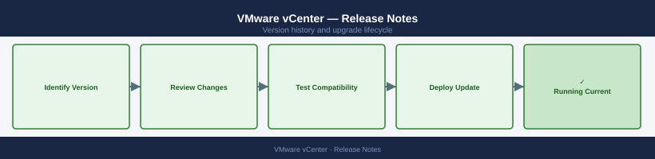

---
tags:
  - vcenter
  - vmware
  - vsphere-8
description: "Version history and release notes for VMware vCenter."
---
# VMware vCenter — Release Notes

*Applies to: vCenter 9.x (VCF/VVF 9) · vCenter 8.0 U3 (EoGS 2027-10-11)*

Version history and release notes for VMware vCenter.

## Version History

Versions, release dates and builds below are taken from Broadcom [KB 326316](https://knowledge.broadcom.com/external/article/326316/vmware-vcenter-server-versions-and-build.html) (checked 2026-11-25).

| Version | Released | Build | Notes | Source |
|---------|----------|-------|-------|--------|
| 9.1.2.0 | 2026-11-24 | 25946533 | Latest vCenter 9.1 release | [KB 326316](https://knowledge.broadcom.com/external/article/326316/vmware-vcenter-server-versions-and-build.html) |
| 9.1.1.0 | 2026-09-03 | 25712839 | vCenter 9.1 update | [KB 326316](https://knowledge.broadcom.com/external/article/326316/vmware-vcenter-server-versions-and-build.html) |
| 9.1 | 2026-05-12 | 25370922 | vCenter 9.1 GA | [KB 326316](https://knowledge.broadcom.com/external/article/326316/vmware-vcenter-server-versions-and-build.html) |
| 9.0.2.0200 | 2026-11-19 | 25901331 | Latest vCenter 9.0 release | [KB 326316](https://knowledge.broadcom.com/external/article/326316/vmware-vcenter-server-versions-and-build.html) |
| 9.0.0.0 | 2025-06-17 | 24755230 | vCenter 9.0 GA | [KB 326316](https://knowledge.broadcom.com/external/article/326316/vmware-vcenter-server-versions-and-build.html) |
| 8.0 U3m (8.0.3.01200) | 2026-11-19 | 25934264 | Latest 8.0 patch; vCenter 8.x EoGS 2027-10-11 ([KB 459135](https://knowledge.broadcom.com/external/article/459135/end-of-general-support-for-vsphere-80.html)) | [KB 326316](https://knowledge.broadcom.com/external/article/326316/vmware-vcenter-server-versions-and-build.html) |
| 8.0 U3 (8.0.3.00000) | 2024-06-25 | 24022515 | vCenter 8.0 Update 3 | [KB 326316](https://knowledge.broadcom.com/external/article/326316/vmware-vcenter-server-versions-and-build.html) |
| 8.0 U2 (8.0.2.00000) | 2023-09-21 | 22385739 | vCenter 8.0 Update 2 | [KB 326316](https://knowledge.broadcom.com/external/article/326316/vmware-vcenter-server-versions-and-build.html) |
| 8.0 U1 (8.0.1.00000) | 2023-04-18 | 21560480 | vCenter 8.0 Update 1 | [KB 326316](https://knowledge.broadcom.com/external/article/326316/vmware-vcenter-server-versions-and-build.html) |
| 8.0 GA (8.0.0.10000) | 2022-10-11 | 20519528 | vCenter 8.0 GA | [KB 326316](https://knowledge.broadcom.com/external/article/326316/vmware-vcenter-server-versions-and-build.html) |
| 7.0 U3w (7.0.3.02500) | 2025-09-29 | 24927011 | Latest 7.0 patch listed | [KB 326316](https://knowledge.broadcom.com/external/article/326316/vmware-vcenter-server-versions-and-build.html) |
| 7.0 U3 (7.0.3.00000) | 2021-10-05 | 18700403 | vCenter 7.0 Update 3 | [KB 326316](https://knowledge.broadcom.com/external/article/326316/vmware-vcenter-server-versions-and-build.html) |

## Key Terminology

**Major Version**
: A release containing significant new features or architectural changes; may require additional planning and testing.

**Patch Release**
: A targeted fix release that addresses bugs or security issues within a major/minor version.

**EOL (End of Life)**
: Date after which the vendor no longer provides updates, security patches, or technical support.

**Upgrade Path**
: The supported sequence of versions a system must traverse to reach a target version (some versions cannot be skipped).

## Upgrade Path

Upgrade vCenter Server using the VMware vCenter Server Installer or VAMI. Always upgrade vCenter before ESXi hosts. Ensure the target version is compatible with all managed hosts using the [VMware Product Interoperability Matrix](https://interopmatrix.vmware.com/). Snapshot the vCenter appliance VM before beginning. Post-upgrade, verify vCenter HA and Plugin compatibility.
