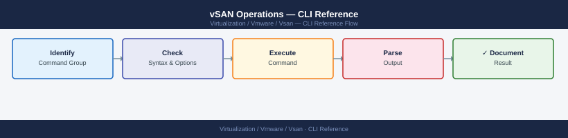

---
tags:
  - operations
  - vmware
  - vsan
  - vsphere-8
description: "Commonly used ESXi shell and PowerCLI commands for managing and troubleshooting vSAN clusters. vSAN is VMware's hyper-converged storage solution — it..."
---
# vSAN Operations — CLI Reference

<div class="kb-summary">
Commonly used ESXi shell and PowerCLI commands for managing and troubleshooting vSAN clusters. vSAN is VMware's hyper-converged storage solution — it pools the local disks of multiple ESXi hosts into a shared datastore.

*Applies to: vSAN 9.x (VCF/VVF 9) · vSAN 8.0 U3 (EoGS 2027-10-11)*
</div>


## Before you begin

- **Access:** vCenter read-only minimum; Administrator role for remediation steps
- **Timing:** safe to run during business hours unless a step is marked ⚠ (causes interruption)
- **Dependencies:** no active upgrades or migrations on the same infrastructure
- **Logging:** capture command output — paste into the change record on completion

---

## Quick Reference

| Task | Command |
|---|---|
| Cluster membership and health | `esxcli vsan cluster get` |
| List all health checks and status | `esxcli vsan health cluster list` |
| Details for one health check | `esxcli vsan health cluster get -t "<test name>"` |
| List disk groups | `esxcli vsan storage list` |
| Object health summary | `esxcli vsan debug object list \| grep -v healthy` |
| Resync queue | `esxcli vsan debug resync summary get` |
| Resync detail | `esxcli vsan debug resync list` |
| Check resync throttle | `esxcli vsan resync throttle get` |
| Set resync throttle (Mbps, 0-512; 0 = no throttling) | `esxcli vsan resync throttle set --level 500` |
| Network performance test (PowerCLI) | `Test-VsanNetworkPerformance -Cluster <cluster>` |
| MTU jumbo frame test | `vmkping -I vmk2 -d -s 8972 <peer_vmk_ip>` |
| Add disk group | `esxcli vsan storage add -s <ssd_naa> -d <cap_naa>` |
| Remove disk group | `esxcli vsan storage remove -s <ssd_naa>` |
| Performance service status | `esxcli vsan perf get` |
| Per-VMDK performance stats | `esxcli vsan debug vmdk list` |
| Per-disk vSAN detail (health, capacity) | `esxcli vsan debug disk list` |

---

## Skyline Health

**From vCenter UI:**
Cluster → Monitor → vSAN → Skyline Health

Equivalent CLI commands (run from any host in the cluster):

```bash
esxcli vsan health cluster list
esxcli vsan health cluster get -t "<test name>"
```


```text
Output varies by release and cluster state; see https://developer.broadcom.com/xapis/esxcli-command-reference/9.0.0/namespace/esxcli_vsan.html
```

!!! warning "Common errors"
    | Error | Fix |
    |---|---|
    | `Error: Unknown command or namespace vsan health` | Verify vSAN is licensed and enabled on the cluster; run `esxcli vsan cluster get` to confirm vSAN is active. |
    | `Error: Unable to connect to vSAN cluster` | Ensure the ESXi host is part of a vSAN cluster and network connectivity exists between cluster members. |
Check performance service status:

```bash
esxcli vsan perf get
```


```text title="Expected output"
Virtual SAN Performance Monitoring
==================================

Cluster UUID: 52d4a8f2-1c3e-4f9a-b2e1-7a9c3d5f8e1b
Cluster Name: prod-vsan-cluster-01

Performance Metrics (Last 5 minutes):
  Read Latency (ms):        2.34
  Write Latency (ms):       3.87
  Read Throughput (MB/s):   1245.6
  Write Throughput (MB/s):  892.3
  IOPS (Read):              18934
  IOPS (Write):             12456
  Congestion Level:         Low
  Physical Capacity Used:   68.5%
  Logical Capacity Used:    71.2%

Disk Group Status:
  Disk Group 1: Healthy
  Disk Group 2: Healthy
  Disk Group 3: Healthy

Last Updated: 2024-01-15 14:32:18 UTC
```

!!! warning "Common errors"
    | Error | Fix |
    |---|---|
    | `Error: Could not connect to the vSAN cluster` | Verify the ESXi host is part of an active vSAN cluster and network connectivity to vSAN management is available. |
    | `Error: Permission denied` | Ensure your user account has the required vSAN.Cluster.Read permission on the vSAN cluster object. |
    | `Error: vSAN service is not running` | Check the vSAN daemons on the host and restart the stopped one (for example `/etc/init.d/vsanmgmtd restart`), per [Broadcom KB 318410](https://knowledge.broadcom.com/external/article/318410). |
---

## Health & Diagnostics

vSAN health checks validate everything from disk capacity to network connectivity to object compliance. Run these after any hardware change or when investigating performance issues.

```bash
# Summary health (pass/fail for all health checks)
esxcli vsan health cluster list

# Detailed trace output
esxcli vsan trace get

# List all VM object components and their health
esxcli vsan debug object list

# Show only unhealthy objects (not accessible or degraded)
esxcli vsan debug object list | grep -i unhealthy

# Objects with absent components (data on a failed or removed host)
esxcli vsan debug object list | grep -i absent

# Active resync operations (rebuilds, rebalances, migrations)
esxcli vsan debug resync list
esxcli vsan debug resync summary get

# Object health summary (counts of objects per health state)
esxcli vsan debug object health summary get
```


```text
Output varies by release and cluster state; see https://developer.broadcom.com/xapis/esxcli-command-reference/9.0.0/namespace/esxcli_vsan.html
```
---

## Disk Groups

A disk group is the fundamental storage unit in vSAN. Each disk group has one cache SSD (handles writes and accelerates reads) and one or more capacity disks (where data actually lives). Each ESXi host can have up to five disk groups.

### List Disk Groups and Devices

```bash
# All vSAN storage devices — shows SSD (cache tier) and capacity disks
esxcli vsan storage list

# Summary: which SSD is the group leader for each group
esxcli vsan storage list | grep -E "Is SSD|Disk Group UUID|VSAN UUID"
```


```text title="Expected output"
Name: mpx.vmhba0:C0:T0:L0
Is SSD: true
Disk Group UUID: 522e4cf7-e8a8-4e2f-91a3-7c2d1f8b9a4d
VSAN UUID: 52534e41-4d4f-4445-a14d-7c2d1f8b9a4d
Congestion Level: 0

Name: mpx.vmhba1:C0:T1:L0
Is SSD: false
Disk Group UUID: 522e4cf7-e8a8-4e2f-91a3-7c2d1f8b9a4d
VSAN UUID: 52534e41-4d4f-4445-a14d-7c2d1f8b9a4d
Congestion Level: 0

Name: mpx.vmhba2:C0:T2:L0
Is SSD: false
Disk Group UUID: 522e4cf7-e8a8-4e2f-91a3-7c2d1f8b9a4d
VSAN UUID: 52534e41-4d4f-4445-a14d-7c2d1f8b9a4d
Congestion Level: 0

Is SSD: true
Disk Group UUID: 522e4cf7-e8a8-4e2f-91a3-7c2d1f8b9a4d
VSAN UUID: 52534e41-4d4f-4445-a14d-7c2d1f8b9a4d
Is SSD: false
Disk Group UUID: 522e4cf7-e8a8-4e2f-91a3-7c2d1f8b9a4d
VSAN UUID: 52534e41-4d4f-4445-a14d-7c2d1f8b9a4d
Is SSD: false
Disk Group UUID: 522e4cf7-e8a8-4e2f-91a3-7c2d1f8b9a4d
VSAN UUID: 52534e41-4d4f-4445-a14d-7c2d1f8b9a4d
```

!!! warning "Common errors"
    | Error | Fix |
    |---|---|
    | `Error: Unknown command or namespace vsan storage` | Verify vSAN is installed and enabled on the host by running `esxcli vsan cluster get`. |
    | `Error: Permission denied` | Run the command with root privileges or ensure your user account has vSAN admin permissions in vCenter. |
### Disk and Group Statistics

```bash
# Per-disk vSAN detail (health, capacity, congestion); I/O metrics come from the
# vSAN performance service (vSphere Client or PowerCLI Get-VsanStat)
esxcli vsan debug disk list

# Per-disk detail (include health state)
esxcli vsan storage list | grep -E "naa\.|Health|State"
```


```text
Output varies by release and cluster state; see https://developer.broadcom.com/xapis/esxcli-command-reference/9.0.0/namespace/esxcli_vsan.html
```

!!! warning "Common errors"
    | Error | Fix |
    |---|---|
    | `Error: Could not connect to the local vSAN cluster` | Verify vSAN is enabled on the cluster and the ESXi host is a vSAN participant using `esxcli vsan cluster get`. |
    | `Error: No such command or namespace` | Ensure you are running the command on an ESXi host with vSAN enabled; this command is not available on non-vSAN hosts. |
### Add Disks / Create Disk Group

```bash
# Add a cache SSD and one or more capacity disks (creates new disk group)
esxcli vsan storage add -s <ssd_naa> -d <capacity_naa1> -d <capacity_naa2>

# Add capacity disk to existing disk group
esxcli vsan storage add -s <existing_ssd_naa> -d <new_capacity_naa>
```


```text title="Expected output"
Adding disk group to vSAN cluster...
Disk group UUID: 564e5c42-a123-b456-c789-d0e1f2a3b4c5
Cache disk: naa.60014056b8e4567890abcdef12345678
Capacity disk 1: naa.60014056b8e4567890abcdef87654321
Capacity disk 2: naa.60014056b8e4567890abcdef11223344
Disk group successfully created and added to cluster.

Adding capacity disk to existing disk group...
Disk group UUID: 564e5c42-a123-b456-c789-d0e1f2a3b4c5
New capacity disk: naa.60014056b8e4567890abcdef99887766
Disk successfully added to disk group.
vSAN rebalancing initiated.
```

!!! warning "Common errors"
    | Error | Fix |
    |---|---|
    | `Error: The specified disk is already in use by another disk group or VMFS datastore` | Ensure the disk is not already claimed by vSAN or another storage system by running `esxcli storage core device list` and checking the attachment status. |
    | `Error: Cache disk (SSD) and capacity disk must be different devices` | Verify you are specifying different NAA identifiers for the `-s` (cache) and `-d` (capacity) parameters. |
    | `Error: Disk group does not exist or SSD is not a valid cache device` | Confirm the SSD NAA is correct and the disk group UUID exists by running `esxcli vsan storage list`. |
### Evacuate Before Removal

Always evacuate data before removing a disk — otherwise object components go absent. `esxcli` has no standalone evacuate command: check the impact with the evacuation pre-check, then evacuate as part of the removal with `-m evacuateAllData`:

```bash
# Pre-check: what it takes to evacuate this disk, disk group or host
esxcli vsan debug evacuation precheck -e <device_naa>

# Remove the disk and evacuate all of its data first
esxcli vsan storage remove -d <device_naa> -m evacuateAllData

# Check resync progress during evacuation
esxcli vsan debug resync list

# Confirm no remaining data on disk
esxcli vsan storage list | grep <device_naa>
```


```text
Output varies by release and cluster state; see https://developer.broadcom.com/xapis/esxcli-command-reference/9.0.0/namespace/esxcli_vsan.html
```

!!! warning "Common errors"
    | Error | Fix |
    |---|---|
    | `Error: Device naa.5001405a1b2c3d4e is not a vSAN disk` | Verify the device NAA identifier is correct by running `esxcli vsan storage list` and matching the exact device name. |
    | `Error: Evacuation failed — insufficient free space on cluster` | Ensure the cluster has at least 30% free capacity before evacuating; add hosts or expand existing disks if needed. |
    | `Error: Device is in use by another operation` | Wait for any ongoing rebalancing or maintenance operations to complete, or check `esxcli vsan debug resync list` for blocking tasks. |
!!! danger "Removes entire disk group — triggers rebuild"
    `esxcli vsan storage remove -s` removes the cache SSD and all associated capacity disks as a unit. All vSAN objects on that disk group are evacuated to other nodes before removal. Do not run if the cluster has degraded objects or insufficient free space (< 25%). Always verify with `esxcli vsan health cluster list` before proceeding.

### Remove a Disk Group

```bash
# Remove a cache SSD (removes entire disk group — evacuate first)
esxcli vsan storage remove -s <ssd_naa>

# Remove a single capacity disk from a group
esxcli vsan storage remove -d <capacity_naa>
```


```text title="Expected output"
Removing disk group with cache SSD naa.5001b1c58d2e4f9a...
Evacuation in progress: 45% complete
Disk group removal initiated successfully
VSAN cluster rebalancing started

Removing capacity disk naa.5001b1c58d2e4f9b from disk group...
Capacity disk removal initiated successfully
Resyncing remaining disks in group
```

!!! warning "Common errors"
    | Error | Fix |
    |---|---|
    | `Error: Disk group is not empty. Please evacuate data before removal.` | Run `esxcli vsan debug evacuation precheck -e <ssd_naa>`, then remove with `esxcli vsan storage remove -s <ssd_naa> -m evacuateAllData`. |
    | `Error: Invalid NAA identifier <ssd_naa>. Disk not found.` | Verify the correct NAA ID using `esxcli vsan storage list` and ensure you're using the full naa.* format. |
    | `Error: Cannot remove capacity disk while rebalancing is in progress.` | Wait for the current rebalancing operation to complete using `esxcli vsan cluster get` before attempting removal. |
### Disk Group Health

```bash
# Check for degraded or absent components
esxcli vsan debug object list | grep -v healthy

# vSAN health check — disk layer
esxcli vsan health cluster list | grep -i disk

# Object health summary
esxcli vsan debug object health summary get
```


```text
Output varies by release and cluster state; see https://developer.broadcom.com/xapis/esxcli-command-reference/9.0.0/namespace/esxcli_vsan.html
```

!!! warning "Common errors"
    | Error | Fix |
    |---|---|
    | `Error: Could not connect to the vSAN health service` | Ensure vSAN is enabled on the cluster and the vSAN health service is running with `esxcli vsan cluster get`. |
    | `Error: Unknown command or namespace` | Verify you are running this command on a vSAN-enabled ESXi host; non-vSAN hosts do not support the `esxcli vsan` namespace. |
### Disk Group Best Practices

| Guideline | Reason |
|---|---|
| 1 SSD : 7 capacity disks max | Beyond 7, cache hit rate drops significantly |
| Evacuate before any disk removal | Prevents component loss |
| Match capacity disk sizes within a group | Avoids uneven wear and wasted space |
| Check `esxcli vsan debug resync list` before maintenance | Ensure no active rebuild before removing another disk |
| Replace failed disk within 24h | vSAN has single-failure tolerance — second failure = data loss |

---

## Networking (vSAN VMkernel)

vSAN requires a dedicated VMkernel adapter tagged for vSAN traffic. All hosts in the cluster communicate via this interface using unicast (since vSAN 6.6). MTU should be 9000 (jumbo frames) end-to-end for best performance.

### vSAN VMkernel Adapters

```bash
# List VMkernel adapters tagged for vSAN traffic
esxcli vsan network list

# Unicast agent list — shows the peer IPs this host sends vSAN traffic to
esxcli vsan cluster unicastagent list
```


```text
Output varies by release and cluster state; see https://developer.broadcom.com/xapis/esxcli-command-reference/9.0.0/namespace/esxcli_vsan.html
```

!!! warning "Common errors"
    | Error | Fix |
    |---|---|
    | `Error: Could not retrieve vSAN network information` | Verify the host is vSAN-enabled with `esxcli vsan cluster get`; if a vSAN daemon is stopped, restart it per [Broadcom KB 318410](https://knowledge.broadcom.com/external/article/318410). |
    | `Error: No vSAN VMkernel adapters found` | Ensure at least one VMkernel adapter is tagged for vSAN traffic in the host's networking configuration. |
### Connectivity Test

`esxcli vsan` has no network test command. Use the vSAN network performance test from PowerCLI (or the vSAN health network checks), and `vmkping` for per-peer checks:

```powershell
# vSAN network performance test across the cluster (PowerCLI, VMware.VimAutomation.Storage)
Test-VsanNetworkPerformance -Cluster <cluster>
```


```text
Output varies; see the cmdlet help in VMware.VimAutomation.Storage: https://www.powershellgallery.com/packages/VMware.VimAutomation.Storage/13.5.2.25952617
```

!!! warning "Common errors"
    | Error | Fix |
    |---|---|
    | `Error: vSAN is not enabled on this host` | Enable vSAN on the ESXi host via the vSphere Client or run `esxcli vsan cluster join`. |
    | `Error: Could not resolve peer hostname` | Verify DNS resolution is working with `nslookup` or check `/etc/hosts` entries for all cluster nodes. |
    | `Error: Network timeout - UDP port 12345 blocked` | Confirm firewall rules allow vSAN traffic on the management network and check vSAN network configuration in vSphere Client. |
### Verifying VMkernel Tagging

```bash
# Confirm vmk is tagged for vSAN
esxcli network ip interface tag get -i vmk2

# Expected output includes: VSAN

# Add vSAN tag to a VMkernel (if missing)
esxcli network ip interface tag add -i vmk2 -t VSAN
```


```text title="Expected output"
Name: vmk2
  IPv4 Address: 192.168.100.45
  IPv6 Address: ::1
  Netstack Instance: vsan
  MAC Address: 00:50:56:c0:00:02
  MTU: 1500
  TSO MSS: 65535
  Enabled: true
  Broadcast: true
  Tags: VSAN
(no output — command completes silently)
```

!!! warning "Common errors"
    | Error | Fix |
    |---|---|
    | `Error: Unknown option or malformed command line.` | Verify the VMkernel interface name is correct (e.g., `vmk2` not `vmk02`) and use lowercase `-i` and `-t` flags. |
    | `Error: The object or item referenced by the supplied identifier is not found.` | Confirm the VMkernel interface exists with `esxcli network ip interface list` before attempting to tag it. |
    | `Error: The VSAN tag is already configured on this interface.` | The interface already has the VSAN tag; skip the `add` command or use `tag remove` first if reconfiguring. |
### MTU Verification

vSAN performs best with jumbo frames (MTU 9000) end-to-end:

```bash
# Check VMkernel MTU
esxcli network ip interface list | grep -A5 vmk2

# Test large packet through physical switches (ping with don't-fragment)
vmkping -I vmk2 -d -s 8972 <peer_vmk_ip>
# Expected: no packet loss. If loss occurs — switch or NIC MTU mismatch
```


```text title="Expected output"
Name: vmk2
Enabled: true
Connected: true
Portset: vSAN
MAC Address: 00:50:56:a1:2c:f4
IPv4 Address: 192.168.100.42
IPv4 Netmask: 255.255.255.0
IPv6 Address: fe80::250:56ff:fea1:2cf4
MTU: 9000
TSO MSS: 65535
NetStack Instance: vsan

PING 192.168.100.43 (192.168.100.43): 8972 data bytes
8980 bytes from 192.168.100.43: icmp_seq=0 time=1.234 ms
8980 bytes from 192.168.100.43: icmp_seq=1 time=1.156 ms
8980 bytes from 192.168.100.43: icmp_seq=2 time=1.289 ms
8980 bytes from 192.168.100.43: icmp_seq=3 time=1.201 ms
--- 192.168.100.43 statistics ---
4 packets transmitted, 4 packets received, 0% packet loss
round-trip min/avg/max = 1.156/1.220/1.289 ms
```

!!! warning "Common errors"
    | Error | Fix |
    |---|---|
    | `PING 192.168.100.43 (192.168.100.43): 8972 data bytes --- 4 packets transmitted, 0 packets received, 100% packet loss` | Verify MTU is set to 9000 on both the ESXi host and the peer host's vSAN vmkernel interface, and check physical switch port configuration for matching MTU. |
    | `Unknown command or namespace vmkping` | Ensure you are running the command directly on the ESXi host console or via SSH; vmkping is not available from vCenter or remote shells. |
    | `Name: vmk2 does not exist` | Confirm the vSAN vmkernel interface is created and bound to the vSAN network stack using `esxcli vsan network list`. |
### Network Configuration Commands

```bash
# Add a vSAN VMkernel
esxcli vsan network ip add -i vmk2

# Remove a VMkernel from vSAN network config
esxcli vsan network ip remove -i vmk2
```


```text title="Expected output"
(no output — command completes silently)
(no output — command completes silently)
```

!!! warning "Common errors"
    | Error | Fix |
    |---|---|
    | `Error: Unable to find vmkernel adapter vmk2` | Verify the VMkernel interface exists with `esxcli network ip interface list` before adding it to vSAN. |
    | `Error: VMkernel vmk2 is not configured for vSAN` | Ensure the interface was previously added to vSAN with the add command before attempting to remove it. |
### Network Troubleshooting

| Symptom | Check |
|---|---|
| Cluster health: Network issues | `Test-VsanNetworkPerformance -Cluster <cluster>` (PowerCLI) and Skyline Health network checks |
| High vSAN latency | `vmkping -d -s 8972` — check MTU along path |
| Host isolated from cluster | `esxcli vsan cluster unicastagent list` — unicast agents populated? |
| vSAN VMkernel missing | `esxcli network ip interface tag get` — VSAN tag present? |

---

## PowerCLI — vSAN

PowerCLI provides a scripting interface to vSAN via vCenter. Use this for automation, scheduled health checks, and capacity reporting across multiple clusters.

```powershell
# Connect to vCenter
Connect-VIServer <vcenter>

# Cluster configuration
Get-VsanClusterConfiguration -Cluster <cluster>

# Health check (equivalent of Skyline Health UI)
Test-VsanClusterHealth -Cluster <cluster>

# Disk groups for a specific host
Get-VsanDiskGroup -VMHost <host>

# Disk inventory for a host
Get-VsanDisk -VMHost <host>

# Resync status — active rebuilds and rebalances
Get-VsanResyncingOverview -Cluster <cluster>
Get-VsanResyncingComponent -Cluster <cluster>

# Capacity usage
Get-VsanSpaceUsage -Cluster <cluster>

# Fault domains
Get-VsanFaultDomain -Cluster <cluster>

# Full vSAN health check via API (detailed)
$vhs = Get-VsanView -Id VsanVcClusterHealthSystem-vsan-cluster-health-system
$vhs.VsanQueryVcClusterHealthSummary(
    (Get-Cluster <cluster>).ExtensionData.MoRef,
    $null, $null, $true, $null, $null, 'defaultView'
)
```

---

## RVC Commands (Legacy)

!!! warning "RVC is deprecated starting with VCF 9.0"
    Starting with VCF 9.0, the Ruby vSphere Console (RVC) and its Ruby components (Rbvmomi) in vCenter are deprecated; Broadcom recommends PowerCLI, DCLI or the vCenter UI instead ([VCF 9.0 vSAN product support notes](https://techdocs.broadcom.com/us/en/vmware-cis/vcf/vcf-9-0-and-later/9-0/release-notes/vmware-cloud-foundation-90-release-notes/platform-product-support-notes/product-support-notes-vsan.html)). The commands below are legacy, for vSAN 8.x and earlier, and use only command names listed in [Broadcom KB 326527](https://knowledge.broadcom.com/external/article/326527).

RVC (Ruby vSphere Console) was the primary vSAN diagnostic tool before vSAN 6.7. Most workflows have moved to `esxcli vsan`, PowerCLI and the Skyline Health UI.

### Connecting to RVC

```bash
# SSH to vCenter appliance, then launch RVC
rvc <user>@<vcenter_fqdn>

# Navigate the object tree
ls
cd localhost/
cd localhost/<datacenter>/computers/<cluster>/
```


```text title="Expected output"
Connecting to vCenter at vcenter.example.com...
Connected to vCenter Server 7.0.3 Build 19480866
Authenticating user: administrator@vsphere.local
RVC 1.11.3 -- vSphere Ruby Console
Type 'help' for command reference.

> ls
.
..
localhost

> cd localhost/
/localhost

> cd localhost/
/localhost

> cd Datacenters/
/localhost/Datacenters

> ls
.
..
Datacenter-1
Datacenter-2

> cd Datacenter-1/computers/
/localhost/Datacenters/Datacenter-1/computers

> ls
.
..
cluster-prod-01
cluster-prod-02
cluster-test-01

> cd cluster-prod-01/
/localhost/Datacenters/Datacenter-1/computers/cluster-prod-01
```

!!! warning "Common errors"
    | Error | Fix |
    |---|---|
    | `Error: Unknown command 'cd localhost/<datacenter>/computers/<cluster>/'` | Use forward slashes and navigate one level at a time, or use the full path like `cd localhost/Datacenters/Datacenter-1/computers/cluster-prod-01/`. |
    | `Error: Connection refused` | Verify vCenter FQDN is correct, the appliance is running, and port 443 is accessible from your network. |
### Cluster Information

```bash
# Cluster summary per host (legacy 8.x)
vsan.cluster_info <cluster_path>
```


```text
Output varies; see Broadcom KB 326527: https://knowledge.broadcom.com/external/article/326527
```

!!! warning "Common errors"
    | Error | Fix |
    |---|---|
    | `error: cluster path not found: /datacenter/cluster-prod-01` | Verify the cluster path exists and use the correct vCenter inventory path format (e.g., `/Datacenters/DC1/Clusters/ClusterName`). |
    | `error: vSAN not enabled on cluster` | Enable vSAN on the cluster via vCenter UI or confirm the cluster is a vSAN-capable cluster with at least 3 nodes. |
    | `error: authentication failed — insufficient permissions` | Ensure your vCenter user account has Administrator or vSAN Administrator role assigned to the target cluster. |
### Disk and Object Status

```bash
# Disk stats per host in the cluster
vsan.disks_stats <cluster_path>

# Detail for a specific object UUID
vsan.object_info <cluster_path> <object_uuid>
```


```text
Output varies; see Broadcom KB 326527: https://knowledge.broadcom.com/external/article/326527
```

!!! warning "Common errors"
    | Error | Fix |
    |---|---|
    | `Error: Cluster path not found or invalid` | Verify the cluster path syntax matches your vCenter inventory structure (e.g., `/Datacenters/DC1/Clusters/vsan-cluster`). |
    | `Error: Object UUID does not exist in cluster` | Confirm the UUID is correct and the object has not been deleted; use `vsan.vm_object_info` on the VM to list its object UUIDs. |
### Resync Dashboard

```bash
# Active resync operations (rebuilds, migrations)
vsan.resync_dashboard <cluster_path>
```


```text
Output varies; see Broadcom KB 326527: https://knowledge.broadcom.com/external/article/326527
```

!!! warning "Common errors"
    | Error | Fix |
    |---|---|
    | `vsan.resync_dashboard: command not found` | Ensure the vSAN CLI tools are installed and the PATH includes the vSAN bin directory, or use the full path to the command. |
    | `Error: Invalid cluster path '<cluster_path>'` | Verify the cluster path exists and is accessible; use `ls` from `/localhost` to confirm the correct path format. |
    | `Error: Unable to connect to vCenter Server` | Confirm vCenter credentials are configured in your environment and the vCenter service is running. |
### RVC vs Modern Alternatives

| RVC Command | Modern Equivalent |
|---|---|
| `vsan.cluster_info` | `esxcli vsan cluster get` / `Get-VsanClusterConfiguration` |
| `vsan.disks_stats` | `esxcli vsan debug disk list` |
| `vsan.resync_dashboard` | `esxcli vsan debug resync summary get` / `Get-VsanResyncingOverview` |
| `vsan.object_info` | `esxcli vsan debug object list -u <object_uuid>` |

RVC is deprecated starting with VCF 9.0; use it only against legacy vSAN 8.x and earlier clusters.

---

## Performance Commands

Use these when investigating latency, IOPS, or throughput issues. Run from the ESXi host shell.

### Performance Service Status

```bash
# Confirm performance service is collecting data
esxcli vsan perf get
```


```text title="Expected output"
Performance Service Status
==========================
Performance Service Enabled: true
Performance Service Running: true
Performance Service Version: 7.0.3.45678-standard
Data Collection Interval: 20 seconds
Last Data Collection: 2024-01-15 14:32:18 UTC
Metrics Collected: 847
Storage Policy Compliance: Compliant
vSAN Cluster UUID: 550e8400-e29b-41d4-a716-446655440000
Performance DB Size: 2.3 GB
Data Retention Period: 7 days
```

!!! warning "Common errors"
    | Error | Fix |
    |---|---|
    | `Error: vSAN Performance Service is not running` | Enable it with `esxcli vsan perf set --enabled true` or in the vSphere Client. |
    | `Error: Unable to connect to vSAN cluster` | Verify the host is part of an active vSAN cluster with `esxcli vsan cluster get` and confirm network connectivity between cluster nodes. |
    | `Error: Permission denied` | Run the command with root privileges or ensure your user account has vSAN administrator permissions in vCenter. |
### Per-VMDK Stats

```bash
# IOPS, latency, and throughput per virtual disk
esxcli vsan debug vmdk list
```


```text title="Expected output"
Virtual Disk Name                          IOPS      Latency(ms)  Throughput(MB/s)
vm-prod-db-01_1                            4521      2.3          156.8
vm-web-app-02_1                            1203      1.8          42.1
vm-backup-srv_1                            892       5.6          31.4
vm-dev-test_1                              234       0.9          8.2
vm-analytics_1                             3456      3.1          124.5
...
Total Virtual Disks: 47
```

!!! warning "Common errors"
    | Error | Fix |
    |---|---|
    | `Error: Could not connect to the vSAN cluster` | Verify the ESXi host is part of an active vSAN cluster and network connectivity to cluster members is functional. |
    | `Error: Permission denied` | Run the command with root privileges or ensure your user account has vSAN administrator role assigned. |
Look for high `ReadLatency` or `WriteLatency` values (milliseconds). Sustained values above 10 ms read / 20 ms write indicate a problem.

### Disk-Level Stats

`esxcli vsan` has no per-disk I/O statistics command. Per-disk IOPS and latency come from the vSAN performance service (vSAN performance views in the vSphere Client, or PowerCLI `Get-VsanStat`). For per-disk vSAN state from the host shell:

```bash
# Per-disk vSAN detail (health, capacity, congestion)
esxcli vsan debug disk list
```


```text
Output varies by release and cluster state; see https://developer.broadcom.com/xapis/esxcli-command-reference/9.0.0/namespace/esxcli_vsan.html
```

!!! warning "Common errors"
    | Error | Fix |
    |---|---|
    | `Error: Could not connect to VSAN cluster` | Verify the host is part of an active vSAN cluster with `esxcli vsan cluster get`; if a vSAN daemon is stopped, restart it per [Broadcom KB 318410](https://knowledge.broadcom.com/external/article/318410). |
    | `Error: Permission denied` | Run the command with root privileges or ensure your user account has vSAN administrator permissions in vCenter. |
### Cache Buffer Utilisation (OSA only)

```bash
# Write buffer usage per disk group — high value = cache SSD bottleneck
esxcli vsan debug disk list | grep -i "cache\|write buffer\|congestion"
```


```text title="Expected output"
Write Buffer Usage: 87%
Write Buffer Congestion Events: 1247
Cache Tier Disk Group 1: SSD-NVME-001 (Usage: 92%)
Cache Tier Disk Group 2: SSD-NVME-002 (Usage: 78%)
Write Buffer Peak: 94%
Congestion Level: High
Last Congestion Event: 2024-01-15 14:32:18 UTC
```

!!! warning "Common errors"
    | Error | Fix |
    |---|---|
    | `esxcli: Unknown command or namespace vsan debug disk` | Verify vSAN is licensed and enabled on the cluster, and run the command from an ESXi host with vSAN participation. |
    | `grep: (standard input) is empty` | The vSAN debug command produced no output; check that vSAN is initialized on this host with `esxcli vsan cluster get`. |
Cache write buffer > 95% sustained = cache SSD is a bottleneck. Options: reduce write IOPS, add capacity disks to the group, or upgrade the cache SSD.

### Congestion

```bash
# Congestion count per disk group — must be 0 in healthy operation
esxcli vsan debug disk list | grep -i congestion
```


```text title="Expected output"
Congestion Count: 0
Congestion Count: 0
Congestion Count: 0
Congestion Count: 0
```

!!! warning "Common errors"
    | Error | Fix |
    |---|---|
    | `Unknown command or namespace vsan.` | Verify vSAN is licensed and enabled on the cluster by checking vCenter > Cluster > Configure > vSAN > General. |
    | `grep: (standard input) is empty` | Run `esxcli vsan debug disk list` without grep first to confirm the host has vSAN disk groups; if empty, the host may not be part of a vSAN cluster. |
### Historical Performance (PowerCLI)

```powershell
# Query cluster-level performance data (requires Performance Service enabled)
$cluster = Get-Cluster "VSAN-LON-01"
$end = Get-Date
$start = $end.AddHours(-1)

Get-VM -Location $cluster | ForEach-Object {
    $stats = Get-Stat -Entity $_ -Stat "disk.read.latency.average","disk.write.latency.average" `
        -Start $start -Finish $end -IntervalMins 5 -ErrorAction SilentlyContinue
    if ($stats) {
        [PSCustomObject]@{
            VM         = $_.Name
            AvgReadMs  = [Math]::Round(($stats | Where-Object Stat -eq "disk.read.latency.average"  | Measure-Object Value -Average).Average, 2)
            AvgWriteMs = [Math]::Round(($stats | Where-Object Stat -eq "disk.write.latency.average" | Measure-Object Value -Average).Average, 2)
        }
    }
} | Sort-Object AvgWriteMs -Descending | Select -First 20
```

### Latency Alert Thresholds

| Metric | Normal | Investigate | Escalate |
|---|---|---|---|
| Read latency (all-flash OSA) | < 1 ms | > 5 ms sustained | > 10 ms |
| Write latency (all-flash OSA) | < 2 ms | > 10 ms sustained | > 20 ms |
| Read latency (ESA) | < 0.5 ms | > 2 ms sustained | > 5 ms |
| Write latency (ESA) | < 1 ms | > 5 ms sustained | > 10 ms |
| Congestion | 0 | Any non-zero | Sustained > 0 |

---

## See also

- [vSAN — Procedures](../procedures/)
- [vSAN — Scripts](../scripts/)
- [vSAN — Health Checks](../health-checks/)

## Verify

- **Alarms:** vSphere Client → Home → Alarms — no new critical alarms after the operation
- **Events:** monitor the vCenter Events view for the affected object for 5 minutes
- **Health check:** run the morning health-check sequence for the affected product tier
