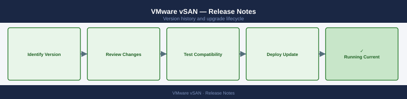

---
tags:
  - vmware
  - vsan
  - vsphere-8
description: "Version history and release notes for VMware vSAN."
---
# VMware vSAN — Release Notes

*Applies to: vSAN 9.x (VCF/VVF 9) · vSAN 8.0 U3 (EoGS 2027-10-11)*

Version history and release notes for VMware vSAN.

## Version History

vSAN 9.x ships inside VMware Cloud Foundation / vSphere Foundation 9 (vSAN runs in the ESX build), so 9.x rows are VCF releases. vSAN 8.x rows are from Broadcom KB 326465 (vSAN build numbers). vSAN 8.x reaches End of General Support on 2027-10-11 ([Broadcom KB 459135](https://knowledge.broadcom.com/external/article/459135)).

| Version | Released | Summary | Source |
|---------|----------|---------|--------|
| VCF 9.1.2.0 | 2026-11-24 | VCF 9.1 patch release | [VCF 9.1.2.0 RN](https://techdocs.broadcom.com/us/en/vmware-cis/vcf/vcf-9-0-and-later/9-1/release-notes/vmware-cloud-foundation-9-1-2-0-release-notes.html) |
| VCF 9.1.1.0 | 2026-09-03 | VCF 9.1 patch release | [VCF 9.1.1.0 RN](https://techdocs.broadcom.com/us/en/vmware-cis/vcf/vcf-9-0-and-later/9-1/release-notes/vmware-cloud-foundation-9-1-1-0-release-notes.html) |
| VCF 9.1 (ESX 9.1.0.0, build 25370933) | 2026-05-12 | Extended vSAN deduplication and compression, including dedupe with data-at-rest encryption | [VCF 9.1 RN](https://techdocs.broadcom.com/us/en/vmware-cis/vcf/vcf-9-0-and-later/9-1/release-notes/vmware-cloud-foundation-9-1-0-0-release-notes.html), [What's New](https://techdocs.broadcom.com/us/en/vmware-cis/vcf/vcf-9-0-and-later/9-1/release-notes/vmware-cloud-foundation-9-1-0-0-release-notes/what-s-new.html) |
| VCF 9.0.2.0 | 2026-01-20 | VCF 9.0 patch release | [VCF 9.0.2 RN](https://techdocs.broadcom.com/us/en/vmware-cis/vcf/vcf-9-0-and-later/9-0/release-notes/vmware-cloud-foundation-9-0-2-release-notes.html) |
| VCF 9.0.1.0 | 2025-09-29 | VCF 9.0 patch release | [VCF 9.0.1.0 RN](https://techdocs.broadcom.com/us/en/vmware-cis/vcf/vcf-9-0-and-later/9-0/release-notes/vmware-cloud-foundation-9-0-1-0-release-notes.html) |
| VCF 9.0 (ESX 9.0.0.0, build 24755229) | 2025-06-17 | vSAN DR with VMware Live Recovery (RPO down to 1 minute); stretched compute-only clusters with vSAN storage clusters; vSAN licensing assigned from VCF Operations; RVC/Rbvmomi deprecated | [VCF 9.0 RN](https://techdocs.broadcom.com/us/en/vmware-cis/vcf/vcf-9-0-and-later/9-0/release-notes/vmware-cloud-foundation-90-release-notes.html), [vSAN What's New](https://techdocs.broadcom.com/us/en/vmware-cis/vcf/vcf-9-0-and-later/9-0/release-notes/vmware-cloud-foundation-90-release-notes/platform-whats-new/whats-new-vsan.html), [vSAN support notes](https://techdocs.broadcom.com/us/en/vmware-cis/vcf/vcf-9-0-and-later/9-0/release-notes/vmware-cloud-foundation-90-release-notes/platform-product-support-notes/product-support-notes-vsan.html) |
| vSAN 8.0 U3i (build 25205845) | 2026-02-24 | Patch; on-disk format 20 | [KB 326465](https://knowledge.broadcom.com/external/article/326465) |
| vSAN 8.0 U3 (build 24022510) | 2024-06-25 | Update release; on-disk format 20 | [KB 326465](https://knowledge.broadcom.com/external/article/326465) |
| vSAN 8.0 U2 (build 22380479) | 2023-09-21 | Update release; on-disk format 19 | [KB 326465](https://knowledge.broadcom.com/external/article/326465) |
| vSAN 8.0 U1 (build 21495797) | 2023-04-18 | Update release; on-disk format 18 | [KB 326465](https://knowledge.broadcom.com/external/article/326465) |
| vSAN 8.0 (build 20513097) | 2022-10-11 | Major release; on-disk format 17 | [KB 326465](https://knowledge.broadcom.com/external/article/326465) |
| vSAN 7.0 U3w (build 24784741) | 2025-07-15 | Last 7.0 patch listed; on-disk format 15 | [KB 326465](https://knowledge.broadcom.com/external/article/326465) |

## Key Terminology

**Update (U)**
: vSAN update numbering suffix (e.g. 8.0 U3) — incremental feature and fix release within a major version.

**ESA (Express Storage Architecture)**
: vSAN storage architecture (vSphere 8.0 and later) in which each host's disks are claimed into a single-tier storage pool (`esxcli vsan storagepool`) instead of OSA cache/capacity disk groups.

**vSAN licensing (9.x)**
: The vSAN license is assigned to the vCenter instance from VCF Operations; all vSAN clusters in that vCenter become licensed ([VCF 9.0 vSAN What's New](https://techdocs.broadcom.com/us/en/vmware-cis/vcf/vcf-9-0-and-later/9-0/release-notes/vmware-cloud-foundation-90-release-notes/platform-whats-new/whats-new-vsan.html)).

**Build Number**
: Unique ESXi/vSAN build identifier used to confirm exact patch level after upgrade.

## Upgrade Path

Use the vSphere Lifecycle Manager (vLCM) image-based baseline to upgrade vSAN clusters. Validate interoperability with the [VMware Compatibility Guide](https://www.vmware.com/resources/compatibility/search.php) before upgrading. Always upgrade vCenter and ESXi to the target version before upgrading the vSAN disk format. For ESA clusters, a full rolling evacuation is performed per host.
